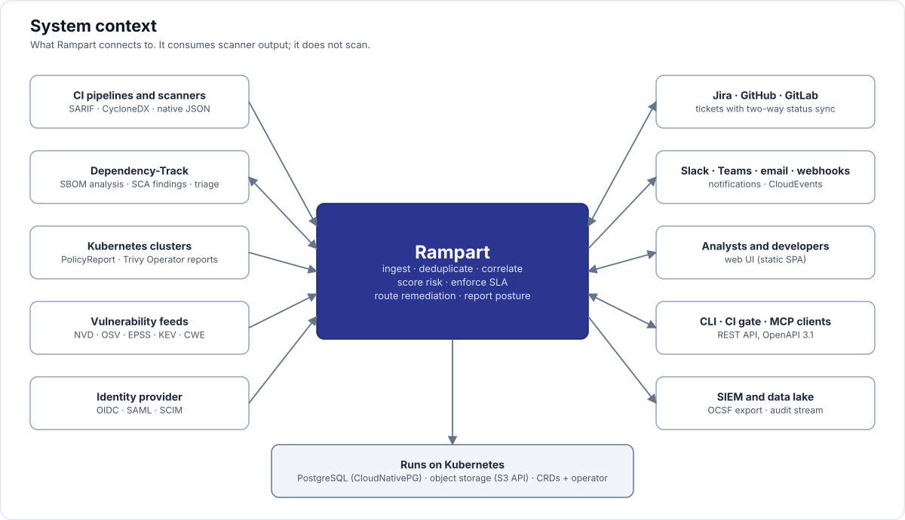
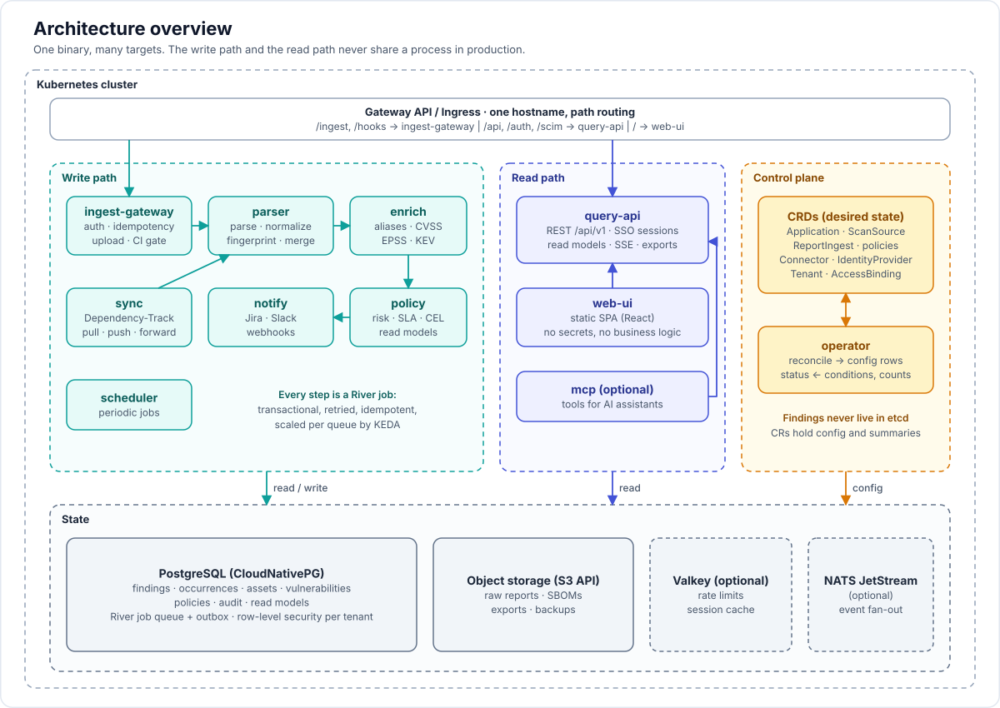

<p align="left">
  <picture>
    <source media="(prefers-color-scheme: dark)" srcset="docs/images/logo-dark.svg">
    
  </picture>
</p>

# Rampart — cloud-native ASPM in Go

A Kubernetes-native Application Security Posture Management platform. It takes the output of every security scanner, deduplicates it, ties it to applications, scores risk with real context, enforces deadlines, pushes fixes into developer tools, and reports posture. It covers the DefectDojo and ArmorCode use case as one Go binary with its own CRDs and operator, PostgreSQL, and object storage, and it integrates with Dependency-Track as a first-class source.

Status: **Phase 0 and the core of Phase 1 are built** (ingest, merge, PostgreSQL with row-level security, sign-in, operator, Helm chart, web UI shell). The rest follows the [roadmap](docs/09-roadmap.md); see its status section for what is done and what is not. The name is a working proposal.

## Quick start (Docker Compose)

```bash
cd deploy/compose
./init.sh                       # random secrets into .env, demo users into dex/config.yaml
docker compose up -d --build    # PostgreSQL, object store, Dex, Rampart (UI included)
```

Open http://localhost:8080. `init.sh` prints the accounts: two demo users in Dex (single sign-on) and the first administrator inside Rampart. Details in [deploy/compose/README.md](deploy/compose/README.md). On Kubernetes, `deploy/helm/rampart` installs the same thing; the notes printed by `helm install` say where the first administrator's password is.

## How people sign in

- **Single sign-on (OIDC)** is the way for everyone: Okta, Entra ID, Keycloak, Dex and the rest ([doc 14](docs/14-sso-and-identity.md)). Roles come from bindings in the configuration, never straight from the provider.
- **The first administrator**, like Argo CD's initial admin, exists so that you can sign in before any identity provider does. Its password is generated, never logged, and the account switches itself off when single sign-on is configured unless you keep it on. Regular users with passwords are deliberately not stored in Rampart: password policy and MFA belong to the identity provider (use Dex with static passwords for a small installation).
- **API tokens** for automation and CI.



## Architecture at a glance



- **Write path**: `ingest-gateway` receives reports, `parser` normalizes, fingerprints and merges, `enrich` adds vulnerability intelligence, `policy` scores and sets deadlines, `notify` and `sync` talk to ticketing tools and Dependency-Track.
- **Read path**: `query-api` serves the API and SSO sessions, `web-ui` is a static single-page application.
- **Control plane**: CRDs hold configuration; the `operator` reconciles them into the database. Findings never live in etcd.
- **State**: PostgreSQL (also the job queue) and S3-compatible object storage.

## Documentation

Start with 00 and 02, then use 16 for anything precise. Document 16 is normative and wins on conflict.

| Doc | What it answers |
|---|---|
| [00 Vision and scope](docs/00-vision-and-scope.md) | What we build, what we leave out, what we learned from DefectDojo |
| [01 Features](docs/01-features.md) | Feature catalogue with priorities tied to the roadmap |
| [02 Architecture](docs/02-architecture.md) | Targets, write and read paths, deployment modes, package layout |
| [03 Domain model](docs/03-domain-model.md) | Entities, finding lifecycle, policies, identity |
| [04 CRDs](docs/04-crds.md) | Every custom resource with examples and operator behaviour |
| [05 Ingestion and dedup](docs/05-ingestion-and-dedup.md) | Formats, parser contract, normalization, fingerprints, reimport, VEX |
| [06 Risk and SLA](docs/06-risk-and-sla.md) | Score formula, deadlines, policy engine, risk acceptance |
| [07 Enterprise](docs/07-enterprise.md) | Multi-tenancy, access, audit, data protection, operations |
| [08 Tech stack](docs/08-tech-stack.md) | Library choices and repository layout |
| [09 Roadmap](docs/09-roadmap.md) | Phases, exit criteria, way of working, open decisions |
| [10 Dependency-Track](docs/10-dependency-track-integration.md) | The four integration flows, mapping, triage sync |
| [11 API design](docs/11-api-design.md) | Route families, conventions, endpoints, events, CLI |
| [12 Database schema](docs/12-database-schema.md) | PostgreSQL sketch and the changes required by the review |
| [13 Frontend](docs/13-frontend.md) | Stack, structure, how it talks to the backend, visual direction |
| [14 SSO and identity](docs/14-sso-and-identity.md) | OIDC, SAML, SCIM, CI federation, tokens |
| [15 Cloud-native tour](docs/15-cloud-native.md) | Kubernetes objects, networking, scaling, observability, recovery |
| [16 Implementation decisions](docs/16-implementation-decisions.md) | **Normative.** Precise rules that close the review findings |
| [17 Design review](docs/17-design-review.md) | What two independent reviews found, what was fixed, what is still open |
| [18 Brand](docs/18-brand.md) | Logo, colour, type, voice |
| [19 Integration SDK](docs/19-integration-sdk.md) | How to add parsers, API sources, trackers and notifiers without changing the core |
| [ADRs](docs/adr/) | Six architecture decision records |
| [Research](docs/research/) | DefectDojo, the ASPM market, standards, Kubernetes-native patterns |

## Diagrams

| | |
|---|---|
| [Ingestion pipeline](docs/images/ingestion-pipeline.svg) | [CRDs and control plane](docs/images/crd-control-plane.svg) |
| [Dependency-Track flows](docs/images/dependency-track-flows.svg) | [Finding lifecycle](docs/images/finding-lifecycle.svg) |
| [Deployment modes](docs/images/deployment-modes.svg) | [SSO login flow](docs/images/sso-flow.svg) |
| [Frontend layout](docs/images/frontend-layout.svg) | [Domain model](docs/images/domain-model.svg) |
| [Risk score](docs/images/risk-score.svg) | [Integration tiers](docs/images/integration-tiers.svg) |

## Six decisions in one paragraph

CRDs hold configuration and summaries, PostgreSQL holds findings (ADR 0001). PostgreSQL through River is the job queue, NATS is optional (ADR 0002). SARIF and CycloneDX are first-class inputs and OpenVEX is the triage vocabulary (ADR 0003). One binary with `-target` selects ingestion, workers, API, UI or operator, so receiving reports and showing them never share a process in production (ADR 0004). Tenancy is `tenant_id` with row-level security, mapped to the namespaces a tenant owns (ADR 0005). Dependency-Track is the SCA system of record when connected (ADR 0006).
