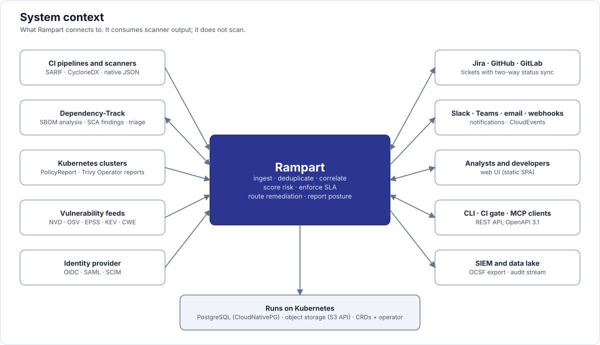

# 00 — Vision and scope

> Project codename: **Rampart** API group placeholder: `rampart.aspm.dev`.

## 1. What we are building

A cloud-native **Application Security Posture Management (ASPM)** platform, written in Go, that runs natively on Kubernetes with its own CRDs and operator, and that replaces the DefectDojo / ArmorCode use case:

> Ingest findings from every security scanner, normalize and deduplicate them, correlate them to applications and assets, score risk with real context (EPSS, KEV, exposure, business criticality), enforce SLAs and policies, push remediation into developer tools, and report posture to leadership and auditors.

It is **not** a scanner. It consumes the output of scanners (SAST, DAST, SCA, IaC, container, secrets, CSPM, pentest, Kubernetes policy reports) and of supply-chain tooling (SBOM, VEX, attestations).

## 2. Why not DefectDojo (what we learned)

DefectDojo is the OSS reference and we keep its good ideas (import/reimport semantics, per-scanner hash fields, risk acceptance with expiry, SLA config, Jira two-way). We leave behind the things that hurt (see [research/01-defectdojo.md](research/01-defectdojo.md) §8):

| DefectDojo pain | Our answer |
|---|---|
| Django monolith + uWSGI + Celery + Beat + Redis + Postgres; "four services to patch" | One Go binary, Loki-style `-target=all` for small installs, split targets for scale |
| Per-finding Celery dedupe; 1000-finding import takes minutes | Batch pipeline: parse → fingerprint → `COPY` into staging → single `ON CONFLICT` merge |
| Filters take minutes at 5M findings; N+1 from tags; 50 s to edit a finding | Read models (CQRS-light), denormalized filter columns with matching indexes, no ORM |
| OOMKilled on Kubernetes; root containers | Distroless static binaries, bounded memory per worker, streaming parsers |
| No multi-tenancy; RBAC/SSO/EPSS moved to Pro | Tenant + hierarchy from day one; OIDC/SAML, RBAC, EPSS/KEV in the open core |
| Reimport never updates existing fields; unstable hashes churn findings | Explicit field-merge policy per scanner; fingerprint excludes volatile fields |
| Config via ~100 System_Settings toggles and admin UI | Declarative config as CRDs (GitOps), status conditions reflected back |
| Pentest engagement management, questionnaires, credentials vault, benchmarks bundled into core | Out of scope for the core; pluggable modules at most |

## 3. ASPM core (what Gartner and the market agree on)

From [research/02-aspm-market.md](research/02-aspm-market.md):

1. **Coverage**: ingest from every AST tool and from the pipeline/runtime side.
2. **Inventory**: applications, services, repos, pipelines, artifacts, workloads, owners; coverage gaps.
3. **Correlation and deduplication**: same issue across tools and across code → image → workload.
4. **Prioritization**: explainable risk score from severity + exploitability + exposure + business context.
5. **Policy and governance**: SLAs, exceptions, guardrails, compliance mapping.
6. **Remediation workflow**: tickets, ownership, two-way sync, campaigns.
7. **Developer integration**: CI gates, PR annotations, IDE (SARIF).
8. **Reporting**: posture score, trends, MTTR, SLA adherence, audit evidence.

## 4. In scope / out of scope

### In scope (core)
- Finding ingestion in SARIF, CycloneDX (SBOM/VDR/VEX), SPDX, OpenVEX, CSAF VEX, Kubernetes PolicyReport/OpenReports and Trivy Operator CRDs, GitLab security reports, OCSF, plus native parsers for the top scanners.
- Asset inventory: Application → Service/Component → Environment; repos, images, workloads, hosts, URLs, packages.
- Deduplication, reimport semantics, finding lifecycle (OpenVEX-based triage states), risk acceptance with expiry.
- Enrichment: NVD, OSV, EPSS, KEV, CISA SSVC, exploit maturity; air-gap mirrors.
- Risk scoring (explainable, pluggable), SLA policies, exception workflow.
- Policy engine (CEL first, Rego optional) for auto-triage, routing, gates.
- Connectors: Jira, GitHub Issues, GitLab Issues, Azure Boards, ServiceNow (later), Slack, MS Teams, email, generic webhooks.
- Compliance taxonomies: OWASP Top 10 (2021/2025), CWE Top 25, ASVS 5 via OpenCRE, PCI DSS 6.x, ISO 27001 8.x, NIST SSDF, CIS, SLSA.
- Reporting: dashboards, posture score, trend, SLA, exports (CSV/JSON/PDF), SBOM/VEX export, OCSF export.
- Enterprise: multi-tenant, hierarchy/business units, RBAC + scopes, OIDC/SAML, SCIM, audit log, API tokens, rate limits, retention.
- Kubernetes-native: CRDs for configuration and summaries, operator, Helm chart, KEDA scaling, CloudNativePG, air-gapped install.
- Supply chain: SBOM inventory per artifact, VEX, in-toto/SLSA attestation verification → posture findings.

### Out of scope (core); candidate optional modules
- Running scanners / scan orchestration (we integrate with secureCodeBox, Trivy Operator, CI instead). A thin `ScheduledScan` that launches a Kubernetes Job is the only exception, and it is a module.
- Pentest engagement project management (scheduling, leads, checklists, test strategy).
- Questionnaires / surveys / self-assessments.
- Credentials vault for scanners.
- ASVS "benchmark" checklists as a manual workflow (we map findings to ASVS instead).
- Threat modeling, PSIRT, AI governance.
- Our own SAST/DAST/SCA engines.

## 5. Design principles

1. **Kubernetes is the control plane, Postgres is the data plane.** CRDs carry desired state and small summaries; findings never live in etcd.
2. **Standards in, standards out.** SARIF/CycloneDX/OpenVEX/OCSF are first-class; proprietary parsers map into the same canonical model.
3. **Stable identity.** Every finding has a deterministic fingerprint that survives rescans; every asset has a stable key (purl, image digest, repo URL, k8s UID).
4. **Explainable risk.** Every score shows its factors. No black box.
5. **Separation of write and read paths.** Ingestion components never serve UI queries; UI components never parse reports.
6. **One binary, many targets.** `rampart -target=all` on a laptop, `-target=ingest-gateway|parser|enrich|policy|notify|sync|query-api|web-ui|operator|scheduler` in production.
7. **Multi-tenant from the first migration.** `tenant_id` on every table with RLS; tenant ↔ namespace mapping.
8. **Air-gap friendly.** No mandatory outbound calls; all feeds mirrorable; images signed with SBOM attached.
9. **API-first.** OpenAPI 3.1 is the contract; the UI, CLI, and MCP server are clients.

## 6. Success criteria for v1.0

- Ingest 100k new findings from a SARIF file, merged, enriched and scored, in under 60 s on the reference hardware; rescan of 100k unchanged in under 20 s. These are goals to be proven by a Phase 0 spike (see [16-implementation-decisions.md](16-implementation-decisions.md) D28).
- Filter and page 5M findings in under 500 ms p95 at the API for supported filter and sort combinations.
- Zero-downtime upgrade with CNPG; HA for every target.
- Install with `helm install` in under 5 minutes with bundled Postgres; `-target=all` with Docker Compose for evaluation.
- Pass its own posture check: signed images, SBOM, SLSA L3 provenance, no critical findings.
