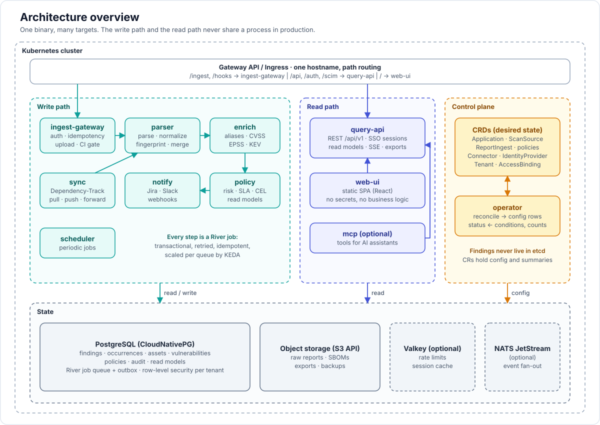

# 02 — Architecture

> Normative details (who may call the Kubernetes API, run ownership, database roles, merge and close rules) are in [16-implementation-decisions.md](16-implementation-decisions.md). Where this overview is less precise, that document decides.



## 1. Big picture

```
                      ┌──────────────────────────── Kubernetes cluster ────────────────────────────┐
                      │                                                                             │
  CI / scanners ──────┼──► ingest-gateway ──► object storage (S3/MinIO)                            │
  (SARIF, CDX, ...)   │        │                     ▲                                              │
                      │        │ outbox/job          │ fetch raw                                    │
  kubectl / GitOps ───┼──► operator ◄── CRDs        │                                              │
  (CRDs)              │        │ reconcile → config  │                                              │
                      │        ▼                     │                                              │
                      │   ┌────────────────── PostgreSQL (CNPG) + River queue ──────────────────┐  │
                      │   │  tenants · assets · findings · occurrences · vulns · policies · audit │  │
                      │   └───────────▲──────────────▲──────────────▲──────────────▲────────────┘  │
                      │               │              │              │              │               │
                      │           parser         enrich         policy         notify            │
                      │           workers        workers        engine         workers           │
                      │        (normalize,      (NVD/OSV/      (risk, SLA,    (Jira, Slack,       │
                      │         fingerprint,     EPSS/KEV)      CEL rules)     webhooks)           │
                      │         dedup merge)                                                       │
                      │                                                                             │
  Browser / CLI / ────┼──► query-api (read models, OpenAPI) ──► web-ui (static SPA)                 │
  MCP client          │                                                                             │
                      └─────────────────────────────────────────────────────────────────────────────┘
```

Two hard separations the user asked for:

- **Receiving reports is not the same component as showing them.** `ingest-gateway` + `parser` own the write path. `query-api` + `web-ui` own the read path. They share a database but never share request handlers, and in distributed mode they are different Deployments with different scaling rules and different RBAC.
- **Configuration is Kubernetes, data is Postgres.** The `operator` is the only component that talks to the Kubernetes API for CRDs. Everyone else reads config from Postgres tables the operator populates.

## 2. Components (targets)

All targets are built into one binary (`rampart`) and one container image. `-target=all` runs them in-process (monolithic mode). Each target can run as its own Deployment (distributed mode). This is the Loki/Mimir pattern; see [adr/0004](adr/0004-single-binary-multi-target.md).

| Target | Responsibility | Scaling signal | Talks to |
|---|---|---|---|
| `ingest-gateway` | AuthN for upload tokens and CI federation, idempotency, presigned URL issuance, small direct uploads, inbound webhooks, writes `upload` and `ingest_run` rows and enqueues the parse job | HTTP RPS | Postgres, S3 |
| `parser` | Fetch raw report, detect format, parse (streaming), normalize, fingerprint, batch-merge into findings/occurrences, emit `finding.*` events | queue depth (`parse` queue) | Postgres, S3 |
| `enrich` | Resolve CVE/GHSA/OSV aliases, attach CVSS/EPSS/KEV/SSVC, package metadata; feed sync jobs | queue depth (`enrich`), cron | Postgres, feed mirrors |
| `policy` | Risk score computation, SLA deadlines, CEL policies (auto-triage, routing), roll-ups, posture score | queue depth (`policy`) | Postgres |
| `notify` | Downstream connectors: Jira, GitHub/GitLab issues, Slack/Teams/email, webhooks; ticket status sync | queue depth (`notify`) | Postgres, external APIs |
| `sync` | Upstream connectors: Dependency-Track (portfolio and project pulls, SBOM forwarding, triage write-back), later SonarQube, GitHub Code Scanning, Snyk. Produces `RawFinding`s for the same merge pipeline | queue depth (`dtrack-sync`, `dtrack-push`) | Postgres, S3, upstream APIs |
| `query-api` | OpenAPI 3.1 REST for UI/CLI/MCP: queries and commands (triage, bulk, risk acceptance, admin), SSO sessions, CI gate evaluation. Never parses reports | HTTP RPS | Postgres (read replica OK), S3 (signed download links) |
| `web-ui` | Static SPA (React/TS). Served by `query-api` in monolithic mode, by its own nginx/static Deployment in distributed mode | HTTP RPS | `query-api` |
| `operator` | controller-runtime manager: reconciles all CRDs into config tables, syncs referenced Secret material (encrypted) for the other targets, writes status conditions and summaries. Watching reports in managed clusters is a later, separate `collector` target | 1 leader + standby | Kubernetes API, Postgres |
| `scheduler` | Periodic jobs: SLA sweep, risk acceptance expiry, retention, feed sync, report generation | 1 leader | Postgres |
| `mcp` | MCP server exposing query/triage tools | optional | `query-api` |

In monolithic mode `ingest-gateway`, `query-api` and `web-ui` share one HTTP listener but are mounted on different route prefixes (`/ingest/v1`, `/api/v1`, `/`). In distributed mode the Ingress routes prefixes to different Services.

## 3. Write path (ingestion pipeline)

```
client ──POST /ingest/v1/uploads──► gateway: create upload (tenant, source, format hint, context, options, idempotency key)
       ◄── {uploadId, presignedPutUrl}
client ──PUT raw report──────────► S3
client ──POST /ingest/v1/uploads/{id}/complete {sha256}──► gateway
                                         │ tx: upload.status=completed; insert ingest_run(queued); river.Insert(ParseJob)
                                         ▼
                                  parser worker
                                   1. stream object from S3; sniff format (SARIF / CDX / SPDX / native)
                                   2. parse → []RawFinding (bounded batches of 5 000)
                                   3. normalize → canonical Occurrence (ids, purl, cpe, cwe, cvss, location)
                                   4. fingerprint (per DedupPolicy) → finding_key
                                   5. COPY batch into `occurrence_staging`
                                   6. one SQL merge: upsert findings ON CONFLICT (tenant_id, finding_key)
                                      → classify created / untouched / updated / reactivated
                                   7. close step per scope (source, scanner family, asset, track): occurrences not seen → absent; findings with no present occurrence → fixed
                                   8. write ingest_run summary; enqueue enrich + policy jobs; one event per run and scope
                                         ▼
                                  enrich → policy → notify (each a River job family, retried, idempotent)
```

Key properties:

- The gateway never holds the report in memory; `complete` is metadata only.
- `Idempotency-Key` is unique per tenant; a retry returns the original upload id.
- Everything after `complete` is a transactional job; the River job row commits in the same transaction as the state it depends on (outbox pattern for free). See [adr/0002](adr/0002-postgres-as-queue.md).
- Parsers are pure functions `Parse(ctx, io.Reader, ParseContext) iter.Seq2[RawFinding, error]` with no DB access, which makes them trivially testable and reusable in the CLI.

## 4. Read path

- The explorer reads the `finding` table, which is itself the denormalized current state (severity, risk score, SLA due, asset, owner, taxonomies, KEV and EPSS flags). Dashboards read aggregate read models: `application_summary`, `hierarchy_rollup`, `trend_daily`, `control_status`. The `policy` target recomputes them per application after each run, so dashboard queries never join over occurrences.
- Full-text search over title/description uses Postgres `tsvector` first; OpenSearch is an optional target later.
- Large exports stream to S3 and return a signed URL instead of streaming through the API pod.
- Read replicas: CNPG `-ro` service for the query API in distributed mode; a read that follows a write in the same session goes to the primary.

## 5. Control plane (Kubernetes)

- CRDs (see [04-crds.md](04-crds.md)) describe: tenants/hierarchy, applications and their selectors, scan sources, dedup/risk/SLA/retention policies, connectors, report ingests, feed mirrors.
- The operator reconciles each CR into Postgres config tables keyed by `(cluster, namespace, name, uid)` and writes back `status.conditions` (`Ready`, `Synced`, `Degraded`) and bounded summaries (counts, last run) with server-side apply.
- Secrets are referenced by name (`credentialsRef`). The operator is the only reader of Kubernetes Secrets; it stores the referenced material envelope-encrypted in `secret_material`, and `notify`, `sync` and `query-api` decrypt it from there ([16-implementation-decisions.md](16-implementation-decisions.md) D1).
- Tenant isolation: a cluster-scoped `Tenant` lists the namespaces it owns (one by default); the binding never comes from a namespace label. Cluster-scoped `ClusterRiskPolicy` / `ClusterSLAPolicy` provide defaults resolved namespace-first.
- Managed clusters (after v1.0): a `collector` target watches `PolicyReport`, OpenReports and Trivy Operator CRs through a kubeconfig Secret and feeds them as ordinary ingest runs. The local cluster can only be watched through a platform-admin `ClusterScanSource`.

## 6. Deployment modes

| Mode | What runs | Infra | When |
|---|---|---|---|
| **monolithic** | one Deployment, `-target=all` | Postgres (bundled CNPG or external), object storage (bundled MinIO or S3), optional Valkey | eval, small teams, air-gapped single node, local dev (`docker compose`) |
| **simple-scalable** | `write` (gateway+parser+enrich+policy+notify+sync+scheduler), `read` (query-api+web-ui), `operator` | same | mid-size |
| **distributed** | one Deployment per target, KEDA scaling of worker targets, read replicas, NATS JetStream optional | CNPG HA, S3, Valkey, NATS | large / multi-tenant SaaS |

Helm values: `mode: monolithic | simple-scalable | distributed`; everything else derives from it.

## 7. Cross-cutting

- **Multi-tenancy**: `tenant_id` on every table; Postgres RLS with `set_config('app.tenant_id', …)` per transaction; app role is not the table owner. Tenant resolved from token / OIDC claim / namespace.
- **AuthN/AuthZ**: OIDC (go-oidc) for humans; API tokens (hashed) and Kubernetes ServiceAccount token review for machines. Casbin-style RBAC with scopes evaluated in middleware; decision cached per request.
- **Observability**: OpenTelemetry for traces/metrics/logs, Prometheus `/metrics` on every target, `/healthz` + `/readyz`, structured `slog`, trace id in every job row.
- **Config**: koanf; one config struct; env + file + flags (key reference in [16-implementation-decisions.md](16-implementation-decisions.md) D6); CRD-sourced config lives in Postgres and is cached with change notification (`LISTEN/NOTIFY` on a direct connection, 15 s polling otherwise).
- **Migrations**: goose embedded; run by an init Job (Helm hook) or `rampart migrate`.
- **Events**: internal `EventBus` interface; default implementation is River jobs (Postgres); optional NATS JetStream implementation for fan-out to external consumers and multi-cluster.
- **Supply chain**: ko builds, distroless `static:nonroot`, multi-arch, cosign-signed, SBOM + SLSA provenance attached; Helm chart published as OCI.

## 8. External systems

| System | Direction | Mechanism | Detail |
|---|---|---|---|
| CI pipelines and scanners | in | `/ingest/v1` uploads, CLI, CI OIDC federation | [05-ingestion-and-dedup.md](05-ingestion-and-dedup.md) |
| **Dependency-Track** | both | SBOM forward, webhook trigger, REST pull, analysis write-back | [10-dependency-track-integration.md](10-dependency-track-integration.md) |
| Managed Kubernetes clusters | in | operator watches PolicyReport / OpenReports / Trivy Operator CRs | [04-crds.md](04-crds.md) §2 |
| Vulnerability feeds (NVD, OSV, EPSS, KEV, CWE) | in | scheduled sync, mirrorable | [07-enterprise.md](07-enterprise.md) §4 |
| Jira, GitHub, GitLab, Azure Boards | both | tickets out, status webhooks in | `Connector` CRD |
| Slack, Teams, email, webhooks, NATS | out | notifications and CloudEvents | [11-api-design.md](11-api-design.md) |
| Identity provider | in | OIDC, SAML, SCIM | [14-sso-and-identity.md](14-sso-and-identity.md) |

**Extension points.** New parsers, API sources, trackers and notifiers are added through the Integration SDK ([19-integration-sdk.md](19-integration-sdk.md)) at four tiers: standard formats, declarative YAML, sandboxed plugins, built-in Go. All tiers implement the same contracts in `internal/integrations`, and the core keeps scheduling, retries, secrets, tenancy and audit.

Dependency-Track is the one upstream that is more than a report source. When it is connected it is the SCA system of record: CI uploads an SBOM once to Rampart, Rampart forwards it to DT, DT analyses it continuously, a DT webhook tells Rampart which project changed, the `sync` target pulls that project's findings into the normal merge pipeline, and triage decisions flow back to DT analysis. See ADR 0006.

## 9. Component boundaries (Go modules/packages)

```
cmd/rampart/                 single entrypoint, -target flag
internal/targets/            wiring per target (all, write, read, ingest-gateway, parser, enrich, policy, notify, sync, query-api, web-ui, operator, scheduler, mcp)
internal/config/apply/       resource → config rows; shared by the operator and `rampart apply`
internal/domain/             pure domain types: Finding, Occurrence, Asset, Vulnerability, Policy, SLA, Tenant
internal/parsers/            format detection + one package per parser (sarif, cyclonedx, spdx, openvex, trivy, grype, semgrep, ...)
internal/normalize/          canonical mapping, identifier normalization (purl, cpe, cve aliases), fingerprinting
internal/ingest/             upload lifecycle, staging/merge SQL, reimport classification
internal/enrich/             feed clients + mirrors (nvd, osv, epss, kev, ssvc), cache
internal/risk/               scoring engine, factor plugins, roll-ups
internal/policy/             CEL environment, policy evaluation, SLA computation
internal/integrations/       contracts, registry, mapping engine, WASM host, declarative source and action engines, plugin client, conformance kit
internal/connectors/         downstream: jira, github, gitlab, azureboards, slack, teams, email, webhook
internal/upstream/           upstream pulls: dependencytrack (client, sync, forward, triage), sonarqube, ...
internal/query/              read models, OpenAPI handlers (huma)
internal/store/              pgx + sqlc generated code, migrations, RLS helpers
internal/jobs/               River job definitions and workers
internal/events/             EventBus interface, river + nats implementations
internal/auth/               oidc, tokens, rbac
api/v1alpha1/                CRD Go types (controller-gen)
internal/operator/           controller-runtime reconcilers
web/                         SPA source (separate toolchain), embedded at build
charts/rampart/              Helm chart
```
