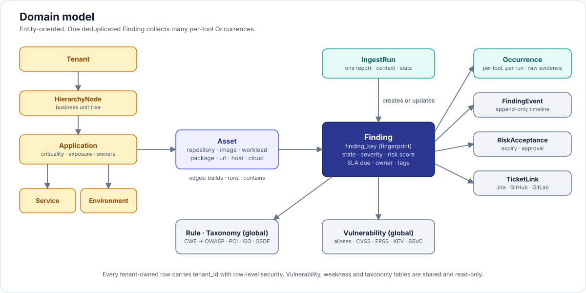
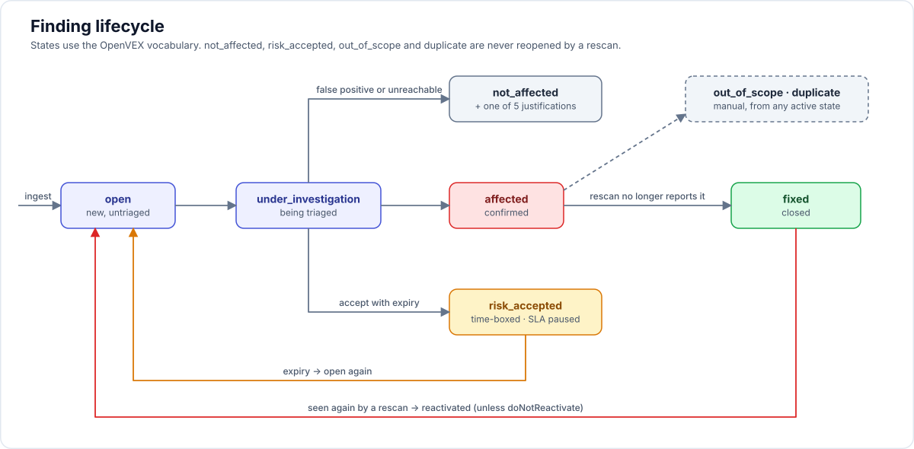

# 03 — Domain model

> Updated by [16-implementation-decisions.md](16-implementation-decisions.md): assets have versions and tracks (D10), occurrences are upserted evidence (D12), detection and disposition are separate (D18), users are global with tenant membership (D8), tenant-supplied rule and vulnerability data is tenant-local (D19). Field lists here are descriptive; the schema in 12 plus the deltas listed there are authoritative.



Entity-oriented (not event-oriented like OCSF). Everything carries `tenant_id`. Identifiers are UUIDv7 (time-ordered) unless stated.

## 1. Tenancy and inventory

```
Tenant
 └── HierarchyNode (N-level tree; "business unit", "portfolio", "team"; tag-driven; ArmorCode "Hierarchies")
      └── Application                      (DefectDojo Product; ArmorCode Product)
           └── Service / Component         (ArmorCode Sub-Product; a deployable unit)
                └── Environment            (dev / staging / prod; attribute, also used for exposure)
Asset (typed, belongs to Application and optionally Service + Environment)
```

**Tenant**: `id`, `slug`, `display_name`, `settings` (jsonb), `k8s_namespace`.

**HierarchyNode**: `id`, `parent_id`, `name`, `path` (ltree), `tags`, `metadata`.

**Application**: `id`, `hierarchy_node_id`, `name`, `slug`, `description`, `owners[]` (teams/users), `business_criticality` (critical/high/medium/low), `internet_facing` (bool|unknown), `data_classification[]` (pii, pci, phi, secret, public), `compliance_scope[]` (pci-dss, soc2, iso27001, fedramp, cra, hipaa), `compensating_controls[]` (waf, api_gateway, mtls, private_network), `lifecycle` (planning/development/production/deprecated/retired), `tags`, `source` (manual | crd:`ns/name` | connector:id), `crd_ref`.

**Service**: `id`, `application_id`, `name`, `kind` (api, web, worker, library, infra, mobile), `owners[]`, `tags`.

**Environment**: `id`, `application_id`, `name`, `kind` (dev/test/staging/prod/other), `internet_facing`, `tags`.

**Asset**: `id`, `application_id`, `service_id?`, `environment_id?`, `type`, `key` (stable natural key, unique per tenant+type), `display_name`, `attributes` (jsonb), `first_seen`, `last_seen`, `owners[]`, `tags`, `active`.

| Asset type | Stable `key` | Attributes |
|---|---|---|
| `repository` | normalized clone URL | default branch, provider, visibility, languages |
| `branch` | `repo_key#branch` | head commit, protected |
| `image` | `registry/repository` (digest is a version, see [16-implementation-decisions.md](16-implementation-decisions.md) D10) | base image, tags per version |
| `workload` | `cluster/namespace/kind/name` (UID and template hash are versions) | labels, images[], replicas |
| `host` | hostname or cloud instance id | ip, os, cloud account |
| `url` | normalized `scheme://host:port/path` | method set, auth type |
| `package` | purl without version qualifier | ecosystem, license |
| `cloud_resource` | ARN / resource id | provider, account, region, type |
| `pipeline` | `repo_key:workflow` | provider, last run |

Asset relations: `asset_edge(from_id, to_id, relation)` with relations `builds` (repo→image), `runs` (workload→image), `deploys_to` (image→environment), `contains` (image→package, repo→package), `serves` (workload→url), `derived_from_provenance` (edge created from a verified attestation). This is the minimal "code-to-cloud" graph.

## 2. Vulnerability intelligence (tenant-independent, shared)

**Vulnerability**: `id` (canonical: prefer CVE, else GHSA, else OSV id, else tool-local), `aliases[]` (CVE/GHSA/OSV/PYSEC/RUSTSEC/...), `summary`, `description`, `cwes[]`, `cvss[]` (`{version, vector, score, source}`), `epss` (`{score, percentile, date}`), `kev` (`{date_added, due_date, ransomware_known, required_action}`), `ssvc` (CISA ADP vector when present), `exploit_maturity` (none/poc/functional/weaponized; from feeds), `published`, `modified`, `references[]`, `affected[]` (OSV-style ranges per purl/ecosystem), `fixed_versions[]`, `source_payloads` (jsonb per feed), `updated_at`.

**Weakness** (CWE): `id` (int), `name`, `abstraction`, `parents[]`, `top25_rank`, `description`.

**Taxonomy** / **Taxon** / **TaxonMapping**: versioned frameworks (OWASP Top 10 2021/2025, ASVS 5.0, PCI DSS 4.0.1 req 6, ISO 27001:2022 A.8, NIST SSDF 1.1, CIS, SLSA, OWASP API Top 10). Mapping keys: `cwe` → taxon, `rule_id` (scanner, rule) → taxon, `control_id` (scanner-supplied, e.g. CIS 5.2.1) → taxon.

**Rule**: `(scanner_family, rule_id)`, `name`, `description`, `help_uri`, `default_severity`, `cwes[]`, `tags`, `category` (sast/sca/secret/iac/container/dast/cspm/compliance/license/supply_chain). Populated from SARIF `tool.driver.rules` and native parsers.

## 3. Findings

```
Finding (1) ──< Occurrence (N)        one per (ingest run × tool record) that matched this finding
Finding (1) ──< FindingEvent (N)      append-only timeline
Finding (N) >── RiskAcceptance (1)
Finding (N) >── TicketLink (N)
Finding (N) >── FindingGroup (N)
```

**Finding** (the deduplicated, triaged entity):
- Identity: `id`, `tenant_id`, `finding_key` (fingerprint, unique with tenant), `dedup_scope` (asset | application | tenant).
- Classification: `category`, `rule_scanner_family`, `rule_id`, `title`, `description`, `cwes[]`, `vulnerability_id?` (FK), `taxa[]` (materialized from mappings).
- Where: `asset_id` (primary), `application_id`, `service_id?`, `environment_id?`, `location` (jsonb, typed by category: `{file, start_line, end_line, start_col, end_col, function, snippet_hash}` | `{purl, installed_version, fixed_version, dependency_path[]}` | `{url, method, param}` | `{resource_type, resource_name, attribute}` | `{image, layer, path}`), `locations_extra[]`.
- Severity and risk: `tool_severity` (as reported), `severity` (normalized critical/high/medium/low/info; overridable), `severity_override_reason`, `cvss` (best available vector+score), `risk_score` (0–1000), `risk_factors` (jsonb explanation), `risk_band`.
- State (see §4): `state`, `state_reason`, `justification` (VEX), `impact_statement`, `action_statement`, `verified` (bool), `first_seen`, `last_seen`, `resolved_at`, `resolution` (fixed | not_affected | risk_accepted | out_of_scope | duplicate | superseded | deleted_asset), `reopened_count`.
- SLA: `sla_policy_id`, `sla_start`, `sla_due`, `sla_breached_at`, `sla_paused_at` (during risk acceptance).
- Workflow: `owner_user_id?`, `owner_team_id?`, `tags`, `duplicate_of_id?`, `group_ids[]`, `ticket_count`.
- Bookkeeping: `occurrence_count`, `source_count` (distinct scanner families), `created_at`, `updated_at`, `version` (optimistic lock).

**Occurrence** (current evidence of one finding from one source at one concrete location; upserted on every run, see [16-implementation-decisions.md](16-implementation-decisions.md) D12):
- `id`, `finding_id`, `ingest_run_id`, `scan_source_id`, `scanner_family`, `scanner_name`, `scanner_version`, `tool_record_id` (SARIF guid / unique_id_from_tool), `tool_fingerprints` (SARIF partialFingerprints etc.), `raw` (jsonb, the original record), `normalized` (jsonb canonical), `tool_severity`, `cvss_vectors[]`, `location`, `first_seen`, `last_seen`, `present_in_last_run` (bool), `vex_state_from_tool?`.

Occurrences that are no longer present are deleted after the retention period. Run history lives in `finding_event` and `ingest_run`.

**FindingEvent**: `id`, `finding_id`, `at`, `actor` (user | system:parser | system:policy | connector:jira), `type` (created, reactivated, closed_by_rescan, state_changed, severity_changed, risk_changed, sla_breached, risk_accepted, risk_acceptance_expired, ticket_created, ticket_synced, note_added, owner_changed, merged_into, split_from), `from` (jsonb), `to` (jsonb), `note`.

**FindingGroup**: `id`, `name`, `group_by` (component | rule | file | cve | manual), `key`, `application_id`, `finding_ids[]`, `ticket_links[]`.

**RiskAcceptance**: `id`, `name`, `scope` (findings[] | rule + asset selector | vulnerability + application), `decision` (accept | mitigate | transfer | avoid), `justification` (OpenVEX justification enum when `not_affected`), `impact_statement`, `owner`, `approver?`, `status` (pending | approved | rejected | expired | revoked), `proof_files[]`, `expires_at`, `on_expiry` (reactivate | notify_only), `restart_sla_on_expiry`, `created_by`, `created_at`.

**Exception / Waiver**: same shape as RiskAcceptance but matched by selector at ingest time (rule, path glob, purl pattern, CVE) so new findings are born in the accepted state.

**TicketLink**: `finding_id | group_id`, `connector_id`, `external_key` (e.g. `SEC-123`), `external_url`, `external_status`, `last_synced`, `sync_direction`.

**IngestRun**: `id`, `upload_id`, `scan_source_id`, `tenant_id`, `application_id`, `asset_id`, `scanner_family`, `format`, `scan_started`, `scan_finished`, `context` (`{branch, commit, build_id, image_digest, environment, pipeline_url}`), `status` (queued | parsing | merging | enriching | scoring | completed | completed_with_errors | failed | stale), `stats` (`{parsed, created, updated, untouched, reactivated, closed, skipped_min_severity, record_errors}`), `error`, `raw_object_ref`, `started_at`, `finished_at`, `crd_ref?` (the `ReportIngest` that created it).

## 4. Finding state machine



States use the OpenVEX vocabulary so VEX export is lossless, extended with workflow states DefectDojo users expect.

```
                    ┌──────────────────────────────────────────────────────────┐
  ingest ──► open ──┼──► under_investigation ──► affected (confirmed) ─────────┼──► fixed (closed by rescan or manual)
                    │            │                     │                        │
                    │            ├──► not_affected (false positive / unreachable, 5 justifications)
                    │            ├──► risk_accepted (time-boxed; SLA paused) ── expiry ──► open
                    │            ├──► out_of_scope
                    │            └──► duplicate (→ duplicate_of)
                    └──────────────────────────────────────────────────────────┘
  rescan sees finding again while fixed/not_affected: not_affected stays; fixed → open (reactivated) unless do_not_reactivate
```

| Internal state | OpenVEX export | CycloneDX `analysis.state` | DefectDojo equivalent |
|---|---|---|---|
| `open` | `under_investigation` (default) | `in_triage` | active, unverified |
| `under_investigation` | `under_investigation` | `in_triage` | under review |
| `affected` | `affected` | `exploitable` | active, verified |
| `not_affected` + justification | `not_affected` | `not_affected` / `false_positive` | false positive |
| `fixed` | `fixed` | `resolved` | mitigated |
| `risk_accepted` | `affected` + `action_statement` | `exploitable` + `response: will_not_fix` | risk accepted |
| `out_of_scope` | (not exported) | `not_affected` (`requires_environment`) | out of scope |
| `duplicate` | (not exported) | — | duplicate |

There is no separate `verified` flag: "confirmed" is the `affected` state. Whether a scanner still reports the finding is a separate, derived field, `detection` (`present` / `absent`); see [16-implementation-decisions.md](16-implementation-decisions.md) D18.

## 5. Policies (config mirrored from CRDs)

**DedupPolicy**: `scope`, per `scanner_family`: `fingerprint_fields[]`, `normalizers` (path relative, strip line numbers, lowercase), `cross_tool_correlation` (on/off, rules).

**RiskPolicy**: `base` (severity → base points), `factors[]` (`{name, condition (CEL), weight|points}`), `bands` (score ranges → critical/high/medium/low), `recompute_on` (kev_added, epss_change_gt, asset_context_change).

**SLAPolicy**: `matrix[risk_band][asset_tier] = days`, `caps` (`kev_due_date: true`, `max_days`), `start_from` (first_seen | verified_at), `restart_on_reactivation`, `pause_on_risk_acceptance`, `business_days` (bool).

**Policy** (automation rule): `trigger` (finding.created | finding.updated | ingest.completed | schedule), `match` (CEL over finding + asset + application), `actions[]` (set_severity, set_state, set_owner, add_tag, create_ticket{connector, project}, notify{channel}, fail_gate), `mode` (enforce | simulate).

**RetentionPolicy**: `occurrences_days`, `raw_reports_days`, `resolved_findings_days`, `audit_days`, `events_days`.

## 6. Identity, access, audit

**User**: `id`, `tenant_id`, `subject` (OIDC `iss|sub`), `email`, `display_name`, `status`, `last_login`. **Team**: `id`, `name`, `members[]`, `external_id` (SCIM/IdP group). **Role**: built-ins `viewer`, `triager`, `maintainer`, `owner`, `admin`, plus custom (P2). **Binding**: `(principal: user|team|token, role, scope: tenant | hierarchy_node | application)`. **APIToken**: `id`, `hash`, `prefix`, `principal`, `scopes[]` (ingest, read, triage, admin), `expires_at`, `last_used`, `created_by`. **AuditEvent**: append-only `(id, tenant_id, at, actor, action, resource_type, resource_id, before, after, ip, user_agent, request_id)`.

## 7. Connectors and sources

**ScanSource**: `id`, `tenant_id`, `name`, `type` (ci | api_pull | kubernetes | registry | webhook), `scanner_family?`, `default_application_id?`, `mapping_rules` (how to derive application/asset/environment from report context), `schedule?`, `credentials_ref`, `status`, `crd_ref`.

**Connector**: `id`, `tenant_id`, `type` (jira | github | gitlab | azure_boards | servicenow | slack | teams | email | webhook), `config` (jsonb, non-secret), `credentials_ref`, `status`, `crd_ref`. **ConnectorRoute**: `(connector_id, match: CEL, target: {project, issue_type, labels, assignee, channel})`.

**ClusterFeedMirror**: `feed` (nvd | osv | epss | kev | cwe), `url`, `schedule`, `last_sync`, `status`.
