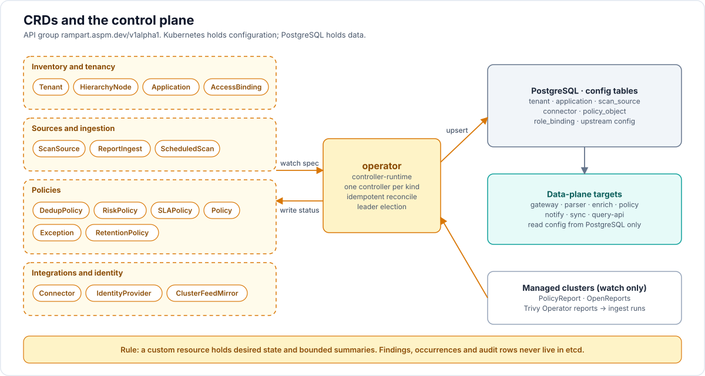
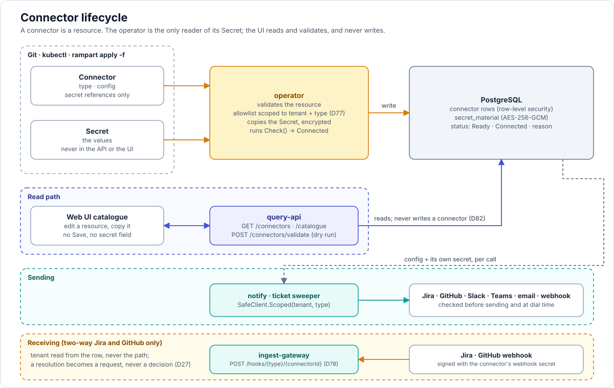

# 04 — Custom Resource Definitions

> Scope note ([16-implementation-decisions.md](16-implementation-decisions.md) D29): v1.0 ships `Tenant`, `Application`, `ScanSource`, `Connector`, `SLAPolicy`, `RiskPolicy`, `IdentityProvider`, `AccessBinding` and `ReportIngest`. The other kinds described here are designed now and delivered after v1.0, except `IntegrationPackage`, which arrives in Phase 3 (mappings and declarative connectors) and Phase 4 (WebAssembly plugins). Deletion behaviour, status throttling and tenant binding rules are in D20 and D21.



API group: `rampart.aspm.dev`, version `v1alpha1` (storage). All resources are namespaced unless prefixed with `Cluster`. The namespace maps to a tenant (label `rampart.aspm.dev/tenant: <slug>`).

**Rule of thumb** (see [adr/0001](adr/0001-crds-for-config-not-findings.md)): a CRD holds *desired state* and *bounded summaries*. Findings, occurrences, vulnerabilities and audit rows live in Postgres. No CR may grow with the number of findings.

Every CRD:
- has `spec` and a `status` subresource with `conditions[]` (`metav1.Condition`: `Ready`, `Synced`, `Degraded`) and `observedGeneration`;
- is validated with OpenAPI schema + CEL `x-kubernetes-validations` (no admission webhooks in v1alpha1);
- is reconciled by the operator into Postgres config tables keyed by `(tenant, kind, namespace, name)`; the uid is an attribute, so re-applying from Git re-attaches to the same rows;
- gets a finalizer `rampart.aspm.dev/finalizer` when deletion needs cleanup (e.g. deregistering a Jira webhook).

## 1. Inventory

### `Application`
Maps business context and Kubernetes workloads to an application.

```yaml
apiVersion: rampart.aspm.dev/v1alpha1
kind: Application
metadata:
  name: payments-api
  namespace: team-payments            # tenant namespace
spec:
  displayName: Payments API
  hierarchy: [fintech, payments]      # path under the tenant's HierarchyNode tree (created on demand)
  owners:
    - team: payments-core
    - user: alice@example.com
  businessCriticality: critical       # critical|high|medium|low
  internetFacing: true
  dataClassification: [pci, pii]
  complianceScope: [pci-dss, soc2]   # labels a ComplianceFramework's appliesTo.complianceScope selects (D102, docs/27)
  compensatingControls: [waf, apiGateway]   # waf | apiGateway | mtls | privateNetwork (D55)
  lifecycle: production
  services:
    - name: api
      kind: api
    - name: worker
      kind: worker
  environments:
    - name: prod
      kind: prod
      internetFacing: true
    - name: staging
      kind: staging
  selectors:                          # how assets attach automatically
    repositories:
      - url: https://github.com/example/payments-api
    images:
      - repository: ghcr.io/example/payments-api   # exact key, or a prefix ending in * (D56)
    workloads:                        # not built: needs a connected cluster (collector, after v1.0); refused today (D56)
      - cluster: prod-eu
        namespaceSelector: {matchLabels: {app.kubernetes.io/part-of: payments}}
        labelSelector: {matchLabels: {app.kubernetes.io/name: payments-api}}
        environment: prod
  tags: [tier-1]
status:
  observedGeneration: 3
  conditions:
    - type: Ready
      status: "True"
      reason: Reconciled
      lastTransitionTime: "2026-11-10T10:00:00Z"
  applicationId: 019321f0-...
  assets: {repositories: 1, images: 14, workloads: 6, packages: 412}
  findings: {critical: 2, high: 11, medium: 40, low: 93, info: 10}   # open only
  riskScore: 742
  postureBand: high
  lastIngest: "2026-11-10T09:58:12Z"
```

Printer columns: `Criticality`, `Risk`, `Critical`, `High`, `Ready`, `Age`.

CEL rules: `environments` names unique; `businessCriticality` immutable only if `spec.lockCriticality` (optional); `selectors.workloads[*].cluster` must reference a `ScanSource` of type `kubernetes` (checked in reconcile, reported as `Ready=False/UnknownCluster`).

### `HierarchyNode` (optional, for explicit trees)
```yaml
kind: HierarchyNode
spec:
  parent: fintech          # name of another HierarchyNode in the namespace, or empty for root
  displayName: Payments
  tags: [bu:fintech]
status: { path: /fintech/payments, applications: 7, riskScore: 610 }
```
Applications may also create nodes implicitly through `spec.hierarchy`.

## 2. Sources and ingestion

### `ScanSource`
Where reports come from and how to map them.

```yaml
kind: ScanSource
metadata: {name: github-actions, namespace: team-payments}
spec:
  type: ci                       # ci | apiPull | kubernetes | registry | webhook
  scannerFamily: ""              # optional fixed family; else auto-detected per upload
  defaultApplication: payments-api
  mapping:                       # derive application/asset/environment from upload context
    applicationFrom: context.repository          # CEL over upload context
    environmentFrom: 'context.branch == "main" ? "prod" : "staging"'
  ingestionPolicy:
    minimumSeverity: low
    closeOldFindings: true       # reimport semantics per (asset, source, scope)
    closeScope: asset            # asset | application
    doNotReactivate: false
    fieldMerge: scanner          # scanner | keep (which side wins for text and severity on update)
    maxClosePercent: 50          # hold the close step above this share of a scope
    maxReportBytes: 536870912
    acceptedFormats: [sarif, cyclonedx, spdx, openvex, generic, native]
  trackedRefs: [main, "release/*"]   # other branches produce ephemeral runs for the CI gate only
  tokenSecretRef:                # the operator mints an ingest token into this Secret if absent
    name: github-actions-rampart-token
status:
  conditions: [...]
  sourceId: 0193...
  lastIngest: "2026-11-10T09:58:12Z"           # rolling counters are Prometheus metrics, not status
```

`type: apiPull`:
```yaml
spec:
  type: apiPull
  connector: sonarqube            # name of a Connector in the namespace
  schedule: "0 */6 * * *"
  pull: {projectKeys: [payments-api]}
```

`type: kubernetes` (agentless consumption of in-cluster reports):
```yaml
spec:
  type: kubernetes
  cluster:
    name: prod-eu
    kubeconfigSecretRef: {name: prod-eu-kubeconfig}   # omit for the local cluster
  watch:
    policyReports: true           # wgpolicyk8s.io + openreports.io
    trivyOperator: true           # VulnerabilityReport, ConfigAuditReport, ExposedSecretReport, SbomReport, ...
    namespaces: {matchLabels: {rampart.aspm.dev/scan: "true"}}
status:
  conditions: [{type: Connected, status: "True"}]
  watched: {policyReports: 1203, vulnerabilityReports: 480}
```

### `ReportIngest`
A declarative request to ingest one report that is **already in object storage**, created by users or GitOps. API uploads do not create this resource; they exist only as `ingest_run` rows (see [16-implementation-decisions.md](16-implementation-decisions.md) D1). The object key must lie inside the tenant's own prefix.

```yaml
kind: ReportIngest
metadata:
  name: payments-api-trivy-20261110-0958
  namespace: team-payments
  labels: {rampart.aspm.dev/source: github-actions}
spec:
  source: github-actions
  format: auto                        # auto | sarif | cyclonedx | spdx | openvex | trivy | grype | ...
  object:
    bucket: rampart-raw
    key: tenants/0193a1c2-.../reports/payments-api-trivy.json   # must lie under tenants/<tenant id>/ (D20)
    sha256: 9f2c...
  context:
    repository: https://github.com/example/payments-api
    branch: main
    commit: 1a2b3c
    imageDigest: sha256:abcd...
    environment: prod
    buildId: "4821"
    pipelineUrl: https://github.com/example/payments-api/actions/runs/4821
  options:                             # override ScanSource.ingestionPolicy for this run
    closeOldFindings: true
  ttlSecondsAfterFinished: 604800
status:
  phase: Completed                     # Queued | Parsing | Merging | Enriching | Scoring | Completed | CompletedWithErrors | Failed | Stale
  ingestRunId: 0193...
  scannerFamily: trivy
  scannerVersion: 0.62.1
  stats: {parsed: 318, created: 4, updated: 2, untouched: 300, reactivated: 1, closed: 11, skipped: 0}
  startedAt: ...
  finishedAt: ...
  conditions:
    - {type: Succeeded, status: "True", reason: Completed}
  findingsURL: https://rampart.example.com/t/team-payments/ingests/0193...
```

CEL: `spec.object` immutable after creation; `spec.object.sha256` matches `^[a-f0-9]{64}$`; `spec.format` in enum. The operator enqueues the parse job (idempotent on `uid`) and mirrors River job status back. With a TTL the operator deletes finished CRs; the `IngestRun` row in Postgres remains.

### `IntegrationPackage` / `ClusterIntegrationPackage`
Adds an integration without changing the core: a declarative parser mapping, a declarative API source, tracker or notifier, a WebAssembly parser plugin, or a gRPC plugin. Namespaced packages (tenant admins) are limited to the data-only runtimes `mapping` and `declarative`; cluster-scoped packages (platform admins) may also use `wasm` and `grpc` and must be signed. Used through `ScanSource.spec.scannerFamily: <name>` or `Connector.spec.type: plugin`. Full reference: [19-integration-sdk.md](19-integration-sdk.md).

### `ClusterParser` / `Parser` ("All Come In Front Door", docs/29, D127)
Every parser in Rampart is represented as a CRD resource. `ClusterParser` is cluster-scoped and provides standard or cluster-wide parsers (shipped by default in the Helm chart under `templates/clusterparsers.yaml`). `Parser` is namespaced and allows tenants to introduce or override custom scanners.

Supported runtimes:
- `native`: Wraps compiled streaming Go parsers for zero key regression and high throughput.
- `lua`: Sandboxed in-process Lua scripts via `gopher-lua` (JSON decode/encode, `emit` callback, safe sandboxed environment).
- `wasm`: Sandboxed WebAssembly execution via `wazero` for compiled binary filters (WASI stdin -> stdout JSONL). Runs safely in air-gapped / offline enterprise environments with zero network syscalls.
- `mapping`: Declarative CEL mapping expressions.

```yaml
# Example 1: Cluster-wide native parser (wrapping compiled engine)
apiVersion: rampart.aspm.dev/v1alpha1
kind: ClusterParser
metadata:
  name: sarif
spec:
  version: "2.1.0"
  family: sarif
  category: sast
  runtime: native
  native: sarif
  description: "Streaming SARIF 2.1.0 parser with Semgrep, Trivy, Gitleaks enrichers"
  detect:
    filenames: ["*.sarif", "*sarif*.json"]
    probes:
      - jsonHasKeys: ["runs"]
---
# Example 2: Namespaced custom Lua parser
apiVersion: rampart.aspm.dev/v1alpha1
kind: Parser
metadata:
  name: custom-linter
  namespace: team-payments
spec:
  version: "1.0.0"
  family: custom-linter
  category: sast
  runtime: lua
  detect:
    filenames: ["*linter*.json"]
  script: |
    function parse(input, emit)
      local report = json.decode(input)
      for _, item in ipairs(report.results or {}) do
        emit({
          rule_id = item.check_id,
          title = item.message,
          severity = item.level or "HIGH",
          file = item.path,
          line = item.start_line
        })
      end
    end
---
# Example 3: Air-Gapped Sandboxed WASM parser (OCI artifact)
apiVersion: rampart.aspm.dev/v1alpha1
kind: ClusterParser
metadata:
  name: proprietary-scanner
spec:
  version: "1.2.0"
  family: proprietary
  category: sast
  runtime: wasm
  source:
    oci: "registry.internal.local/parsers/proprietary-scanner:1.2.0"
  limits:
    maxMemoryMB: 128
  detect:
    filenames: ["proprietary-report.json"]
    probes:
      - jsonHasKeys: ["proprietary_scan_id"]
```

## 3. Policies

### `DedupPolicy` / `ClusterDedupPolicy`
```yaml
kind: DedupPolicy
spec:
  scope: asset                         # asset (default) | application | tenant
  families:
    - family: semgrep
      fingerprint: [rule_id, file_path, logical_location, snippet_hash]   # not line numbers
    - family: trivy
      fingerprint: [canonical_vuln_id, purl_base, manifest_path]
    - family: "sarif:*"                 # unknown SARIF drivers
      fingerprint: [rule_id, file_path, snippet_hash]
  normalizers: {pathsRelativeToRepo: true, lowercaseHost: true}
  crossTool:
    enabled: true
    rules:
      - name: same-cve-same-package
        when: 'a.vulnerability_id == b.vulnerability_id && a.purl_base == b.purl_base'
```

### `RiskPolicy` / `ClusterRiskPolicy`
This is the shape the server accepts and runs (`internal/risk/policy.go`, D62, D63). A policy that lists `factors` replaces the whole built-in list, so a tenant restates every factor it wants to keep; omit `factors` to keep the built-in ones. Unknown fields are refused, and each `when` is compiled and probed at apply time, so a misspelled variable is an error then, not a silent `false` later. The built-in list is in [06-risk-and-sla.md](06-risk-and-sla.md) section 2 (which also lists three factors that are not built, see docs/36 section 5); a full worked example with its scores is in [36-application-context-and-scoring.md](36-application-context-and-scoring.md) section 15 and [examples/payments-scoring/](examples/payments-scoring/).
```yaml
kind: RiskPolicy
spec:
  base: {critical: 600, high: 400, medium: 200, low: 80, info: 10}
  factors:                      # name, when (CEL, must be a boolean), points; reason and group are optional
    - {name: KEV, when: "vuln.kev", points: 300, group: threat}
    - {name: EPSS_HIGH, when: "vuln.epss >= 0.5", points: 150, group: threat}
    - {name: EPSS_MODERATE, when: "vuln.epss >= 0.1 && vuln.epss < 0.5", points: 60, group: threat}
    - {name: EXPLOIT_WEAPONIZED, when: 'vuln.exploit_maturity == "weaponized"', points: 120, group: threat}
    - {name: INTERNET_FACING, when: "app.internet_facing", points: 100, group: context}
    - {name: SENSITIVE_DATA, when: 'app.data_classification.exists(d, d in ["pci", "pii", "phi"])', points: 80, group: context}
    - {name: APP_CRITICAL, when: 'app.criticality == "critical"', points: 100, group: context}
    - {name: COMPENSATING_CONTROL, when: 'finding.category == "dast" && app.compensating_controls.exists(c, c in ["waf", "api_gateway"])', points: -80, group: reduction}
  bands: {critical: 800, high: 600, medium: 300}             # lower bounds; low is everything below medium; the score is clamped to 0..1000
```
The variables a `when` can read are `finding.{severity, category, rule_id, scanner, cwes, secret_verified, track}`, `vuln.{id, kev, epss, exploited, exploited_sources, exploit_maturity}` and `app.{criticality, internet_facing, data_classification, compensating_controls}`. An earlier version of this page showed `vuln.epss.score`, `app.business_criticality`, `finding.reachability`, `env.internet_facing` and `recomputeOn`; none of them exists, and the example was refused by the server. Reachability and "fix available" are not scoring inputs in this version (docs/36 section 5).

### `SLAPolicy` / `ClusterSLAPolicy`
```yaml
kind: SLAPolicy
spec:
  matrix:                       # days; rows = risk band, columns = application criticality
    critical: {critical: 3,  high: 7,   medium: 14,  low: 30}
    high:     {critical: 7,  high: 14,  medium: 30,  low: 60}
    medium:   {critical: 30, high: 45,  medium: 90,  low: 120}
    low:      {critical: 90, high: 120, medium: 180, low: 365}
  caps:
    kevDueDate: true            # never later than CISA due date
    maxDays: 365
  startFrom: firstSeen          # firstSeen | verified
  restartOnReactivation: true
  pauseDuringRiskAcceptance: true
  businessDays: false
  notify:
    beforeBreach: [7d, 1d]
    onBreach: true
```

### `Policy` (automation / auto-triage / gates)
```yaml
kind: Policy
metadata: {name: auto-accept-test-fixtures}
spec:
  mode: enforce                        # enforce | simulate
  trigger: finding.created             # finding.created | finding.updated | ingest.completed | gate.evaluated | schedule
  match: |
    finding.category == "secret" && finding.location.file.matches("^(test|fixtures)/")
  actions:
    - setState: {state: not_affected, justification: vulnerable_code_not_present, note: "test fixture"}
    - addTags: [auto-triaged]
---
kind: Policy
metadata: {name: ticket-critical-prod}
spec:
  trigger: finding.updated
  match: 'finding.risk_band == "critical" && env.kind == "prod" && finding.ticket_count == 0'
  actions:
    - createTicket: {connector: jira-sec, project: SEC, issueType: Bug, assigneeFrom: app.owners[0]}
    - notify: {connector: slack-appsec, channel: "#appsec-critical"}
---
kind: Policy
metadata: {name: ci-gate}
spec:
  trigger: gate.evaluated
  match: 'gate.new_findings.exists(f, f.risk_band in ["critical","high"] && f.state == "open")'
  actions:
    - failGate: {reason: "New critical/high findings"}
status: {evaluations24h: 1032, matched24h: 12, lastError: ""}
```

### `RetentionPolicy` / `ClusterRetentionPolicy`
```yaml
spec: {occurrencesDays: 180, rawReportsDays: 90, secretReportsDays: 7, resolvedFindingsDays: 730, eventsDays: 730, auditDays: 2555, runResultsDays: 30}
```
Minimums and the reasons for them are in [16](16-implementation-decisions.md) D53. Until this resource exists the same values come from the configuration (`retention.*`).

### `Exception`
Selector-based waiver that applies at ingest time.
```yaml
kind: Exception
spec:
  match: 'finding.rule_id == "CKV_AWS_18" && asset.type == "repository" && finding.location.file.startsWith("infra/sandbox/")'
  decision: not_affected
  justification: inline_mitigations_already_exist
  owner: alice@example.com
  expiresAt: "2027-01-31T00:00:00Z"
  onExpiry: reactivate
status: {matchedFindings: 14, state: Active}
```

### ComplianceFramework and ClusterComplianceFramework

A framework Rampart does not ship, described as data: a tenant's own (`ComplianceFramework`, namespaced) or one the platform offers every tenant (`ClusterComplianceFramework`). Each control is matched to findings by CWE, category or scanner rule, optionally from a minimum severity, or attested by a person. The fields, the rules and an example are in docs/27; the decision in docs/16 D102.

## 4. Integrations

### `Connector`



Created only as a resource (D82); the operator validates it with the allowlist scoped to its tenant and type (D77) and is the only reader of its Secret (D1); callbacks arrive on `/hooks/{type}/{connectorId}` (D78).

```yaml
kind: Connector
metadata: {name: jira-sec}
spec:
  type: jira                               # jira | github | slack | teams | email | webhook | dependencyTrack
  direction: outbound                      # outbound | inbound | bidirectional
  jira:
    url: https://example.atlassian.net
    credentialsSecretRef: {name: jira-sec-creds}     # keys: email, apiToken (or pat)
    defaultProject: SEC
    issueType: Bug
    severityToPriority: {critical: Highest, high: High, medium: Medium, low: Low}
    statusMapping:
      closedStatuses: [Done, Won't Do]
      resolutionToState: {"Won't Do": risk_accepted, "False Positive": not_affected}
    twoWaySync: true
    syncInterval: 5m
    customFields: {customfield_10042: "{{ finding.risk_score }}"}
status:
  conditions: [{type: Connected, status: "True", reason: AuthOK}]
  webhookURL: https://rampart.example.com/hooks/jira/0193...
  lastSync: ...
```

Examples for Notifiers and Webhooks:
```yaml
# Slack Notifier (chat.postMessage with Block Kit)
kind: Connector
metadata: {name: slack-sec-alerts}
spec:
  type: slack
  direction: outbound
  slack:
    tokenSecretRef: {name: slack-bot-token, key: token} # Bot token (xoxb-...)
    defaultChannel: "#security-alerts"

---
# Microsoft Teams Notifier (Power Automate Workflows webhook with Adaptive Cards)
kind: Connector
metadata: {name: teams-sec-alerts}
spec:
  type: teams
  direction: outbound
  teams:
    webhookSecretRef: {name: teams-workflow-url, key: url}

---
# Signed Outbound Webhook (CloudEvents v1.0 or raw format with HMAC-SHA256 signature)
kind: Connector
metadata: {name: audit-webhook}
spec:
  type: webhook
  direction: outbound
  webhook:
    url: https://siem.example.com/webhook
    secretRef: {name: webhook-hmac-key, key: secret} # signs each delivery: webhook-id, webhook-timestamp, webhook-signature (Standard Webhooks, D100)
    format: cloudevents                              # cloudevents | raw
    headers:
      X-Environment: "production"
```

### Dependency-Track (`Connector` type `dependencyTrack` + `ScanSource` type `apiPull`)
The connector holds the API endpoint and key; the scan source holds project filters, mapping rules, webhook, triage sync and SBOM forwarding settings. Full example and field reference: [10-dependency-track-integration.md](10-dependency-track-integration.md) §8. Status reports discovered, mapped and unmapped project counts, last event time, missing DT permissions and pending write-backs.

### `IdentityProvider` / `ClusterIdentityProvider`
OIDC or SAML configuration per tenant or platform-wide. Full reference: [14-sso-and-identity.md](14-sso-and-identity.md) §7.

### `ClusterFeed` (kind `ClusterFeedMirror` is still accepted)
Which sources of vulnerability data the server reads, and from where. The full account is [docs/33](33-vulnerability-feeds-and-kev-architecture.md) section 0; the keys are the ones the parser accepts (it refuses any other).
```yaml
apiVersion: rampart.aspm.dev/v1alpha1
kind: ClusterFeed
metadata: {name: default}
spec:
  egress: deny                      # allow (default) | deny: with deny only a feed that has a url (a mirror) is read
  storageMode: lightweight          # lightweight (default) | full: what is kept, see docs/33 section 4
  kev:  {url: https://mirror.internal/kev/known_exploited_vulnerabilities.json}   # a full file
  epss: {url: https://mirror.internal/epss/epss_scores-current.csv.gz}            # a full file
  nvd:  {url: https://mirror.internal/nvd/rest/json/cves/2.0, tokenFile: /etc/rampart/feed-secrets/nvd}   # an API address
  osv:  {url: https://mirror.internal/osv, ecosystems: [Go, PyPI, npm]}           # a base address; the ecosystems it reads
  vulnrichment: {}                  # optional sources: named means on; enabled: false switches one off
  euvd: {tokenFile: /etc/rampart/feed-secrets/euvd}
  custom:
    - {name: inhouse, format: intel-jsonl, url: https://feeds.internal/x.jsonl}
# kev, epss, nvd and osv run by default without any block; any source takes enabled: false.
# A token file must be under /etc/rampart/feed-secrets (a push token under /var/run/rampart/feeds).
```
The Feeds page (`/feeds`) shows what each feed did and why a feed that is not run is not (`disabled_reason`: `switched_off`, `egress_denied`, `no_ecosystem`, `server_disabled`).

### `ScheduledScan` (optional module)
Launches a Kubernetes Job from a template (e.g. Trivy image scan) and feeds the result as a `ReportIngest`.
```yaml
spec:
  schedule: "0 1 * * *"
  source: nightly-trivy
  jobTemplate: {spec: {template: {spec: {containers: [{name: trivy, image: aquasec/trivy, args: [image, --format, sarif, -o, /out/report.sarif, ghcr.io/example/payments-api:latest]}]}}}}
  outputPath: /out/report.sarif
```

## 5. Tenancy and access

### `Tenant` (cluster-scoped)
```yaml
kind: Tenant
metadata: {name: team-payments}
spec:
  displayName: Payments
  namespaces: [team-payments]        # namespaces this tenant owns; created if missing. The binding comes only from this list
  quotas: {maxIngestsPerHour: 500, maxReportBytes: 1Gi, retention: default}
  features: [crossToolDedup, mcp]
status: {tenantId: 0193..., applications: 12, findingsOpen: 2210, conditions: [...]}
```

### `AccessBinding`
```yaml
kind: AccessBinding
spec:
  role: triager                      # viewer | triager | maintainer | owner | admin | custom:<name>
  subjects:
    - kind: Group      # qualified by identity provider
      idp: okta
      name: payments-devs
    - kind: User
      idp: okta
      subject: 00u1abcd
  scope:
    applications: [payments-api]     # or hierarchy: [fintech]  or  tenant: true
```

## 6. Status and summaries: what may be written back

Allowed in `status`: conditions, ids, timestamps, counters by severity/band (fixed cardinality), last error string (truncated), URLs. **Not allowed**: lists of findings, per-finding anything, unbounded arrays. The operator writes status via server-side apply with field manager `rampart-operator`.

## 7. Versioning plan

- `v1alpha1`: additive changes only, no conversion webhook.
- `v1beta1` when the schema has been stable for two minor releases; add conversion webhook (hub = `v1beta1`) with cert-manager.
- `v1` at 1.0 GA.

## 8. Operator behaviour summary

| CRD | Reconcile does | Status writes | Finalizer |
|---|---|---|---|
| Tenant | ensure namespace + labels, upsert tenant row, apply quotas | counts, tenantId | yes: refused while it has data unless `deletionPolicy: Purge` (D49) |
| Application / HierarchyNode | upsert rows, evaluate selectors against known assets, link workloads from connected clusters | counts, risk | yes: the row is kept and orphaned (D49) |
| ScanSource | upsert row, mint ingest token Secret, start/stop watchers (kubernetes type), schedule pulls (apiPull) | last ingest, counters, Connected | yes: disabled, tokens revoked, secret material removed (D49) |
| ReportIngest | enqueue parse job once per uid, mirror job state, GC on TTL | phase, stats | no |
| DedupPolicy / RiskPolicy / SLAPolicy / RetentionPolicy / Exception | upsert policy row; enqueue recompute job when changed | evaluation counters | SLAPolicy yes: removed and due dates recomputed (D49); others no |
| Policy | compile CEL (report compile errors as `Ready=False`), upsert | match counters | no |
| Connector | validate credentials (test call), register webhooks, upsert | Connected, webhook URL | yes (deregister webhook) |
| ClusterFeedMirror | upsert feed config, schedule sync jobs | per-feed last sync | no |
| AccessBinding | upsert binding rows | — | no |
| ScheduledScan | create CronJob with sidecar uploader | lastScheduleTime | yes |
