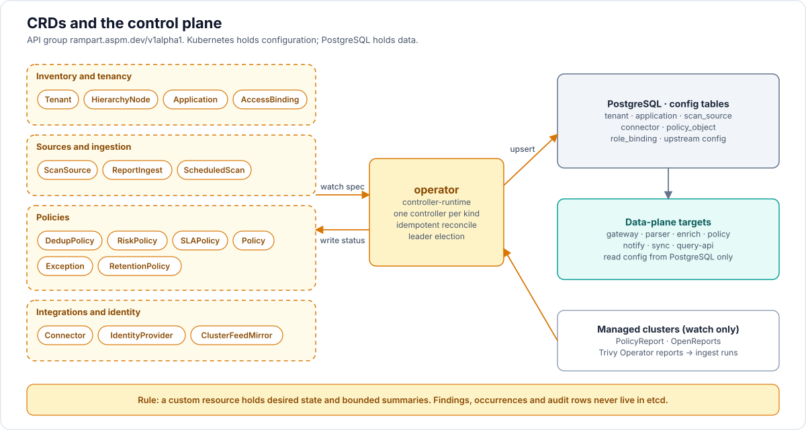

# 04 — Custom Resource Definitions

> Scope note ([16-implementation-decisions.md](16-implementation-decisions.md) D29): v1.0 ships `Tenant`, `Application`, `ScanSource`, `Connector`, `SLAPolicy`, `RiskPolicy`, `IdentityProvider`, `AccessBinding` and `ReportIngest`. The other kinds described here are designed now and delivered after v1.0, except `IntegrationPackage`, which arrives in Phase 3 (mappings and declarative connectors) and Phase 4 (WebAssembly plugins). Deletion behaviour, status throttling and tenant binding rules are in D20 and D21.



API group: `rampart.aspm.dev`, version `v1alpha1` (storage). All resources are namespaced unless prefixed with `Cluster`. The namespace maps to a tenant (label `rampart.aspm.dev/tenant: <slug>`).

**Rule of thumb** (see [adr/0001](adr/0001-crds-for-config-not-findings.md)): a CRD holds *desired state* and *bounded summaries*. Findings, occurrences, vulnerabilities and audit rows live in Postgres. No CR may grow with the number of findings.

Every CRD:
- has `spec` and a `status` subresource with `conditions[]` (`metav1.Condition`: `Ready`, `Synced`, `Degraded`) and `observedGeneration`;
- is validated with OpenAPI schema + CEL `x-kubernetes-validations` (no admission webhooks in v1alpha1);
- is reconciled by the operator into Postgres config tables keyed by `(tenant, kind, namespace, name)`; the uid is an attribute, so re-applying from Git re-attaches to the same rows;
- gets a finalizer `rampart.aspm.dev/finalizer` when deletion needs cleanup (e.g. deregistering a Jira webhook).

## 1. Inventory

### `Application`
Maps business context and Kubernetes workloads to an application.

```yaml
apiVersion: rampart.aspm.dev/v1alpha1
kind: Application
metadata:
  name: payments-api
  namespace: team-payments            # tenant namespace
spec:
  displayName: Payments API
  hierarchy: [fintech, payments]      # path under the tenant's HierarchyNode tree (created on demand)
  owners:
    - team: payments-core
    - user: alice@example.com
  businessCriticality: critical       # critical|high|medium|low
  internetFacing: true
  dataClassification: [pci, pii]
  complianceScope: [pci-dss, soc2]
  compensatingControls: [waf, apiGateway]   # waf | apiGateway | mtls | privateNetwork (D55)
  lifecycle: production
  services:
    - name: api
      kind: api
    - name: worker
      kind: worker
  environments:
    - name: prod
      kind: prod
      internetFacing: true
    - name: staging
      kind: staging
  selectors:                          # how assets attach automatically
    repositories:
      - url: https://github.com/example/payments-api
    images:
      - repository: ghcr.io/example/payments-api   # exact key, or a prefix ending in * (D56)
    workloads:                        # not built: needs a connected cluster (collector, after v1.0); refused today (D56)
      - cluster: prod-eu
        namespaceSelector: {matchLabels: {app.kubernetes.io/part-of: payments}}
        labelSelector: {matchLabels: {app.kubernetes.io/name: payments-api}}
        environment: prod
  tags: [tier-1]
status:
  observedGeneration: 3
  conditions:
    - type: Ready
      status: "True"
      reason: Reconciled
      lastTransitionTime: "2026-11-10T10:00:00Z"
  applicationId: 019321f0-...
  assets: {repositories: 1, images: 14, workloads: 6, packages: 412}
  findings: {critical: 2, high: 11, medium: 40, low: 93, info: 10}   # open only
  riskScore: 742
  postureBand: high
  lastIngest: "2026-11-10T09:58:12Z"
```

Printer columns: `Criticality`, `Risk`, `Critical`, `High`, `Ready`, `Age`.

CEL rules: `environments` names unique; `businessCriticality` immutable only if `spec.lockCriticality` (optional); `selectors.workloads[*].cluster` must reference a `ScanSource` of type `kubernetes` (checked in reconcile, reported as `Ready=False/UnknownCluster`).

### `HierarchyNode` (optional, for explicit trees)
```yaml
kind: HierarchyNode
spec:
  parent: fintech          # name of another HierarchyNode in the namespace, or empty for root
  displayName: Payments
  tags: [bu:fintech]
status: { path: /fintech/payments, applications: 7, riskScore: 610 }
```
Applications may also create nodes implicitly through `spec.hierarchy`.

## 2. Sources and ingestion

### `ScanSource`
Where reports come from and how to map them.

```yaml
kind: ScanSource
metadata: {name: github-actions, namespace: team-payments}
spec:
  type: ci                       # ci | apiPull | kubernetes | registry | webhook
  scannerFamily: ""              # optional fixed family; else auto-detected per upload
  defaultApplication: payments-api
  mapping:                       # derive application/asset/environment from upload context
    applicationFrom: context.repository          # CEL over upload context
    environmentFrom: 'context.branch == "main" ? "prod" : "staging"'
  ingestionPolicy:
    minimumSeverity: low
    closeOldFindings: true       # reimport semantics per (asset, source, scope)
    closeScope: asset            # asset | application
    doNotReactivate: false
    fieldMerge: scanner          # scanner | keep (which side wins for text and severity on update)
    maxClosePercent: 50          # hold the close step above this share of a scope
    maxReportBytes: 536870912
    acceptedFormats: [sarif, cyclonedx, spdx, openvex, generic, native]
  trackedRefs: [main, "release/*"]   # other branches produce ephemeral runs for the CI gate only
  tokenSecretRef:                # the operator mints an ingest token into this Secret if absent
    name: github-actions-rampart-token
status:
  conditions: [...]
  sourceId: 0193...
  lastIngest: "2026-11-10T09:58:12Z"           # rolling counters are Prometheus metrics, not status
```

`type: apiPull`:
```yaml
spec:
  type: apiPull
  connector: sonarqube            # name of a Connector in the namespace
  schedule: "0 */6 * * *"
  pull: {projectKeys: [payments-api]}
```

`type: kubernetes` (agentless consumption of in-cluster reports):
```yaml
spec:
  type: kubernetes
  cluster:
    name: prod-eu
    kubeconfigSecretRef: {name: prod-eu-kubeconfig}   # omit for the local cluster
  watch:
    policyReports: true           # wgpolicyk8s.io + openreports.io
    trivyOperator: true           # VulnerabilityReport, ConfigAuditReport, ExposedSecretReport, SbomReport, ...
    namespaces: {matchLabels: {rampart.aspm.dev/scan: "true"}}
status:
  conditions: [{type: Connected, status: "True"}]
  watched: {policyReports: 1203, vulnerabilityReports: 480}
```

### `ReportIngest`
A declarative request to ingest one report that is **already in object storage**, created by users or GitOps. API uploads do not create this resource; they exist only as `ingest_run` rows (see [16-implementation-decisions.md](16-implementation-decisions.md) D1). The object key must lie inside the tenant's own prefix.

```yaml
kind: ReportIngest
metadata:
  name: payments-api-trivy-20261110-0958
  namespace: team-payments
  labels: {rampart.aspm.dev/source: github-actions}
spec:
  source: github-actions
  format: auto                        # auto | sarif | cyclonedx | spdx | openvex | trivy | grype | ...
  object:
    bucket: rampart-raw
    key: tenants/0193a1c2-.../reports/payments-api-trivy.json   # must lie under tenants/<tenant id>/ (D20)
    sha256: 9f2c...
  context:
    repository: https://github.com/example/payments-api
    branch: main
    commit: 1a2b3c
    imageDigest: sha256:abcd...
    environment: prod
    buildId: "4821"
    pipelineUrl: https://github.com/example/payments-api/actions/runs/4821
  options:                             # override ScanSource.ingestionPolicy for this run
    closeOldFindings: true
  ttlSecondsAfterFinished: 604800
status:
  phase: Completed                     # Queued | Parsing | Merging | Enriching | Scoring | Completed | CompletedWithErrors | Failed | Stale
  ingestRunId: 0193...
  scannerFamily: trivy
  scannerVersion: 0.62.1
  stats: {parsed: 318, created: 4, updated: 2, untouched: 300, reactivated: 1, closed: 11, skipped: 0}
  startedAt: ...
  finishedAt: ...
  conditions:
    - {type: Succeeded, status: "True", reason: Completed}
  findingsURL: https://rampart.example.com/t/team-payments/ingests/0193...
```

CEL: `spec.object` immutable after creation; `spec.object.sha256` matches `^[a-f0-9]{64}$`; `spec.format` in enum. The operator enqueues the parse job (idempotent on `uid`) and mirrors River job status back. With a TTL the operator deletes finished CRs; the `IngestRun` row in Postgres remains.

### `IntegrationPackage` / `ClusterIntegrationPackage`
Adds an integration without changing the core: a declarative parser mapping, a declarative API source, tracker or notifier, a WebAssembly parser plugin, or a gRPC plugin. Namespaced packages (tenant admins) are limited to the data-only runtimes `mapping` and `declarative`; cluster-scoped packages (platform admins) may also use `wasm` and `grpc` and must be signed. Used through `ScanSource.spec.scannerFamily: <name>` or `Connector.spec.type: plugin`. Full reference: [19-integration-sdk.md](19-integration-sdk.md).

## 3. Policies

### `DedupPolicy` / `ClusterDedupPolicy`
```yaml
kind: DedupPolicy
spec:
  scope: asset                         # asset (default) | application | tenant
  families:
    - family: semgrep
      fingerprint: [rule_id, file_path, logical_location, snippet_hash]   # not line numbers
    - family: trivy
      fingerprint: [canonical_vuln_id, purl_base, manifest_path]
    - family: "sarif:*"                 # unknown SARIF drivers
      fingerprint: [rule_id, file_path, snippet_hash]
  normalizers: {pathsRelativeToRepo: true, lowercaseHost: true}
  crossTool:
    enabled: true
    rules:
      - name: same-cve-same-package
        when: 'a.vulnerability_id == b.vulnerability_id && a.purl_base == b.purl_base'
```

### `RiskPolicy` / `ClusterRiskPolicy`
```yaml
kind: RiskPolicy
spec:
  base: {critical: 600, high: 400, medium: 200, low: 80, info: 10}
  factors:
    - name: kev
      when: 'vuln.kev != null'
      points: 300
    - name: epss-high
      when: 'vuln.epss.score >= 0.5'
      points: 150
    - name: epss-medium
      when: 'vuln.epss.score >= 0.1 && vuln.epss.score < 0.5'
      points: 60
    - name: exploit-weaponized
      when: 'vuln.exploit_maturity in ["functional","weaponized"]'
      points: 120
    - name: internet-facing
      when: 'app.internet_facing || env.internet_facing'
      points: 100
    - name: sensitive-data
      when: 'app.data_classification.exists(d, d in ["pci","pii","phi"])'
      points: 80
    - name: business-critical
      when: 'app.business_criticality == "critical"'
      points: 100
    - name: compensating-control
      when: '"waf" in app.compensating_controls && finding.category == "dast"'
      points: -80
    - name: not-reachable
      when: 'finding.reachability == "unreachable"'
      points: -200
    - name: fix-available
      when: 'finding.location.fixed_version != ""'
      points: 20
  bands: {critical: 800, high: 600, medium: 300, low: 0}     # lower bounds, clamp 0..1000
  recomputeOn: [kevAdded, epssDelta: 0.1, assetContextChanged]
```

### `SLAPolicy` / `ClusterSLAPolicy`
```yaml
kind: SLAPolicy
spec:
  matrix:                       # days; rows = risk band, columns = application criticality
    critical: {critical: 3,  high: 7,   medium: 14,  low: 30}
    high:     {critical: 7,  high: 14,  medium: 30,  low: 60}
    medium:   {critical: 30, high: 45,  medium: 90,  low: 120}
    low:      {critical: 90, high: 120, medium: 180, low: 365}
  caps:
    kevDueDate: true            # never later than CISA due date
    maxDays: 365
  startFrom: firstSeen          # firstSeen | verified
  restartOnReactivation: true
  pauseDuringRiskAcceptance: true
  businessDays: false
  notify:
    beforeBreach: [7d, 1d]
    onBreach: true
```

### `Policy` (automation / auto-triage / gates)
```yaml
kind: Policy
metadata: {name: auto-accept-test-fixtures}
spec:
  mode: enforce                        # enforce | simulate
  trigger: finding.created             # finding.created | finding.updated | ingest.completed | gate.evaluated | schedule
  match: |
    finding.category == "secret" && finding.location.file.matches("^(test|fixtures)/")
  actions:
    - setState: {state: not_affected, justification: vulnerable_code_not_present, note: "test fixture"}
    - addTags: [auto-triaged]
---
kind: Policy
metadata: {name: ticket-critical-prod}
spec:
  trigger: finding.updated
  match: 'finding.risk_band == "critical" && env.kind == "prod" && finding.ticket_count == 0'
  actions:
    - createTicket: {connector: jira-sec, project: SEC, issueType: Bug, assigneeFrom: app.owners[0]}
    - notify: {connector: slack-appsec, channel: "#appsec-critical"}
---
kind: Policy
metadata: {name: ci-gate}
spec:
  trigger: gate.evaluated
  match: 'gate.new_findings.exists(f, f.risk_band in ["critical","high"] && f.state == "open")'
  actions:
    - failGate: {reason: "New critical/high findings"}
status: {evaluations24h: 1032, matched24h: 12, lastError: ""}
```

### `RetentionPolicy` / `ClusterRetentionPolicy`
```yaml
spec: {occurrencesDays: 180, rawReportsDays: 90, secretReportsDays: 7, resolvedFindingsDays: 730, eventsDays: 730, auditDays: 2555, runResultsDays: 30}
```
Minimums and the reasons for them are in [16](16-implementation-decisions.md) D53. Until this resource exists the same values come from the configuration (`retention.*`).

### `Exception`
Selector-based waiver that applies at ingest time.
```yaml
kind: Exception
spec:
  match: 'finding.rule_id == "CKV_AWS_18" && asset.type == "repository" && finding.location.file.startsWith("infra/sandbox/")'
  decision: not_affected
  justification: inline_mitigations_already_exist
  owner: alice@example.com
  expiresAt: "2027-01-31T00:00:00Z"
  onExpiry: reactivate
status: {matchedFindings: 14, state: Active}
```

## 4. Integrations

### `Connector`
```yaml
kind: Connector
metadata: {name: jira-sec}
spec:
  type: jira                               # jira | github | slack | teams | email | webhook | dependencyTrack
  direction: outbound                      # outbound | inbound | bidirectional
  jira:
    url: https://example.atlassian.net
    credentialsSecretRef: {name: jira-sec-creds}     # keys: email, apiToken (or pat)
    defaultProject: SEC
    issueType: Bug
    severityToPriority: {critical: Highest, high: High, medium: Medium, low: Low}
    statusMapping:
      closedStatuses: [Done, Won't Do]
      resolutionToState: {"Won't Do": risk_accepted, "False Positive": not_affected}
    twoWaySync: true
    syncInterval: 5m
    customFields: {customfield_10042: "{{ finding.risk_score }}"}
status:
  conditions: [{type: Connected, status: "True", reason: AuthOK}]
  webhookURL: https://rampart.example.com/hooks/jira/0193...
  lastSync: ...
```

Examples for Notifiers and Webhooks:
```yaml
# Slack Notifier (chat.postMessage with Block Kit)
kind: Connector
metadata: {name: slack-sec-alerts}
spec:
  type: slack
  direction: outbound
  slack:
    tokenSecretRef: {name: slack-bot-token, key: token} # Bot token (xoxb-...)
    defaultChannel: "#security-alerts"

---
# Microsoft Teams Notifier (Power Automate Workflows webhook with Adaptive Cards)
kind: Connector
metadata: {name: teams-sec-alerts}
spec:
  type: teams
  direction: outbound
  teams:
    webhookSecretRef: {name: teams-workflow-url, key: url}

---
# Signed Outbound Webhook (CloudEvents v1.0 or raw format with HMAC-SHA256 signature)
kind: Connector
metadata: {name: audit-webhook}
spec:
  type: webhook
  direction: outbound
  webhook:
    url: https://siem.example.com/webhook
    secretRef: {name: webhook-hmac-key, key: secret} # Used for X-Rampart-Signature-256
    format: cloudevents                              # cloudevents | raw
    headers:
      X-Environment: "production"
```

### Dependency-Track (`Connector` type `dependencyTrack` + `ScanSource` type `apiPull`)
The connector holds the API endpoint and key; the scan source holds project filters, mapping rules, webhook, triage sync and SBOM forwarding settings. Full example and field reference: [10-dependency-track-integration.md](10-dependency-track-integration.md) §8. Status reports discovered, mapped and unmapped project counts, last event time, missing DT permissions and pending write-backs.

### `IdentityProvider` / `ClusterIdentityProvider`
OIDC or SAML configuration per tenant or platform-wide. Full reference: [14-sso-and-identity.md](14-sso-and-identity.md) §7.

### `ClusterFeedMirror`
```yaml
kind: ClusterFeedMirror
metadata: {name: airgap}
spec:
  nvd:  {url: https://mirror.internal/nvd/,  schedule: "0 2 * * *"}
  osv:  {url: https://mirror.internal/osv/,  schedule: "0 3 * * *"}
  epss: {url: https://mirror.internal/epss/, schedule: "0 4 * * *"}
  kev:  {url: https://mirror.internal/kev/known_exploited_vulnerabilities.json, schedule: "0 */6 * * *"}
  cwe:  {url: https://mirror.internal/cwe/cwec_latest.xml.zip, schedule: "0 5 * * 0"}
  egress: deny                                   # deny all other outbound calls
status: {nvd: {lastSync: ..., records: 285000}, kev: {lastSync: ..., records: 1340}}
```

### `ScheduledScan` (optional module)
Launches a Kubernetes Job from a template (e.g. Trivy image scan) and feeds the result as a `ReportIngest`.
```yaml
spec:
  schedule: "0 1 * * *"
  source: nightly-trivy
  jobTemplate: {spec: {template: {spec: {containers: [{name: trivy, image: aquasec/trivy, args: [image, --format, sarif, -o, /out/report.sarif, ghcr.io/example/payments-api:latest]}]}}}}
  outputPath: /out/report.sarif
```

## 5. Tenancy and access

### `Tenant` (cluster-scoped)
```yaml
kind: Tenant
metadata: {name: team-payments}
spec:
  displayName: Payments
  namespaces: [team-payments]        # namespaces this tenant owns; created if missing. The binding comes only from this list
  quotas: {maxIngestsPerHour: 500, maxReportBytes: 1Gi, retention: default}
  features: [crossToolDedup, mcp]
status: {tenantId: 0193..., applications: 12, findingsOpen: 2210, conditions: [...]}
```

### `AccessBinding`
```yaml
kind: AccessBinding
spec:
  role: triager                      # viewer | triager | maintainer | owner | admin | custom:<name>
  subjects:
    - kind: Group      # qualified by identity provider
      idp: okta
      name: payments-devs
    - kind: User
      idp: okta
      subject: 00u1abcd
  scope:
    applications: [payments-api]     # or hierarchy: [fintech]  or  tenant: true
```

## 6. Status and summaries: what may be written back

Allowed in `status`: conditions, ids, timestamps, counters by severity/band (fixed cardinality), last error string (truncated), URLs. **Not allowed**: lists of findings, per-finding anything, unbounded arrays. The operator writes status via server-side apply with field manager `rampart-operator`.

## 7. Versioning plan

- `v1alpha1`: additive changes only, no conversion webhook.
- `v1beta1` when the schema has been stable for two minor releases; add conversion webhook (hub = `v1beta1`) with cert-manager.
- `v1` at 1.0 GA.

## 8. Operator behaviour summary

| CRD | Reconcile does | Status writes | Finalizer |
|---|---|---|---|
| Tenant | ensure namespace + labels, upsert tenant row, apply quotas | counts, tenantId | yes: refused while it has data unless `deletionPolicy: Purge` (D49) |
| Application / HierarchyNode | upsert rows, evaluate selectors against known assets, link workloads from connected clusters | counts, risk | yes: the row is kept and orphaned (D49) |
| ScanSource | upsert row, mint ingest token Secret, start/stop watchers (kubernetes type), schedule pulls (apiPull) | last ingest, counters, Connected | yes: disabled, tokens revoked, secret material removed (D49) |
| ReportIngest | enqueue parse job once per uid, mirror job state, GC on TTL | phase, stats | no |
| DedupPolicy / RiskPolicy / SLAPolicy / RetentionPolicy / Exception | upsert policy row; enqueue recompute job when changed | evaluation counters | SLAPolicy yes: removed and due dates recomputed (D49); others no |
| Policy | compile CEL (report compile errors as `Ready=False`), upsert | match counters | no |
| Connector | validate credentials (test call), register webhooks, upsert | Connected, webhook URL | yes (deregister webhook) |
| ClusterFeedMirror | upsert feed config, schedule sync jobs | per-feed last sync | no |
| AccessBinding | upsert binding rows | — | no |
| ScheduledScan | create CronJob with sidecar uploader | lastScheduleTime | yes |
