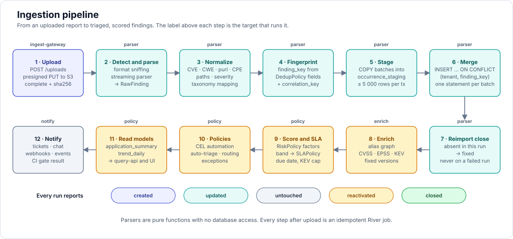

# 05 — Ingestion, normalization, deduplication, reimport



## 1. Supported formats and priority

| Tier | Format | Why |
|---|---|---|
| 1 | **SARIF 2.1.0** | ~15 scanners emit it natively (CodeQL, Semgrep, Trivy, Grype, Gitleaks, Checkov, Bandit, Nuclei, Snyk, ZAP, Dependency-Check, KICS, Scorecard, OSV-Scanner, Hadolint); GitHub/Azure/Jenkins speak it |
| 1 | **CycloneDX 1.4–1.7** (SBOM, VDR, VEX) | Syft, Trivy, Grype, cdxgen, Dependency-Track; VEX round-trip |
| 1 | **OpenVEX**, **CSAF VEX** | triage state import/export |
| 1 | **Kubernetes PolicyReport / OpenReports / Trivy Operator CRDs** | agentless in-cluster coverage (Kyverno, Trivy, Falco, Kubewarden, Kubescape) |
| 2 | **Native JSON**: Trivy, Grype, Semgrep, Gitleaks, Checkov, Nuclei (JSONL), ZAP, Bandit, Dependency-Check, kube-bench, Prowler (OCSF), Snyk, Syft, GitLab security report schemas | richer data than SARIF (per-source CVSS, EPSS/KEV, dataflow, CIS ids) or no SARIF at all |
| 2 | **SPDX 2.3** | Syft/Trivy SBOMs |
| 2 | **Generic JSON** (DefectDojo-compatible superset) | migration and homegrown tools |
| 3 | API pulls: SonarQube, GitHub Code Scanning alerts, GitLab vulnerabilities, Dependency-Track findings, Snyk REST, Wiz, Tenable, Qualys | `ScanSource.type=apiPull` |
| 3 | Declarative mappings and WebAssembly parser plugins (`IntegrationPackage`) | long tail without core changes; see [19-integration-sdk.md](19-integration-sdk.md) |

Design rule: **SARIF for triage, native JSON for enrichment.** When both are available for the same scanner, the native parser wins and sets `scanner_family` identically so fingerprints match.

## 2. Parser contract

```go
// internal/parsers/parser.go
type Parser interface {
    Family() string                     // "trivy", "semgrep", "sarif", ...
    Detect(head []byte, hint Hint) (confidence int)   // 0..100 from first 64 KiB + filename/content-type
    Parse(ctx context.Context, r io.Reader, pc ParseContext) iter.Seq2[RawFinding, error]
}

type RawFinding struct {
    ScannerFamily, ScannerName, ScannerVersion string
    ToolRecordID   string              // SARIF guid / unique_id_from_tool
    ToolFingerprints map[string]string // SARIF partialFingerprints etc.
    RuleID, RuleName, Title, Description, Remediation string
    Category       Category            // sast | sca | secret | iac | container | dast | cspm | compliance | license | supplychain
    ToolSeverity   string              // as reported
    Severity       Severity            // normalized
    CVSS           []CVSSVector
    VulnIDs        []string            // CVE-, GHSA-, OSV ids, tool-local
    CWEs           []int
    Location       Location            // typed union
    Evidence       map[string]any      // request/response, snippet, dataflow
    VEX            *VEXStatement       // when the report carries analysis
    Tags           []string
    Raw            json.RawMessage     // original record, stored on the Occurrence
}
```

Rules:
- Parsers are streaming (`json.Decoder` token walk for arrays; JSONL line by line; XML `xml.Decoder`). Memory is bounded by batch size, not report size.
- Parsers never touch the DB and never compute fingerprints; they only map.
- Each parser ships with `testdata/<tool>/<version>/*.json` fixtures and a golden canonical output; the conformance test asserts the golden and that fingerprints are stable across two runs with changed line numbers.
- SARIF parser has per-tool enrichers keyed on `tool.driver.name` (e.g. read `properties.security-severity`, `properties.tags` for CWE, Semgrep `metadata`).

## 3. Normalization

- **Identifiers**: `CVE-` uppercased; `GHSA-` lowercased body; OSV ids as-is; aliases resolved to a canonical `Vulnerability` by the enrich target (CVE preferred).
- **purl**: parsed with `packageurl-go`, re-serialized canonically; `purl_base` = purl without version and qualifiers (for dedup and asset key).
- **CPE 2.3**: validated; stored verbatim.
- **Paths**: made relative to repo root when the context has `repository`; `uriBaseId` resolved; backslashes normalized; `./` stripped.
- **Images**: `registry/repo@sha256:digest` preferred; tag-only refs are stored but flagged `unpinned`.
- **Severity**: tool severity → normalized via per-family table; CVSS score fallback (≥9.0 critical, ≥7.0 high, ≥4.0 medium, >0 low); SARIF `level` alone never sets severity above medium unless `security-severity` present.
- **CWE**: from SARIF taxa/relationships/tags (`external/cwe/cwe-79`, `CWE-79`), Semgrep metadata, Trivy `CweIDs`, CycloneDX `cwes`, Nuclei classification; stored as ints.
- **Category**: from family default + rule tags (secret / iac / sca / sast / container / dast / compliance / license).
- **Taxonomy materialization**: after normalization, `taxa[]` = union of mappings by CWE, rule id and control id.

## 4. Fingerprint (finding_key)

```
finding_key = sha256( tenant_id | dedup_scope_key | scanner_family_or_crosstool_class | canonical_fields... )
```

- `dedup_scope_key`: asset id plus track (default), application id, or tenant, per `DedupPolicy.scope`. The asset is the long-lived thing (image repository, not digest); see [16-implementation-decisions.md](16-implementation-decisions.md) D10 and the full fingerprint specification in D11.
- Default fingerprint fields per family (overridable in `DedupPolicy`):

| Family / category | Fields | Excluded on purpose |
|---|---|---|
| SAST (semgrep, codeql, bandit, sonarqube, generic SARIF) | `rule_id`, `file_path`, `logical_location` (function/class) if present, else `snippet_hash` (normalized whitespace), else `primaryLocationLineHash` | `line`, `column`, `message` |
| SCA (trivy, grype, snyk, dependency-check, osv-scanner, cyclonedx VDR) | `vulnerability_id` (canonical), `purl_base`, `image_repository` or `manifest_path` | installed version (fix bumps version), description |
| Secrets (gitleaks, trufflehog, detect-secrets) | `rule_id`, `file_path`, `secret_hash` (sha256 of the matched secret) | line, commit |
| IaC (checkov, tfsec/trivy-config, kics, terrascan) | `rule_id`, `file_path`, `resource_address` | line range |
| Container misconfig / compliance (kube-bench, trivy-config, prowler, policyreport) | `control_id` or `rule_id`, `resource_key` (cluster/ns/kind/name or ARN) | timestamps, message |
| DAST (zap, nuclei, burp) | `rule_id` (pluginid/template-id), `normalized_url` (scheme+host+port+path, no query values), `method`, `param` | evidence, payload |
| License | `purl_base`, `license_id` | |

- **Cross-tool correlation** (after v1.0; v1 uses non-destructive correlation groups, [16-implementation-decisions.md](16-implementation-decisions.md) D24): a second key `correlation_key` computed from category-level fields only (e.g. SCA: `vulnerability_id + purl_base + asset`; SAST: `cwe + file_path + function`). Findings with the same `correlation_key` but different `scanner_family` are merged into one Finding with multiple Occurrences when `DedupPolicy.crossTool.enabled`. The earliest Finding is the survivor; severity = max; `source_count` increments. Merging is reversible (`FindingEvent: merged_into` / `split_from`).
- **Tool-provided ids first**: if the tool gives a stable `ToolRecordID` (Snyk id + path, SonarQube issue key, Checkmarx similarity id) the policy can select `unique_id_from_tool` semantics (DefectDojo parity): `finding_key = sha256(tenant | scope | family | tool_record_id)`, with fallback to field fingerprint when missing (`unique_id_or_fields`).
- Fingerprints are versioned: `finding_key_version` column; a `DedupPolicy` change triggers a background re-key job that maps old → new keys and merges collisions, with a "transition window" where both keys match (DefectDojo Pro Universal Parser idea).

## 5. Merge and close

The complete, normative algorithm is in [16-implementation-decisions.md](16-implementation-decisions.md) D13. In short:

1. `COPY` normalized rows into `ingest_staging` (unlogged, no RLS, keyed by run and sequence).
2. Per batch of at most 5 000 staged rows, in one transaction and under an advisory lock on the scope: collapse duplicate keys, read existing findings `FOR UPDATE`, insert new ones, update existing ones, and classify each as created, updated, untouched or reactivated by comparing the pre-update state and a content hash.
3. Upsert occurrences (current evidence per source and location) and write finding events.
4. Close step, once per scope and only when the run had no record errors: occurrences not seen become absent; active findings with no present occurrence become `fixed`.

Guarantees:
- Two runs on the same scope are serialised; an older run arriving late is marked `stale` and changes nothing.
- A finding reported by two sources stays open until both stop reporting it.
- `not_affected`, `risk_accepted`, `out_of_scope` and `duplicate` are never reopened by a rescan; they show "no longer detected" when absent.
- A run with parse errors never closes anything. A run that would close more than half of a scope is held for confirmation.
- Runs from untracked branches (pull requests) are ephemeral: they feed the CI gate and never change the inventory.
- A retried batch cannot double-count, because counters are recomputed from rows.

## 6. Reimport semantics (DefectDojo parity table)

| DefectDojo option | Rampart equivalent |
|---|---|
| `import-scan` vs `reimport-scan` | one endpoint; a run is always a reimport within its `(asset, source, scope)`; first run just creates |
| `auto_create_context` | `ScanSource.mapping` + `Application.selectors`; unknown assets are created under the default application |
| `close_old_findings` / `_product_scope` | `ingestionPolicy.closeOldFindings` + `closeScope: asset|application` |
| `do_not_reactivate` | `ingestionPolicy.doNotReactivate` (per source or per run) |
| `minimum_severity` | `ingestionPolicy.minimumSeverity` |
| `scan_date` | `context.scanFinished` |
| `group_by` | `FindingGroup` auto-grouping policy (component / rule / file / cve) |
| `push_to_jira` | `Policy` action `createTicket` |
| `active` / `verified` force flags | `Policy` action `setState` / `verified` on `ingest.completed` |
| `service` in hash | `dedup scope` + `service` in context (part of asset key when set) |
| `deduplication_on_engagement` | `DedupPolicy.scope: asset` |
| `tags`, `apply_tags_to_findings` | `context.tags` applied to run + findings |
| `version`, `build_id`, `commit_hash`, `branch_tag` | `context.{version, buildId, commit, branch}` |
| `test_title` / `engagement_name` | not needed; runs are keyed by source + asset + context |

## 7. VEX import and export

- Import: OpenVEX / CycloneDX VEX / CSAF VEX statements match findings by `(vulnerability alias set) × (product purl/cpe → asset or package)`; `subcomponents` narrow to packages. Statement → state transition with `justification`, `impact_statement`, `action_statement`; author and timestamp recorded in `FindingEvent`. Later statements override earlier (OpenVEX precedence rules).
- Export: `GET /api/v1/applications/{id}/vex?format=openvex|cyclonedx|csaf` emits current triage states; `not_affected` requires a justification (enforced in UI).

## 8. Kubernetes report consumption

`ScanSource.type=kubernetes` watchers convert in place:
- `PolicyReport`/`ClusterPolicyReport`/`Report`: each `results[]` with `result in (fail, warn, error)` → RawFinding (category `compliance`/`iac`, `rule_id = policy/rule`, `resource_key` from `resources[]`/`scope`, severity from `severity`, `properties` into evidence). `pass` results update a `control_status` table (for compliance coverage) but do not create findings.
- Trivy `VulnerabilityReport`: `report.vulnerabilities[]` → SCA findings on asset `image` (digest from `report.artifact.digest`) linked to the owning workload via ownerRef.
- `ConfigAuditReport`, `ExposedSecretReport`, `RbacAssessmentReport`, `InfraAssessmentReport`: → iac/secret/compliance findings on the workload asset.
- `SbomReport`: → SBOM inventory for the image.
- Each watch event becomes an `IngestRun` with `format: k8s/<kind>`; reimport-close is scoped to the report's subject so a deleted report (workload gone) closes its findings with `resolution = deleted_asset`.

## 9. CI gate

`POST /api/v1/gate` with `{source, context{commit|imageDigest}, expect[], wait: true}`: waits for the declared runs (and linked Dependency-Track sync runs) to reach a final, scored status, evaluates `Policy` rules with trigger `gate.evaluated` against the run's *new* and *reactivated* findings, returns `{pass: bool, reasons[], summary, url}` and the SARIF subset for PR annotation. `rampart gate --wait` in CLI.
