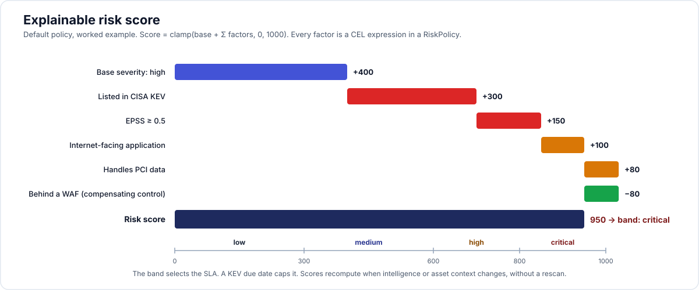

# 06 — Risk scoring, SLA, policy engine



## 1. Goals

- **Explainable**: every score lists its factors and points; no hidden ML in the core.
- **Configurable**: defaults ship as a `ClusterRiskPolicy`; tenants override with `RiskPolicy`.
- **Reactive**: scores recompute when intel changes (KEV addition, EPSS jump) or asset context changes, without rescanning (ArmorCode/Wiz behaviour).
- **Comparable to the market**: 0–1000 scale (Snyk, Rapid7, DefectDojo Pro posture score) with bands.

## 2. Score formula (default policy)

```
score = clamp( base(severity) + Σ factor_points(finding, vuln, asset, app, env) , 0, 1000 )
```

| Component | Default | Source |
|---|---|---|
| base | critical 600 · high 400 · medium 200 · low 80 · info 10 | normalized severity (CVSS-derived when available) |
| KEV | +300 | CISA KEV feed |
| EPSS ≥ 0.5 / ≥ 0.1 | +150 / +60 | FIRST EPSS |
| exploit maturity functional/weaponized | +120 | feeds (VulnCheck/Exploit-DB when configured), CVSS v4 Threat `E` |
| internet-facing app or env | +100 | Application / Environment |
| sensitive data (pci/pii/phi) | +80 | Application |
| business criticality critical / high | +100 / +50 | Application |
| production environment | +60 | Environment |
| fix available | +20 (nudge: cheap to fix) | finding |
| compensating control relevant to category | −80 | Application |
| reachability = unreachable (from external tools) | −200 | finding.reachability |
| age > 90 days open | +30 | finding.first_seen |
| secret verified live (from scanner) | +250 | finding.evidence.verified |

Bands (lower bounds): critical 800, high 600, medium 300, low 0. The band drives SLA; the raw score drives ordering.

Factors are CEL expressions evaluated with a fixed environment: `finding`, `vuln`, `asset`, `app`, `env`, `now`. Cost-limited (CEL cost budget) and compiled once per policy version.

**Roll-ups**: `application.risk_score = max(open finding score)` plus a density term `min(100, 2 × count(open critical/high))`, shown separately as "max risk" and "exposure count" (Brinqa max-based asset score, Dependency-Track inherited risk). Hierarchy nodes aggregate children. **Posture score** (0–1000, higher is better) = 1000 − weighted open risk normalized by asset count, with SLA adherence and coverage as modifiers; defined in the same policy so it is tunable.

## 3. SSVC (P2)

Compute CISA SSVC decision from: Exploitation (KEV → active; EPSS ≥ 0.1 or PoC → poc; else none), Automatable (CVSS AV:N + AC:L + PR:N + UI:N → yes), Technical Impact (CVSS C/I/A high → total), Mission & Well-being (business criticality + data classification). Output `Track | Track* | Attend | Act` as a finding attribute and a filter.

## 4. SLA

- Policy resolution order: `SLAPolicy` in tenant namespace matching the application (by selector/labels) → namespace default → `ClusterSLAPolicy` → built-in.
- Built-in matrix (days) mirrors the market medians:

| Risk band \ App criticality | critical | high | medium | low |
|---|---|---|---|---|
| critical | 3 | 7 | 14 | 30 |
| high | 7 | 14 | 30 | 60 |
| medium | 30 | 45 | 90 | 120 |
| low | 90 | 120 | 180 | 365 |

- Caps: KEV `dueDate` wins when earlier (FedRAMP VDR and BOD 22-01 behaviour); `maxDays`.
- `sla_start` = `first_seen` (default) or `verified_at`; `restartOnReactivation` resets on reopen; risk acceptance pauses the clock (`sla_paused_at`), expiry resumes.
- Band change (re-score) recomputes `sla_due` from the original `sla_start`, never extends past an already-breached due date.
- A daily (and on-event) sweep marks `sla_breached_at`, emits `finding.sla_breached`, drives notifications `beforeBreach` and `onBreach`, and updates adherence read models (`% within SLA`, `MTTR by band`, `breaches by team`).
- Compliance presets shipped as `ClusterSLAPolicy` examples: `pci-dss` (critical/high 30d), `fedramp-rev5` (30/30/90/180), `fedramp-vdr` (4/14/30 by exploitability × reachability), `cisa-bod` (15/30).

## 5. Policy engine (automation)

- Language: CEL (cel-go) with the same environment as risk factors plus `gate`, `run`, `event`. Reasons to choose CEL over Rego first: identical language to Kubernetes CRD validation and Kyverno; sandboxed; cheap; easy to expose in UI with autocomplete. Rego via embedded OPA is an optional engine (P3) for teams with existing policies.
- Triggers: `finding.created`, `finding.updated` (with changed-field list), `ingest.completed`, `gate.evaluated`, `schedule`, `risk_acceptance.expiring`, `sla.breaching`.
- Actions: `setSeverity`, `setState` (+justification), `setVerified`, `setOwner`, `addTags` / `removeTags`, `assignGroup`, `createTicket`, `updateTicket`, `notify`, `failGate`, `callWebhook`, `setField` (custom fields).
- Modes: `enforce` and `simulate` (DefectDojo Pro "simulate" idea): simulate records what *would* happen in `policy_simulation` rows the UI shows before enabling.
- Ordering: policies sorted by `spec.priority` then name; first `stop: true` halts the chain.
- Loops: an action that triggers `finding.updated` carries `actor = policy:<name>`; policies do not re-fire on their own updates (depth 1).
- Every match is auditable: `FindingEvent.actor = policy:<name>` and a `policy_evaluation` counter per policy for status.

## 6. Exceptions and risk acceptance workflow

1. Analyst (role ≥ triager) requests acceptance with decision, justification (OpenVEX enum when `not_affected`), impact statement, expiry (max from tenant settings, e.g. 180 days), optional proof file.
2. If `tenant.settings.riskAcceptanceApproval = true`, a user with role ≥ maintainer on the scope (and not the requester) approves; otherwise auto-approved.
3. On approval: state → `risk_accepted` / `not_affected`, SLA paused, ticket (if any) commented and transitioned per connector mapping.
4. Scheduler: 14 d and 1 d before expiry → notification; on expiry → `onExpiry` (`reactivate` → state `open`, SLA resumed or restarted; `notify_only`).
5. Everything is in `FindingEvent` and `AuditEvent`; exports include acceptance history for auditors (SOC 2 / ISO 27001 evidence).
