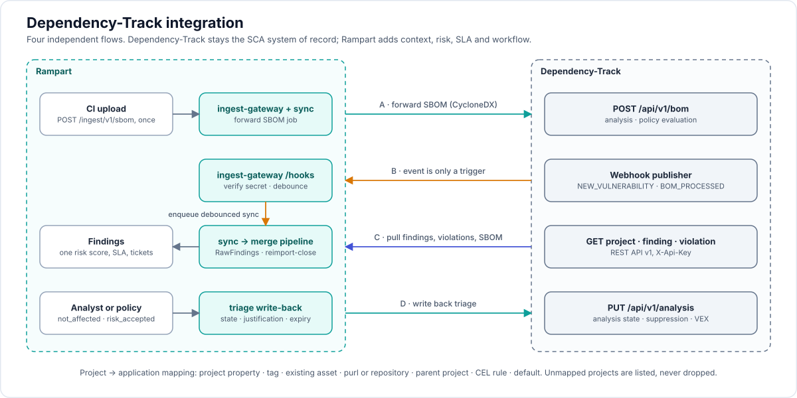

# 10 — Dependency-Track integration

> Release scope ([16-implementation-decisions.md](16-implementation-decisions.md) D23): v1.0 ships flows B and C with triage mode `import` and the FPF file parser. SBOM forwarding (A), write-back (D), policy violations and the DefectDojo-compatible shim follow after v1.0. D23 also lists corrections on webhook secrets, debounce, analysis settling and gate linking.



**How to read the picture.** An SBOM is the *input* of Dependency-Track: DT matches its components against NVD, GHSA, OSV and the others, and the vulnerabilities come *back* to Rampart in flow C, where they become findings. A ready-made vulnerability report (Trivy, Grype, Semgrep, SARIF, CycloneDX VDR) is not part of this picture: it goes through the ordinary ingest path. **In v1.0 flow A is not shipped** (D23): the pipeline sends the SBOM to Dependency-Track directly, with DT's own CI/CD integration, and Rampart learns about it through flows B and C. The arrow "CI → Rampart → DT" is the shape after v1.0.

Dependency-Track (DT) is a first-class integration, not a generic connector. This document defines who owns what, the four data flows, the mapping rules, and the failure handling.

Sources checked on 2026-11-11: https://docs.dependencytrack.org/usage/cicd/ , https://docs.dependencytrack.org/integrations/notifications/ , https://docs.dependencytrack.org/integrations/file-formats/ , https://docs.dependencytrack.org/integrations/defectdojo/ , https://docs.dependencytrack.org/integrations/rest-api/ . Items marked **(confirm)** come from the DT OpenAPI definition as we remember it and must be verified against the target instance's `/api/openapi.json` before coding.

## 1. Division of responsibility

| Concern | Owner | Why |
|---|---|---|
| SBOM storage, component inventory, dependency graph | **Dependency-Track** | It is built for it; teams already have it |
| Matching components to vulnerabilities (NVD, GHSA, OSV, OSS Index, Snyk, Trivy, VulnDB) | **Dependency-Track** | Continuous re-analysis of stored SBOMs without a rescan |
| License and operational policy evaluation on components | **Dependency-Track** | Existing policy engine |
| Unifying SCA findings with SAST, DAST, secrets, IaC, container, cloud | **Rampart** | ASPM core |
| Application and business context, ownership, hierarchy | **Rampart** | DT only has project, parent, tags |
| Risk score, SLA, exceptions with expiry and approval | **Rampart** | DT has severity and an inherited risk score only |
| Ticketing, notifications routing, CI gate across all tools | **Rampart** | |
| Triage decision on a component vulnerability | **Configurable** (see §6) | Both systems can record it; one must win |

Rampart never re-implements DT's component analysis. When DT is connected, DT is the SCA source of truth for the projects it holds. Rampart's own CycloneDX parser still works for teams without DT.

## 2. The four flows

```
                 ┌──────────────── Rampart ────────────────┐            ┌──── Dependency-Track ────┐
  CI ── SBOM ───►│ ingest-gateway ──(A) forward BOM ───────┼───────────►│ POST /api/v1/bom         │
                 │                                          │            │   analysis, policies     │
                 │ ingest-gateway /hooks/dependency-track ◄─┼──(B) event─┤ Webhook publisher        │
                 │        │ enqueue project sync            │            │                          │
                 │        ▼                                 │            │                          │
                 │ sync target ──(C) pull projects,findings,┼───────────►│ GET /api/v1/project      │
                 │               violations, SBOM           │◄───────────┤ GET /api/v1/finding/...  │
                 │        │ RawFindings                     │            │ GET /api/v1/violation/...│
                 │        ▼                                 │            │                          │
                 │ parser merge → enrich → policy → notify  │            │                          │
                 │        │                                 │            │                          │
                 │ sync target ──(D) push triage / VEX ─────┼───────────►│ PUT /api/v1/analysis     │
                 └──────────────────────────────────────────┘            └──────────────────────────┘
```

### Flow A — SBOM forwarding (Rampart → DT)
CI uploads the SBOM once, to Rampart. If the `ScanSource` has `sbomForwarding.enabled`, the parser stores the SBOM inventory locally and enqueues a `DTrackBomUpload` job:

- `POST {url}/api/v1/bom`, `multipart/form-data`, header `X-Api-Key`. Fields: `project` (UUID) when the mapping is known, otherwise `autoCreate=true`, `projectName`, `projectVersion`, and optionally `parentName` + `parentVersion` or `parentUUID`.
- `PUT {url}/api/v1/bom` with JSON `{project, bom: <base64>}` is the alternative for small BOMs.
- The response carries a processing token. The job polls `GET /api/v1/event/token/{uuid}` (`{processing: true|false}`; the older `GET /api/v1/bom/token/{uuid}` is deprecated since 4.11.0) with backoff, bounded to 10 minutes. Both need `BOM_UPLOAD`; a `false` answer does not prove the token is valid (read from the 4.14.6 sources, 2026-11-13, docs/20 section 5). It does not wait if the webhook flow is enabled, because `BOM_PROCESSED` will trigger the pull.
- Rampart stores `dtrack_project_uuid` on the asset so later uploads use the UUID.
- When forwarding is on, Rampart does **not** create SCA findings from the SBOM by itself. Findings come back through flow C. This avoids two SCA engines disagreeing on the same asset.

### Flow B — Events (DT → Rampart)
DT admin creates one notification rule with the **Webhook** publisher, scope `PORTFOLIO`, destination `https://<rampart>/hooks/dependency-track/<sourceId>`, groups (the secret is **not** in the path: the publisher can send one authentication header, Basic, Bearer or a token header named `X-Api-Key` by default and configurable, so the rule is set to send `Authorization: Bearer <secret>`; it cannot send arbitrary headers and does not sign the body, 4.14.6 sources, D23):

`NEW_VULNERABILITY`, `NEW_VULNERABLE_DEPENDENCY`, `PROJECT_AUDIT_CHANGE`, `BOM_PROCESSED`, `BOM_PROCESSING_FAILED`, `BOM_VALIDATION_FAILED`, `POLICY_VIOLATION`. (`BOM_CONSUMED` also exists; `PROJECT_VULN_ANALYSIS_COMPLETE` does **not** exist in 4.14.6, so "analysis finished" has no event: see the open item in §8.)

Rule: **thin event, fat fetch.** DT's webhook publisher has no documented signing, so the payload is treated as an untrusted hint. The handler:

1. Checks the bearer secret in constant time, and the source's optional IP allow-list.
2. Reads only project UUIDs from `notification.subject.project.uuid` or `notification.subject.affectedProjects[].uuid`.
3. Enqueues a `DTrackProjectSync(project_uuid)` job with trailing-edge debounce: an event that arrives during a running sync sets a dirty flag and causes exactly one more sync.
4. Returns `202`. Nothing from the payload is written to findings.

`BOM_PROCESSING_FAILED` and `BOM_VALIDATION_FAILED` mark the matching `IngestRun` as failed with DT's message, so the CI gate reports it.

The operator can create the notification rule in DT automatically when `webhook.manage: true` and the API key has `SYSTEM_CONFIGURATION` **(confirm)**. Otherwise the `ScanSource` status shows the URL to paste.

### Flow C — Pull (DT → Rampart), the data path
A `DTrackProjectSync` job is the unit of work. It is triggered by flow B, by the schedule (default every 30 minutes for changed projects, full reconciliation daily), or manually.

Per project:
1. `GET /api/v1/project/{uuid}`: name, version, parent, tags, classifier, active, `lastBomImport`, properties.
2. `GET /api/v1/finding/project/{uuid}?suppressed=true` (`suppressed` is a boolean, default false; `source` filters by vulnerability source; `Accept: application/sarif+json` returns SARIF; `X-Total-Count` is the number of findings): all findings including suppressed ones, with `component`, `vulnerability`, `analysis`, `attribution`, `matrix`.
3. `GET /api/v1/violation/project/{uuid}?suppressed=true` **(confirm)**: policy violations, if `pull.policyViolations`.
4. `GET /api/v1/bom/cyclonedx/project/{uuid}?variant=inventory` (`variant` is `inventory`, the default, or `withVulnerabilities`; also `format`, `download`, `version`; needs `VIEW_PORTFOLIO`): only when `lastBomImport` changed and SBOM inventory is not already held from flow A.
5. Convert to `RawFinding`s (§4), then the normal staging and merge pipeline with reimport-close scoped to this project.

Discovery: a `DTrackPortfolioSync` job pages `GET /api/v1/project` (total in `X-Total-Count`, verified on `/project`; `pageNumber` and `pageSize` come from the framework's request handling and were **not verified**: confirm against a running 4.x before relying on them; other filters: `name`, `excludeInactive`, `onlyRoot`), applies the source's project filter, upserts assets, and enqueues project syncs for projects whose `lastBomImport` or metrics changed since the last cursor.

Rate and load: per-connector concurrency limit (default 4), token bucket (default 10 req/s), `ETag`/`If-None-Match` when DT supports it, exponential backoff on `429` and `5xx`, circuit breaker that sets `Connector` condition `Connected=False`.

### Flow D — Triage and VEX write-back (Rampart → DT)
When a finding that originated from DT changes state in Rampart, and the source's `triageSync.mode` allows it, a `DTrackAnalysisPush` job calls `PUT /api/v1/analysis` **(confirm)** with `project`, `component`, `vulnerability` UUIDs (taken from the occurrence's `matrix`), `analysisState`, `analysisJustification`, `analysisResponse`, `analysisDetails`, `comment`, `isSuppressed`.

Optional bulk path: export an application's VEX as CycloneDX and `POST /api/v1/vex` (multipart; needs `VULNERABILITY_ANALYSIS`; `PUT` also exists) for the mapped project.

## 3. Identity mapping: DT project to Rampart inventory

DT has `Project(name, version, parent, tags, classifier, properties)`. Rampart has `Application → Service → Environment` and typed `Asset`s.

Resolution order for each DT project (first match wins), configured in `ScanSource.spec.dependencyTrack.mapping`:

1. **Project property** `group=integrations`, `name=rampart.application` (and optional `rampart.service`, `rampart.environment`). Same convention DT uses for its DefectDojo integration.
2. **Project tag** `rampart-app:<slug>`.
3. **Existing asset link**: the project was created by flow A, so `dtrack_project_uuid` is already on an asset.
4. **purl or repository match**: DT project `purl` or an external reference of type `vcs` equals a known `repository` or `image` asset key.
5. **Parent rule**: root parent project name is the application; the child project name is the service.
6. **CEL rule** over `project` (name regex, classifier, tags).
7. **Fallback**: `defaultApplication`, or leave unmapped and list it under "Unmapped projects" in the UI. Unmapped projects are still synced so no data is lost.

Asset created or linked per project:

| DT concept | Rampart |
|---|---|
| Project (name + version) | Asset. If matched to an existing `repository`/`image` asset, that asset. Otherwise a new asset of type `sbom_project`, key `dtrack://<connector>/<project-uuid>` |
| Project version | Asset attribute `version`; `isLatest` **(confirm)** marks the default. Versions of one project are separate assets grouped by `attributes.project_name` |
| Parent / children | `asset_edge(parent, child, contains)` |
| Component (purl) | `package` asset + `asset_edge(project_asset, package, contains)`; direct vs transitive from the dependency graph |
| Tags, classifier | Asset tags and `attributes.classifier` |
| Inactive project | Asset `active=false`; open findings closed with `resolution=deleted_asset` only if `closeOnInactive: true` |

## 4. Finding mapping

One DT finding (a component × vulnerability pair in a project) becomes one `RawFinding`.

| RawFinding field | From DT |
|---|---|
| `ScannerFamily` | `dependency-track` |
| `ScannerVersion` | `meta.version` (FPF) or `/api/version` |
| `ToolRecordID` | `matrix` (`project:component:vulnerability` UUIDs). Kept on the occurrence for write-back |
| `Category` | `sca` |
| `VulnIDs` | `vulnerability.vulnId` + `aliases` (`cveId`, `ghsaId`, ...). Feeds the alias graph |
| `Title` | `vulnId` in `component.name@version` |
| `Description`, `Remediation` | `vulnerability.description`, `vulnerability.recommendation` |
| `ToolSeverity`, `Severity` | `vulnerability.severity` (CRITICAL..UNASSIGNED). UNASSIGNED maps to `info` until enrichment supplies CVSS |
| `CVSS` | `cvssV2Vector`, `cvssV3Vector`, `cvssV4Vector` (FPF 1.3+) |
| `CWEs` | `vulnerability.cwes[].cweId` |
| `Location` | `{purl, installed_version: component.version, fixed_version: from enrichment, latest_version: component.latestVersion}` |
| `Evidence` | `attribution` (analyzer identity, attributed-on date), component hashes, DT URLs |
| `VEX` | from `analysis` (§6) |
| `Raw` | the DT finding object |

Fingerprint for the `dependency-track` family: `vulnerability_id (canonical) + purl_base + asset_key`. The version is excluded on purpose, so a dependency bump that still carries the CVE stays the same finding, and a bump that fixes it closes the finding.

**Cross-tool correlation.** The `correlation_key` for SCA is `canonical_vuln_id + purl_base + asset`. If Trivy or Grype reports the same CVE on the same package for the same asset, the result is one Finding with two Occurrences (`source_count = 2`). This only works when the DT project and the Trivy target resolve to the same asset, which is why mapping rule 4 matters.

**Policy violations** (`pull.policyViolations: true`):

| DT | Rampart |
|---|---|
| `type` LICENSE | category `license`, rule id `dtrack-policy/<policy name>` |
| `type` SECURITY | not imported by default (it duplicates the vulnerability finding); adds tag `dtrack-policy:<name>` to the matching finding |
| `type` OPERATIONAL | category `supplychain` (outdated component, banned coordinates) |
| `violationState` FAIL / WARN / INFO | severity high / medium / info (overridable) |
| Violation analysis APPROVED / REJECTED | state `risk_accepted` / `affected` |

Fingerprint: `policy_uuid + purl_base + asset_key`.

## 5. Reimport semantics for DT

- A project sync is one `IngestRun` with `format: dependency-track/api`, scoped to `(asset, source)`.
- Findings present before and absent now are closed with `resolution=fixed`. The run closes nothing if any page of the pull failed.
- Portfolio discovery never closes findings; only a successful per-project sync does.
- A project deleted in DT: the asset is deactivated after two consecutive discovery runs miss it (protects against partial listings).
- First sync of a large portfolio is throttled (`initialSync.maxProjectsPerHour`) so DT is not overloaded.

## 6. Triage synchronisation

DT analysis states and justifications are the CycloneDX enumerations, which map cleanly to Rampart's OpenVEX-based states.

| DT `analysisState` | Rampart state | Notes |
|---|---|---|
| `NOT_SET` | `open` | |
| `IN_TRIAGE` | `under_investigation` | |
| `EXPLOITABLE` | `affected` (+ `verified=true`) | |
| `NOT_AFFECTED` | `not_affected` + justification | table below |
| `FALSE_POSITIVE` | `not_affected`, justification `vulnerable_code_not_present`, tag `false-positive` | round-trips back to `FALSE_POSITIVE` because of the tag |
| `RESOLVED` | `not_affected` with note "resolved upstream" | never `fixed` while the component is still listed, so it cannot oscillate with reactivation |
| `isSuppressed=true` with any state | keeps the mapped state; if state is `NOT_SET`, maps to `risk_accepted` without expiry and flags "no expiry" for review | |

| DT `analysisJustification` | OpenVEX justification |
|---|---|
| `CODE_NOT_PRESENT` | `vulnerable_code_not_present` |
| `CODE_NOT_REACHABLE` | `vulnerable_code_not_in_execute_path` |
| `REQUIRES_CONFIGURATION`, `REQUIRES_DEPENDENCY`, `REQUIRES_ENVIRONMENT` | `vulnerable_code_cannot_be_controlled_by_adversary` |
| `PROTECTED_BY_COMPILER`, `PROTECTED_AT_RUNTIME`, `PROTECTED_AT_PERIMETER`, `PROTECTED_BY_MITIGATING_CONTROL` | `inline_mitigations_already_exist` |

The original DT justification is stored on the finding (`justification_detail`) so the reverse mapping is lossless.

`risk_accepted` in Rampart pushes `EXPLOITABLE` with `analysisResponse=WILL_NOT_FIX`, `isSuppressed=true`, and the expiry date in `analysisDetails`. On expiry Rampart pushes `isSuppressed=false`.

**Modes** (`triageSync.mode`):

| Mode | Behaviour |
|---|---|
| `off` | DT analysis is imported once as initial state for new findings only |
| `import` (default) | DT → Rampart on every sync. Rampart changes are not written back |
| `export` | Rampart → DT only. DT analysis changes are overwritten on the next push |
| `bidirectional` | Both. Conflicts resolved by `authority` |

**Conflict rule** in `bidirectional`: each side's last change time is compared (DT analysis comment timestamps vs Rampart `FindingEvent`). `authority: rampart | dependencyTrack | lastWriteWins`. Default `rampart`, because Rampart holds expiry and approval that DT cannot express.

**Loop prevention**: every write-back adds a comment prefixed `[rampart:<event-id>]`. A pulled analysis whose latest comment carries a known event id is not treated as a DT-side change. `PROJECT_AUDIT_CHANGE` events caused by our own push are dropped the same way.

**Approval**: a `not_affected` or `risk_accepted` imported from DT bypasses Rampart's approval workflow only if `triageSync.trustUpstreamDecisions: true`. Otherwise it arrives as a pending risk-acceptance request.

## 7. Compatibility path: DT's built-in DefectDojo integration

DT can already push findings to DefectDojo on a schedule, using per-project properties `integrations / defectdojo.engagementId`, `defectdojo.reimport`, `defectdojo.doNotReactivate`, `defectdojo.testTitle`. Rampart offers a **DefectDojo-compatible import shim** so that integration, and existing CI scripts that call DefectDojo, work unchanged:

- `POST /compat/defectdojo/api/v2/import-scan/` and `…/reimport-scan/` accepting `scan_type`, `engagement`, `file`, `active`, `verified`, `minimum_severity`, `close_old_findings`, `do_not_reactivate`, `test_title`, `scan_date`, `tags`, plus the by-name fields.
- `GET /compat/defectdojo/api/v2/tests/?engagement=<id>` returning the minimal shape DT needs to find an existing test for reimport **(confirm exact calls DT makes)**.
- `Authorization: Token <key>` accepted as an alias for a Rampart ingest token.
- `engagement` ids are virtual: an `engagement_alias` table maps an integer to `(application, scan source)`.
- `scan_type=Dependency Track Finding Packaging Format (FPF) Export` routes to the FPF parser.

This is a migration aid (feature A17), weaker than the native connector: no events, no triage write-back, no policy violations, only `FALSE_POSITIVE` and `isSuppressed` carried. The native connector is the recommended path.

A plain file upload of an FPF export (`/api/v1/finding/project/{uuid}/export`, FPF 1.0–1.4) is also supported by the same parser for air-gapped transfers.

## 8. Configuration

```yaml
apiVersion: v1
kind: Secret
metadata: {name: dtrack-api-key, namespace: team-payments}
stringData: {apiKey: odt_xxxxxxxx}
---
apiVersion: rampart.aspm.dev/v1alpha1
kind: Connector
metadata: {name: dtrack, namespace: team-payments}
spec:
  type: dependencyTrack
  dependencyTrack:
    url: https://dtrack-api.example.com          # API server, not the frontend
    frontendUrl: https://dtrack.example.com      # for deep links in the UI
    credentialsSecretRef: {name: dtrack-api-key} # key: apiKey, sent as X-Api-Key
    tls: {caSecretRef: {name: internal-ca}}
    limits: {concurrency: 4, requestsPerSecond: 10, timeout: 30s}
status:
  conditions: [{type: Connected, status: "True", reason: AuthOK}]
  serverVersion: 4.13.2
  permissions: [VIEW_PORTFOLIO, VIEW_VULNERABILITY, VIEW_POLICY_VIOLATION, VULNERABILITY_ANALYSIS, BOM_UPLOAD]
  missingPermissions: []
---
apiVersion: rampart.aspm.dev/v1alpha1
kind: ScanSource
metadata: {name: dtrack-portfolio, namespace: team-payments}
spec:
  type: apiPull
  connector: dtrack
  schedule: "*/30 * * * *"            # incremental; full reconcile daily
  dependencyTrack:
    projects:
      onlyActive: true
      tags: [team-payments]            # optional filter
      nameRegex: ""
      classifiers: [APPLICATION, CONTAINER, LIBRARY]
      versions: latest                 # latest | all
    mapping:
      useProjectProperties: true       # integrations / rampart.application
      tagPrefix: "rampart-app:"
      matchExistingAssets: true        # purl / vcs match
      parentAsApplication: true
      rules:
        - when: 'project.name.startsWith("payments-")'
          application: payments-api
      defaultApplication: ""           # empty = leave unmapped
    pull:
      findings: true
      includeSuppressed: true
      policyViolations: true
      sbom: onChange                   # never | onChange
    webhook:
      enabled: true
      manage: false                    # true = operator creates the DT notification rule
      allowedCIDRs: [10.0.0.0/8]
    triageSync:
      mode: bidirectional              # off | import | export | bidirectional
      authority: rampart               # rampart | dependencyTrack | lastWriteWins
      trustUpstreamDecisions: false
    sbomForwarding:
      enabled: true
      fromSources: [github-actions]    # ScanSources whose SBOM uploads are forwarded
      autoCreate: true
      projectNameFrom: context.repository.split("/")[4]
      projectVersionFrom: context.branch
      parentNameFrom: app.slug
      setProjectProperties: true       # writes integrations/rampart.application back to DT
    initialSync: {maxProjectsPerHour: 600}
    closeOnInactive: false
  ingestionPolicy: {closeOldFindings: true, closeScope: asset, fieldMerge: scanner}
status:
  conditions:
    - {type: Ready, status: "True"}
    - {type: WebhookReceiving, status: "True", reason: EventSeen}
  webhookURL: https://rampart.example.com/hooks/dependency-track/0193...     # the secret is in Secret dtrack-portfolio-webhook, never in status
  projects: {discovered: 412, mapped: 398, unmapped: 14}
  lastPortfolioSync: "2026-11-11T08:00:02Z"
  lastEvent: "2026-11-11T08:12:44Z"
  findingsOpen: {critical: 9, high: 61, medium: 240, low: 118}
  pendingAnalysisPushes: 0
```

DT API key permissions needed, by feature:

| Feature | DT permissions |
|---|---|
| Pull projects and findings | `VIEW_PORTFOLIO`, `VIEW_VULNERABILITY` |
| Pull policy violations | `VIEW_POLICY_VIOLATION` |
| Triage write-back | `VULNERABILITY_ANALYSIS` (and `POLICY_VIOLATION_ANALYSIS` for violations) |
| SBOM forwarding | `BOM_UPLOAD`, plus `PROJECT_CREATION_UPLOAD` for `autoCreate` |
| Managed webhook rule, project properties | `SYSTEM_CONFIGURATION`, `PORTFOLIO_MANAGEMENT` **(confirm)** |

The connector reconcile probes each capability and reports `missingPermissions` in status instead of failing at runtime.

## 9. Where it lives in the architecture

Dependency-Track is a built-in implementation of the `Source` contract from the Integration SDK ([19-integration-sdk.md](19-integration-sdk.md)), with the optional `EventReceiver` (flow B) and `TriageWriter` (flow D) interfaces. SBOM forwarding (flow A) is specific to it and sits outside the generic contracts.

| Piece | Target | Package |
|---|---|---|
| DT REST client (versioned, rate-limited) | library | `internal/upstream/dependencytrack/client` |
| Portfolio and project sync jobs (flow C) | `sync` | `internal/upstream/dependencytrack/sync` |
| Webhook receiver (flow B) | `ingest-gateway` | `internal/ingest/hooks/dependencytrack.go` |
| BOM forward job (flow A) | `sync` | `internal/upstream/dependencytrack/forward` |
| Analysis and VEX push (flow D) | `sync` | `internal/upstream/dependencytrack/triage` |
| DT finding and FPF mapper | `parser` (pure functions) | `internal/parsers/dependencytrack` |
| DefectDojo-compatible shim (§7) | `ingest-gateway` | `internal/ingest/compat/defectdojo` |
| CRD wiring, permission probe, webhook rule management | `operator` | `internal/operator/connector_dependencytrack.go` |

River queues: `dtrack-sync` (project and portfolio syncs), `dtrack-push` (BOM forward, analysis push). Both are scaled by KEDA independently from the parse queue, so a slow DT instance cannot stall other ingestion.

## 10. Versions and compatibility

- Target DT 4.11+ (API v1). FPF 1.0 to 1.4 accepted; missing optional fields tolerated.
- The client reads `/api/version` on connect and enables features by version (CVSS vectors in findings from 4.14, hashed API keys from 4.13, `isLatest`, collection projects).
- DT 5 ("Hyades") keeps API v1 for these resources and introduces API v2. The client sits behind an interface so a v2 implementation can be added without touching sync logic.
- Contract tests run against DT in testcontainers (`dependencytrack/apiserver`) for each supported minor version, with a seeded project and BOM.

## 11. Failure handling

| Failure | Behaviour |
|---|---|
| DT unreachable | Circuit breaker opens; `Connector` `Connected=False`; jobs snooze; no findings closed |
| API key revoked or lacks permission | `Connected=False/AuthFailed` or `missingPermissions`; affected flows pause, others continue |
| Webhook secret wrong | `401`, counted in `rampart_dtrack_webhook_rejected_total`; alert rule |
| No webhook events for 24 h while enabled | `WebhookReceiving=False/Stale`; falls back to schedule |
| BOM rejected by DT | `IngestRun` failed with DT message; CI gate fails with reason |
| Analysis push conflict or 404 (component replaced) | Push dropped after project resync; event recorded on the finding |
| Partial page failure during project sync | Run aborted, retried; reimport-close skipped |
| Project mapped to two applications by rules | First rule wins; `Ready=False/AmbiguousMapping` lists the projects |

## 12. Metrics

`rampart_dtrack_projects{state=mapped|unmapped}`, `rampart_dtrack_sync_duration_seconds`, `rampart_dtrack_sync_total{result}`, `rampart_dtrack_api_requests_total{endpoint,code}`, `rampart_dtrack_webhook_events_total{group}`, `rampart_dtrack_analysis_push_total{result}`, `rampart_dtrack_bom_forward_total{result}`, `rampart_dtrack_lag_seconds` (now minus last successful sync of the oldest changed project).

## 13. Delivery order

1. FPF file parser + mapping to `RawFinding` (works offline, gives fixtures).
2. REST client, `Connector` reconcile with permission probe.
3. Portfolio discovery + project sync + mapping rules + unmapped-projects view.
4. Webhook receiver with debounce.
5. Triage import, then write-back, then bidirectional with loop prevention.
6. SBOM forwarding.
7. Policy violations.
8. DefectDojo-compatible shim.

## 8. Verified against Dependency-Track 4.14.6 (2026-11-13) and still open

Read from the Java sources of the `4.14.6` tag (`src/main/java/org/dependencytrack/`); the live OpenAPI document at `/api/openapi.json` was not fetched. Dependency-Track **5.x exists** (5.2.1 at that date): this document and the plan target 4.x, and compatibility with 5.x is checked before milestone 3.4 starts.

| Item | Result |
|---|---|
| Finding export (FPF) | `GET /api/v1/finding/project/{uuid}/export`, `VIEW_VULNERABILITY`, produces FPF **1.4** (`Content-Disposition: inline; filename=findings-{uuid}.fpf`). The parser still accepts 1.0 to 1.4 |
| Project | `lastBomImport` (epoch ms), `lastBomImportFormat`, `properties`, `tags` are in the model and not hidden from JSON; that the single-project response fills `properties` and `tags` is **not verified**. Lookup: `GET /api/v1/project/lookup?name=&version=` (`VIEW_PORTFOLIO`) and `/project/latest/{name}` |
| Permissions | read projects and BOM: `VIEW_PORTFOLIO`; read findings and the FPF export: `VIEW_VULNERABILITY`; policy violations: `VIEW_POLICY_VIOLATION`; upload a BOM and poll its token: `BOM_UPLOAD`; create a project on upload: `PROJECT_CREATION_UPLOAD`; upload or read VEX and change analysis: `VULNERABILITY_ANALYSIS`. Names `SYSTEM_CONFIGURATION`, `PORTFOLIO_MANAGEMENT` exist; that a notification rule needs the first is **not verified** |
| Permission probe | `GET /api/v1/team/self` answers for the key's team (404 if the key has no team, 400 if the principal is not an API key). That its response **lists the permissions** is **not verified** |
| Webhook publisher | no arbitrary headers, no HMAC; one authentication header (Basic, Bearer or a token header). `BOM_PROCESSED` carries `subject.project` (uuid, name, version); `PROJECT_AUDIT_CHANGE` carries `subject.affectedProjects[]` with one entry. The `BOM_PROCESSED` field names are inferred from the documented `BOM_CONSUMED` example |
| "Analysis settled" | **Open.** There is no analysis-complete event. The processing token needs `BOM_UPLOAD`, which a read-only pull key does not have. `ProjectMetrics.lastOccurrence` (`GET /api/v1/metrics/project/{uuid}/current`) is the signal D23 names, but whether it moves after each analysis is **not verified**. Until tested against a running DT, the sync treats a project as settled when two reads of its findings, spaced by a back-off, are identical, and D23's mass-close guard stays the safety net |

