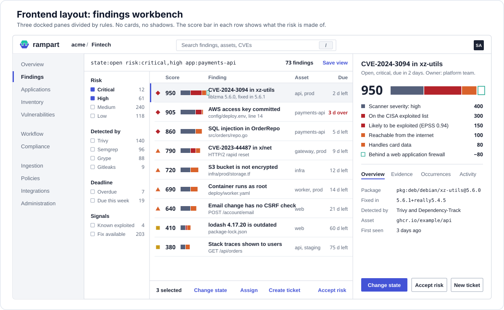

# 13 — Frontend

The web UI is a static single-page application. It holds no secrets and no business logic that the API does not also enforce. It talks to exactly one backend: `query-api` under `/api/v1` (plus `/auth/*` for login). It never calls `ingest-gateway`; a manual report upload from the UI goes through `query-api`, which issues the presigned URL on the user's behalf.



## 1. Stack

| Concern | Choice | Reason |
|---|---|---|
| Framework | React 19 + TypeScript (strict) | ecosystem, hiring |
| Build | Vite; output is static files with hashed names | fast, no server runtime |
| Routing | TanStack Router (typed routes, search params as typed state) | filters live in the URL |
| Server state | TanStack Query | caching, retries, optimistic updates |
| Tables | TanStack Table + TanStack Virtual | 100k-row explorer without DOM bloat |
| Components | Radix primitives for behaviour and accessibility, styled with our own tokens and components (Tailwind as the utility layer). No off-the-shelf theme | the product must not look like a template; see §6 |
| Charts | Apache ECharts (tree-shaken) | trend, heatmap, sankey for code-to-cloud |
| Graph view | React Flow | asset graph, dependency paths |
| API client | `openapi-typescript` + `openapi-fetch`, generated from `/api/v1/openapi.json` in CI | compile error when the API changes |
| Forms and validation | React Hook Form + zod (schemas derived from OpenAPI) | |
| Code editor | CodeMirror 6 with a CEL mode | policy editor, YAML preview of CRDs |
| i18n | `react-i18next`; English first, Arabic in Phase 4; RTL-safe CSS logical properties from the first component | Arabic is a planned first-class locale |
| Tests | Vitest + Testing Library (unit), Playwright (end to end against `-target=all`), Storybook (component catalogue), axe (accessibility) | |

No global client-state library. URL holds view state, TanStack Query holds server state, React context holds session and theme.

## 2. How it is packaged and served

- `web/` is its own workspace, managed with Bun (`bun install`, `bun --bun run build`). The build emits `web/dist`.
- **Monolithic mode**: `web/dist` is embedded in the Go binary with `embed`. `query-api` serves it at `/` with `Cache-Control: immutable` for hashed assets and `no-cache` for `index.html`.
- **Distributed mode**: the same files ship in a tiny static image (`rampart-web`, nginx-unprivileged or Caddy, read-only root filesystem). The Ingress or Gateway routes `/` to it and `/api`, `/auth` to `query-api`. Same origin, so no CORS.
- Runtime configuration comes from `GET /api/v1/ui-config` (public, cacheable): product name, enabled features, login methods, locale defaults, support links. The bundle is identical in every environment.
- Security headers set by whichever server delivers `index.html`: strict `Content-Security-Policy` (`default-src 'self'`; no inline script; `connect-src 'self'`; `frame-ancestors 'none'`), `X-Content-Type-Options`, `Referrer-Policy: same-origin`, HSTS.

## 3. How it talks to the backend

- **Session**: an HttpOnly cookie set by `query-api` after SSO (see [14-sso-and-identity.md](14-sso-and-identity.md)). The SPA never sees a token and stores nothing sensitive in `localStorage`.
- **CSRF**: every mutating request sends `X-CSRF-Token`, read from `GET /auth/session`. Cookie is `SameSite=Lax`.
- **Bootstrap sequence**: `GET /api/v1/ui-config` → `GET /auth/session` (401 → redirect to `/auth/login?return_to=…`) → `GET /api/v1/me/permissions` → render.
- **Permissions**: the UI hides or disables actions from `/me/permissions` (role and scope list). The API still enforces everything; a 403 shows an explanatory toast, never a blank page.
- **Lists**: cursor pagination with infinite scroll in tables; `count=true` only when the user opens the count badge.
- **Filters**: the query grammar from [11-api-design.md](11-api-design.md) is the single filter model. The filter bar builds a `q` string; the same string appears in the URL, in saved views, and can be pasted into the CLI.
- **Mutations**: optimistic update with rollback; `If-Match` version header; on `409` the row refreshes and the user is told what changed.
- **Bulk actions**: `POST /findings/bulk` returns an operation id; a progress toast polls it.
- **Live updates**: one Server-Sent Events stream, `GET /api/v1/stream?topics=ingests,findings,operations`. The server filters events by the caller's RBAC scope and coalesces them to at most one "application X changed" message every few seconds; the client invalidates the matching TanStack Query keys. Falls back to 30 s polling if the stream drops.
- **Exports and reports**: `202` + operation polling, then a signed download link.
- **Errors**: RFC 9457 problem details mapped to inline field errors, toasts, or a full-page error with the `request_id` to quote to support.
- **Deep links**: every entity has a stable URL (`/t/<tenant>/findings/<id>`), used in Jira tickets, Slack messages, and `ReportIngest.status.findingsURL`.

## 4. Information architecture

Top bar: tenant switcher, hierarchy scope picker (business unit filter applied to every page), global search (`/`), command palette (`Ctrl/⌘+K`), notifications, user menu.

Left navigation, in this order:

| Section | Pages |
|---|---|
| **Overview** | Opens with what changed since yesterday (new, reopened, fixed, newly exploited) and the overdue queue. Below: open risk trend with annotations, deadline adherence, applications ranked by risk, coverage gaps. No KPI tile row |
| **Findings** | Explorer (default page for analysts), grouped views (by rule, CVE, component, owner), saved views, bulk triage |
| **Applications** | List with risk and SLA columns → application page with tabs: Summary, Findings, Assets, SBOM, Coverage, Compliance, Activity, Settings |
| **Inventory** | Assets (by type), Components ("where is this package used"), Asset graph (repo → image → workload) |
| **Vulnerabilities** | Vulnerability explorer by CVE with impact across the tenant, KEV and EPSS watchlists |
| **Workflow** | Risk acceptances (requests, approvals, expiring), Tickets, SLA breaches, My work (assigned to me or my teams) |
| **Compliance** | Frameworks (OWASP Top 10, CWE Top 25, PCI DSS, ISO 27001, SSDF, ASVS), per-control status, evidence export |
| **Ingestion** | Ingest runs, Sources (including Dependency-Track: sync state, unmapped projects, mapping editor), Parsers and formats |
| **Policies** | Risk, SLA, Automation (with simulate results), Dedup, Exceptions, Retention |
| **Integrations** | Catalogue (search, support level, what each needs), Connectors (Jira, GitHub, Slack, Dependency-Track …), Webhooks, API tokens. Every connector form is generated from the integration's config schema, so a new integration needs no frontend change |
| **Administration** | Users, Teams, Access bindings, Identity providers, Audit log, Tenant settings, Feeds status |

Objects managed by a CRD show a "Managed by Kubernetes" badge with the namespace/name, are read-only in the UI, and offer "View YAML" and "Copy kubectl command". Objects created in the UI offer "Export as YAML" so teams can move them to GitOps.

## 5. Key screens in detail

### Findings explorer
- Filter bar with token chips and autocomplete for fields and values; free text falls back to full-text search.
- Facet rail on the left: state, risk band, severity, category, scanner, application, environment, owner, KEV, fix available, SLA status, age. Each facet shows counts from `groupBy` aggregates.
- Virtualized table. Default columns: band shape, risk score with its segmented score bar (see §6), title, application, asset, location (file:line or package@version), scanners (icons, with count when correlated), state, SLA due (countdown, red when breached), first seen, owner. Column chooser and density toggle are stored per saved view.
- Row click loads the finding in the docked inspector; `Enter` opens the full page. Keyboard: `j/k` move, `x` select, `s` set state, `a` assign, `t` create ticket, `e` request risk acceptance, `?` help.
- Bulk bar appears on selection: set state, assign, tag, ticket, group, accept risk. "Select all N matching" switches to filter-based bulk.

### Finding detail
- Header: title, risk score and band, state control, SLA countdown, owner, tickets.
- **Why this score**: the full-width score bar and a ledger of factors with points and the fact behind each (on the CISA exploited list since a date, EPSS value, reachable from the internet, …).
- Tabs: Overview (description, remediation, fixed version, references), Evidence (code snippet with highlighted lines, dataflow steps, request/response, dependency path), Occurrences (one row per scanner and run, raw JSON viewer), Vulnerability (CVSS vectors per source, EPSS chart, KEV, CWE, aliases), Related (same CVE elsewhere, same rule in this app, duplicates), Activity (timeline of events, notes with mentions), Compliance (mapped controls).
- State change dialog enforces justification for `not_affected` and expiry for `risk_accepted`.

### Application page
- Summary cards (open by band, risk, SLA adherence, MTTR, last scan per category), trend chart, top findings, owners, business context tags.
- Coverage tab: a matrix of assets × scan categories with last-scan age.
- SBOM tab: components table, licence summary, dependency tree, link to the Dependency-Track project when mapped.

### Dependency-Track source page
- Connection health, DT version, permissions present or missing.
- Counters: discovered, mapped, unmapped projects; last portfolio sync; last webhook event; pending write-backs.
- Unmapped projects table with inline "assign to application" and "create rule from this".
- Mapping rules editor with a live preview of which projects each rule matches.
- Triage sync mode and authority, with a log of the last conflicts.

### Integration catalogue and mapping editor
- Catalogue list with kind, runtime, support level (Core, Verified, Community) and conformance status. Platform admins install; tenant admins enable.
- Mapping editor for declarative parsers: paste or upload a sample report on the left, write the record path and field expressions in the middle, see the canonical findings and record errors on the right, live. Saving creates an `IntegrationPackage`; "Export as YAML" moves it to Git.

### Policy editor
- Form for the common cases, CEL editor with autocomplete and inline evaluation against a sample finding for the rest.
- "Simulate" runs the policy against the last 7 days and shows what would have changed before enabling.

### Ingest run page
- Status timeline (queued → parsing → merging → enriching → done), stats (created, updated, untouched, reactivated, closed), context (commit, branch, image), errors with line references, link to the raw report.

## 6. Visual direction

This is a tool people sit in for hours, sorting a long queue. The design is a **workbench**, and it must not read as a generic dashboard kit. The decisions below are deliberate and binding for the component library.

### What we rejected and why

| Default look | Why it is wrong here | What we do instead |
|---|---|---|
| Content chopped into rounded cards with soft shadows | Cards waste space and hide the fact that the page is one queue | Three docked panes divided by 1 px rules. No shadows, no card containers |
| Coloured pills for every status, tag and filter | Pills make everything shout at the same volume | Plain text for state and tags. Rectangular controls with a 2 px radius. Colour is reserved for risk |
| A row of KPI tiles (big number, small label) on the dashboard | It says nothing about what to do next | The overview opens with "what changed since yesterday" and the overdue queue |
| Brand colour used as decoration, gradient washes | Competes with risk colour | Brand indigo appears only on the selected row, focus, links and the one primary action per view |
| A drawer that slides over the list | Covers the queue you are working through | The inspector is docked; the list stays visible and keyboard-navigable |
| Uppercase tracked labels above every block, dots between metadata | Template chrome | Sentence-case headings; metadata written as short sentences ("Open, critical, due in 2 days.") |

### The signature element: the score bar

Every finding row carries a small segmented bar next to its score. Each segment is one group of risk factors and its length is its points: scanner severity (slate), threat intelligence such as the CISA exploited list and EPSS (red), exposure and business context (orange), and an outlined segment for points removed by compensating controls. The analyst sees *why* a finding ranks where it does without opening it. The inspector repeats the same bar at full width with a ledger of factors and points underneath.

This is the one loud element. It comes from the product's own claim (explainable risk) and echoes the brick courses of a wall. Everything around it stays quiet.

### Tokens

| Role | Light | Dark |
|---|---|---|
| Work surface | `#FFFFFF` | `#141922` |
| Chrome (navigation, selected row) | `#F3F5F8` | `#1C2330` |
| Text | `#1B2233` | `#E7EBF2` |
| Secondary text | `#5B6679` | `#9AA6B8` |
| Rule | `#D5DAE3` | `#2C3545` |
| Interactive (brand indigo) | `#4353D6` | `#8C98FF` |
| Resolved, risk reduced (brand teal) | `#19A38C` | `#2DD4BF` |

Risk bands, each with a shape so colour is never the only signal:

| Band | Colour | Shape |
|---|---|---|
| Critical | `#B4232A` | diamond |
| High | `#D9622B` | triangle |
| Medium | `#C99A1A` | square |
| Low | `#6B7C93` | circle |
| Info | `#A9B4C4` | ring |

Score-bar segments: severity `#55607A`, threat `#B4232A`, context `#D9622B`, reduction outlined `#19A38C`.

### Typography

- **Red Hat Text** for the interface and **Red Hat Display** (800) for the wordmark and page titles. One family, open licence, drawn for cloud consoles, and it ties the product to the logo.
- **Red Hat Mono** only for things that are literally code: the query bar, file paths, package URLs, CVE identifiers in detail views, YAML. Not for ordinary labels or numbers.
- **Noto Sans Arabic** for the Arabic locale, matched by weight.
- Scale: 12, 13, 14, 16, 20, 28 px. Table rows are 13 px with an 11.5 px second line. Scores and counts use tabular figures.
- Sentence case everywhere. No uppercase labels.

### Layout

```
+---------------------------------------------------------------------------+
| mark rampart   acme / Fintech        [ search             / ]          SA |
+---------+-----------------------------------------------+-----------------+
| nav     | query bar (typed filter)        73 findings   | inspector       |
|         +---------+-------------------------------------+ title           |
| Overview| facets  | score  bar   finding      asset due | one-line status |
| Findings| Risk    | 950  ####==  CVE-2024...  api    2d | 950  ########## |
| ...     | Source  | 905  ####=   AWS key ...  pay    3d | factor ledger   |
|         | Due     | ...                                 | tabs            |
|         | Signals +-------------------------------------+ facts           |
|         |         | 3 selected  Change state  Assign .. | actions         |
+---------+---------+-------------------------------------+-----------------+
```

- Top bar 44 px, navigation 170 px (collapsible to icons), facets 156 px, inspector 330 px and resizable. The list takes the rest.
- Row height 46 px (two lines) or 32 px in compact density.
- Everything is left-aligned; numbers that are compared (counts, points, due dates) are right-aligned.
- Navigation has three unlabeled groups separated by space: what you look at, what you act on, what you configure. The current section is marked by a 3 px bar and weight, not a filled pill.
- Responsive down to tablet width by collapsing navigation, then facets into a sheet. On phones the overview, a single finding and approvals work; the list is read-only.

### Motion

None on load. Panes open and close in 120 ms. A row whose state just changed holds a highlight for one second. All of it is disabled under `prefers-reduced-motion`.

### Words

- Actions say what happens: "Change state", "Accept risk until…", "Create Jira ticket". The confirmation uses the same verb: "State changed".
- Name things the way an analyst would: "Detected by", "Due", "Known exploited", not `scanner_family`, `sla_due`, `kev`. The query bar accepts the short technical field names; the facet labels are the plain ones.
- Empty states tell the user what to do: "No findings match. Remove `risk:critical` to see 240 more."
- Errors state what failed and the next step, with the request id. No apologies.

### Quality floor

WCAG 2.1 AA, full keyboard operation, visible 2 px focus ring in brand indigo, contrast checked in CI with axe, light and dark themes from the same tokens, RTL through CSS logical properties from the first component.

## 7. Code organisation

```
web/src/
  app/            router, providers, shell, error boundaries
  routes/         one folder per section (findings, applications, inventory, workflow, compliance, ingestion, policies, integrations, admin)
  features/       feature modules: filter-bar, finding-inspector, score-bar, triage-dialogs, mapping-editor, cel-editor
  components/     design-system primitives (button, table, dialog, badge …)
  api/            generated types and client, query-key factory, SSE client
  lib/            query-grammar parser, formatters, permissions helper, i18n
  styles/         tokens, themes
```

Rules: a route may import features and components; features may not import routes; only `api/` calls the network; query keys come from one factory so SSE invalidation is reliable.

## 8. Performance budgets

| Metric | Budget |
|---|---|
| Initial JS (gzip) | ≤ 250 kB; routes and ECharts, React Flow, CodeMirror are lazy chunks |
| Largest Contentful Paint on the explorer (cold) | ≤ 2.0 s on a mid laptop |
| Explorer filter change to rows rendered | ≤ 500 ms p95 (API ≤ 300 ms) |
| Scrolling 100k rows | 60 fps (virtualized) |

Budgets are checked in CI with Lighthouse CI and a bundle-size check.

## 9. What ships when

- **Phase 1**: shell, login, findings workbench (query bar, facets, table, docked inspector), ingest runs.
- **Phase 2**: triage dialogs, risk waterfall, risk acceptance, application pages, dashboard, compliance views, admin (users, bindings, audit).
- **Phase 3**: integration catalogue and mapping editor, schema-generated connector forms, connectors, Dependency-Track source page and mapping editor, groups and tickets, saved views, exports, SSE.
- **Phase 4**: asset graph, identity providers UI, scheduled reports, Arabic locale completion, MCP settings.

## 10. Status

Built and verified (Phase 0, in `web/`): the shell, the login screen, and the findings workbench structure.

| Area | State |
|---|---|
| Stack | React 19, strict TypeScript, Vite, TanStack Router (typed search params `q`, `sel`, `sort`, `density`), TanStack Query, TanStack Table and Virtual, Radix for menus, dialog, tabs and tooltip, Tailwind v4 on our tokens, react-i18next, Vitest, Testing Library, axe |
| Bootstrap | ui-config, then session (401 shows the login screen), then permissions. The CSRF token lives in memory only. The only thing stored in the browser is the theme |
| Login | One IdP shows "Continue with <name>"; several show a chooser. When the first administrator is usable, a username and password form sits below the single sign-on button as a secondary action (it is the primary one only when it is the sole method); a wrong password, a lock and a disabled account each have plain copy, the field is cleared on failure, and the password is never echoed. The six backend error codes (`invalid_state`, `idp_error`, `email_unverified`, `tenant_not_found`, `no_access`, `internal`) map to plain copy. `return_to` is validated as a same-origin path |
| Workbench | Three docked panes (nav 170 px collapsing to 48, facets 156, inspector 330 and resizable), 44 px top bar, rows 46 or 32 px, the query bar writes `q` and shows term chips, the table fetches `/api/v1/findings` with infinite scroll, empty and no-match states |
| Design | Tokens, band shapes and the segmented score bar as in section 6. No cards, shadows, pills or uppercase labels. Light and dark from the same tokens. Fonts are self-hosted |
| Quality | 51 tests, axe clean on every screen, ESLint and `tsc` clean. Initial JS 211 kB gzipped against the 250 kB budget, checked in CI. CSP-clean: no inline script, no `style=` attribute, no violation in Chromium |
| Verified against the real backend | With Dex (two users with passwords) and PostgreSQL: both sign-in methods are offered; the first administrator signs in; ada (bound to admin) and grace (viewer) sign in through Dex with the right roles; five wrong passwords lock the administrator and refuse even the right one. Original check: open `/`, sign in through Dex, land on the empty workbench with the upload command, session cookie HttpOnly and invisible to JavaScript, `localStorage` empty, reload keeps the session, sign out returns to login |

Not built yet (later phases, per section 9): row selection with `x` and the bulk bar, filter-bar autocomplete, Ctrl+K as a real command palette, the Detected by, Due and Signals facets (they need facet counts from the API), the hierarchy scope picker, notifications, Storybook, Playwright end-to-end tests in CI, Lighthouse CI, the generated OpenAPI client, `count=true`, and `GET /findings/{id}` for the inspector (it reads the loaded list; a deep link to an unloaded finding says so).

Deviations from this document, with reasons:

- **Dark risk colours** are lifted from the light values so each keeps 3:1 against the dark surface. The light values are as specified; light medium (`#C99A1A`) is 2.6:1 on white and info is lower, so the shape and the printed score carry the meaning there.
- **Select** is a styled native `<select>`. Radix Select injects an inline `<style>` that the CSP blocks. Menus and dialogs are non-modal for the same reason; the dialog marks the app root inert and draws its own overlay.
- **The wordmark** is live Red Hat Display 800 text, not outlined paths. The mark itself is the real geometry.
- **API client** is typed by hand from the Go structs until `/api/v1/openapi.json` exists. Only `api/` changes when `openapi-fetch` replaces it.
- **Versions**: Vitest 3, jsdom 26 and Vite 7 (chosen when the toolchain targeted Node 20; they can move up now that Bun is the runner); TypeScript is 5.9 because typescript-eslint does not support 7 yet. Tooling is Bun, run with `bun --bun` so scripts use the Bun runtime.

What the UI asks of the API (not yet provided): application and asset names (or slugs) in the findings list, since `Finding` carries only ids; a `group` on each risk factor so the score bar does not classify by factor name; `count=true`.
