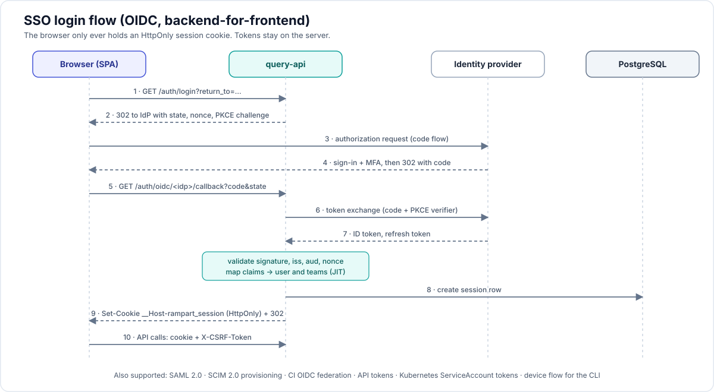

# 14 — SSO and identity

> Corrections from the design review are in [16-implementation-decisions.md](16-implementation-decisions.md) D8 (global users, tenant switching, Phase 1 scope, CLI device login) and D27 (domain claims need approval, subjects qualified by identity provider, tenant allow-list for shared providers, revocation bound).



## 1. What is supported

| Kind | Protocol | Status | Notes |
|---|---|---|---|
| Human login | **OpenID Connect** (Authorization Code + PKCE) | P0 | primary path |
| Human login | **SAML 2.0** (SP-initiated; IdP-initiated optional, off by default) | P1 | for IdPs or organisations without OIDC |
| Provisioning | **SCIM 2.0** (Users, Groups) | P2 | create, update, deactivate, group membership |
| CLI login | OAuth 2.0 Device Authorization Grant (RFC 8628), fallback loopback redirect with PKCE | P0 (Phase 2, D8, D54) | `rampart login` |
| CI pipelines | **OIDC workload federation** (GitHub Actions, GitLab CI, Azure DevOps, CircleCI, Buildkite) | P1 | no stored secret in CI |
| In-cluster callers | Kubernetes ServiceAccount projected tokens, verified against the issuing cluster's OIDC JWKS | P1 | for `ScheduledScan` jobs and sidecars |
| Automation | API tokens (scoped, expiring, hashed) | P0 | |
| MCP clients | OAuth 2.1 authorization code with PKCE against the same IdP | P2 | |
| First administrator and break-glass | one local admin per tenant, bootstrap secret, switches itself off once an IdP is configured unless `keepEnabled` | P0, built | audited, alerting on use. See section 11 |

Identity providers verified by conformance tests or documented setup guides: Okta, Microsoft Entra ID, Google Workspace, Keycloak, Auth0, Ping Identity, OneLogin, JumpCloud, GitLab, Authentik, Zitadel, Dex. GitHub (OAuth without OIDC ID tokens) and LDAP/Active Directory are supported through Dex or Keycloak as a broker; we do not implement LDAP binds ourselves.

Multi-factor authentication, password policy and device posture belong to the IdP. Rampart can require recent authentication (`max_age`) and specific `acr` values for sensitive actions.

## 2. Architecture: backend-for-frontend, no tokens in the browser

`query-api` is the OIDC relying party and SAML service provider. The SPA only ever holds a session cookie.

1. Browser requests `/auth/login?return_to=/t/acme/findings`. `query-api` selects the IdP (§4), creates `state`, `nonce`, PKCE verifier, stores them in a short-lived, encrypted, `__Host-` prefixed cookie, and redirects to the IdP authorization endpoint with `scope=openid profile email groups offline_access` (configurable).
2. IdP authenticates the user (and MFA) and redirects to `/auth/oidc/<idp>/callback?code=…&state=…`.
3. `query-api` checks `state`, exchanges the code with the PKCE verifier (and client secret or `private_key_jwt`), validates the ID token: signature against cached JWKS, `iss`, `aud`, `exp`, `nonce`, optional `hd`/tenant claim.
4. Claims are mapped (§3). The user is created or updated (just-in-time provisioning), team memberships are reconciled from the groups claim, and a session row is written.
5. Response sets `__Host-rampart_session=<opaque 256-bit id>`; `HttpOnly; Secure; SameSite=Lax; Path=/`. Redirect to `return_to` (validated against same-origin paths only).
6. Each API request loads the session (in-process LRU cache, backed by Postgres; Valkey when enabled), sets the tenant, evaluates RBAC.

Session rules:

| Setting | Default |
|---|---|
| Idle timeout | 8 h |
| Absolute lifetime | 24 h |
| Re-validation with IdP | every 15 min via refresh token; failure or disabled user ends the session |
| Concurrent sessions | unlimited; listable and revocable per user |
| Refresh token storage | server side only, envelope-encrypted |
| CSRF | `SameSite=Lax` + `X-CSRF-Token` header on mutating requests, token bound to the session |

Logout: `POST /auth/logout` deletes the session and, when the IdP advertises `end_session_endpoint`, performs RP-initiated logout. OIDC Back-Channel Logout (`/auth/oidc/<idp>/backchannel-logout`) revokes sessions by `sid` or `sub` when the IdP signs the user out. SAML Single Logout is accepted but not required.

`ingest-gateway` has no browser flows. It only validates machine credentials.

## 3. Claim and attribute mapping

| Rampart field | OIDC default | SAML default | Configurable |
|---|---|---|---|
| Subject (stable id) | `iss` + `sub` | `NameID` (persistent) | yes |
| Email | `email` (requires `email_verified` unless disabled) | `email` / `http://schemas.xmlsoap.org/.../emailaddress` | yes |
| Display name | `name` | `displayName` | yes |
| Groups | `groups` | `groups` / `memberOf` | claim name, regex filter, prefix strip |
| Tenant | from login URL or IdP binding; optional claim `rampart_tenant` | same | yes |

Groups become **teams** (`team.external_id`). Roles are never taken from the IdP directly; an `AccessBinding` with `subjects: [{kind: Group, name: payments-devs}]` grants a role on a scope. This keeps authorization auditable in one place and GitOps-managed.

Entra ID specifics: when a user is in more than 200 groups the token carries a `_claim_sources` overage pointer instead of `groups`. The connector then calls Microsoft Graph `getMemberObjects` with the configured application credentials. Group ids are GUIDs; an optional display-name lookup is cached.

Just-in-time provisioning creates the user on first login with no role beyond what group bindings give. `allowedDomains` and `requireGroup` restrict who may log in at all.

## 4. Multiple IdPs and tenant discovery

- A platform may have `ClusterIdentityProvider`s (shared) and each tenant may have its own `IdentityProvider`s.
- Login entry points: `/t/<tenant>/login` (tenant known → its IdPs), or `/login` with an email field that maps the domain to an IdP ("home realm discovery"). A single IdP skips the chooser.
- A user identity is `(issuer, subject)`. The same person arriving from two IdPs is two users unless an admin links them.
- Platform admins authenticate through a `ClusterIdentityProvider` bound to the platform-admin role.

## 5. SAML details

- Implemented in-process (`crewjam/saml`), endpoints `/auth/saml/<idp>/metadata`, `/acs`, `/slo`.
- Requirements: signed assertions (response signature alone is not enough), `AudienceRestriction` match, `NotBefore`/`NotOnOrAfter` with 60 s skew, `InResponseTo` tracking for SP-initiated flows, replay cache for assertion ids, SHA-256 or stronger.
- IdP metadata by URL (refreshed daily) or inline XML. Signing certificate rollover supported through multiple certificates in metadata.
- Encrypted assertions optional; SP key pair from a Secret, rotated by cert-manager.
- After assertion validation the flow joins step 4 of §2.

## 6. SCIM 2.0

- Base `/scim/v2`, bearer token per tenant (`scim` scope), rate limited.
- Resources: `Users` (userName, name, emails, active, externalId), `Groups` (displayName, members, externalId). Supports `filter=userName eq "…"`, pagination, `PATCH` operations, `ServiceProviderConfig`, `Schemas`, `ResourceTypes`.
- `active=false` or `DELETE`: user disabled, sessions and API tokens revoked immediately, ownership of findings kept (shown as inactive owner).
- Group push keeps team membership current between logins; with SCIM on, the groups claim is used only for users SCIM has not provisioned.
- Tested against Okta and Entra ID provisioning clients.

## 7. Configuration (CRD)

```yaml
apiVersion: rampart.aspm.dev/v1alpha1
kind: IdentityProvider
metadata: {name: okta, namespace: team-payments}     # tenant namespace; ClusterIdentityProvider for platform-wide
spec:
  displayName: Okta
  type: oidc                                         # oidc | saml
  oidc:
    issuer: https://acme.okta.com/oauth2/default     # discovery at /.well-known/openid-configuration
    clientId: 0oa1234567
    clientSecretRef: {name: okta-oidc, key: clientSecret}   # or clientAuth: privateKeyJwt + keyRef
    scopes: [openid, profile, email, groups, offline_access]
    claims: {email: email, name: name, groups: groups}
    requireEmailVerified: true
    pkce: S256
    acrValues: []
    backchannelLogout: true
  login:
    emailDomains: [acme.com]                         # home realm discovery
    allowedDomains: [acme.com]
    requireGroup: ""                                 # optional gate
  provisioning:
    jit: true
    groupFilter: "^rampart-.*"
    stripGroupPrefix: "rampart-"
  session: {idleTimeout: 8h, absoluteTimeout: 24h, revalidateInterval: 15m}
status:
  conditions:
    - {type: Ready, status: "True", reason: DiscoveryOK}
  redirectURI: https://rampart.example.com/auth/oidc/okta/callback
  jwksLastFetched: "2026-11-11T08:00:00Z"
  logins24h: 143
```

SAML variant: `spec.type: saml` with `saml: {metadataURL | metadataXML, entityID, nameIDFormat, attributes{email,name,groups}, allowIdPInitiated: false, spKeyPairRef}`; status exposes `acsURL` and `spMetadataURL`.

The operator validates discovery or metadata and reports `Ready=False` with the reason (unreachable issuer, bad secret reference, clock skew). Secrets stay in Kubernetes Secrets; External Secrets Operator can supply them.

## 8. Machine identity

**CI OIDC federation (preferred for pipelines).** The pipeline requests an ID token from its CI provider and sends it as `Authorization: Bearer` to `/ingest/v1`. A `ScanSource` declares what it trusts:

```yaml
spec:
  type: ci
  trust:
    - issuer: https://token.actions.githubusercontent.com
      audience: "rampart:rampart.example.com:acme"   # host and tenant, so a token cannot be replayed elsewhere
      claims:
        repository_owner_id: "1234567"       # immutable ids, not names
        repository_id: ["7654321", "7654322"]
        ref: "refs/heads/*"
    - issuer: https://gitlab.example.com
      audience: "rampart:rampart.example.com:acme"
      claims: {namespace_id: "42", ref_protected: "true"}
```

The gateway verifies signature (JWKS cached per issuer), `aud`, expiry, and claim patterns, then derives upload context (repository, ref, commit, run URL) from the token itself, so a pipeline cannot upload results under another repository's name. The CI token is exchanged once for a 15-minute ingest token; see [16-implementation-decisions.md](16-implementation-decisions.md) D22 for the tenant-in-path rule, replay protection and the mass-close guard.

**API tokens.** Format `rpt_<8-char prefix>_<secret>`; only a SHA-256 hash is stored; scopes `ingest`, `read`, `triage`, `admin`; bound to a source, a user or a service account; mandatory expiry (max set per tenant); last-used tracking; revocation is immediate (cache TTL 30 s).

**Kubernetes.** Pods present a projected ServiceAccount token with the tenant-specific audience; the gateway verifies it against the issuing cluster's OIDC discovery and JWKS, and the source lists allowed `namespace/serviceaccount` pairs. No Kubernetes API access is needed by the gateway.

**Service-to-service.** Targets do not call each other over HTTP in the base design. Where they will (optional `mcp` → `query-api`), they use short-lived internally signed JWTs; a mesh can add mTLS.

## 9. Authorization recap

Authentication yields a principal: user, token, CI workload or service account. Authorization is roles × scopes from [07-enterprise.md](07-enterprise.md) §2: `viewer`, `triager`, `maintainer`, `owner`, `admin`, `platform-admin`, each bound at tenant, hierarchy node or application scope through `AccessBinding` CRs, UI-managed bindings, or SCIM groups. Decisions are evaluated per request, cached for the request, and every denied mutation is written to the audit log.

## 10. Security checklist

- PKCE on every authorization code flow; `state` and `nonce` verified; redirect URIs exact-match.
- ID token signature algorithms allow-listed (RS256, ES256, PS256); `none` and HS* rejected.
- JWKS cached with rotation on unknown `kid`, bounded refetch rate.
- `return_to` restricted to same-origin relative paths.
- Session id rotated at login and at privilege change.
- Cookies use the `__Host-` prefix; no domain-wide cookies.
- Login, token, SCIM and callback endpoints rate limited per IP and per account. (Built for local sign-in: 10 attempts per address per minute and a lock after 5 wrong passwords; OIDC callbacks are protected by `state`.)
- All authentication events in the audit log: login success and failure (with reason), logout, session revocation, token create and revoke, SCIM changes, break-glass use.
- Clock skew tolerance 60 s; the operator reports skew against the IdP `Date` header.

## 11. The first administrator (break-glass)

Single sign-on needs an identity provider, and a fresh installation has none. Like Argo CD's initial admin, Rampart creates one local administrator at first start so that someone can sign in, configure the provider, and hand out roles. It is not a user directory.

- **Created once.** On first start, if `auth.bootstrapAdmin.passwordFile` is set, the account is created in the tenant `auth.bootstrapAdmin.tenant` (default `default`) with the username `auth.bootstrapAdmin.username` (default `admin`) and the role `admin`. The password is read from that file. If the file does not exist, a random 24-character password is generated into it (mode 0600, created exclusively). Helm and Compose generate it into a Secret or `.env` instead. An existing account is never touched on later starts.
- **Never logged.** The password appears nowhere in logs, status or events. The hash is argon2id (64 MiB, 3 passes, 2 lanes, random 16-byte salt), stored as a PHC string.
- **Off when single sign-on is on.** Password sign-in is refused (`403`) once `auth.oidc.issuer` is set, unless `auth.bootstrapAdmin.keepEnabled=true`. `GET /api/v1/ui-config` lists the `password` method only when it is usable, and the UI offers it below the single sign-on button as a secondary action.
- **One endpoint.** `POST /auth/local/login` takes JSON `{tenant?, username, password}` and answers `204` with the session cookie. It accepts only `application/json` (a cross-site form cannot send it), caps the body at 4 KiB and the password at 1024 characters, and answers `401` with the same body for a wrong password and for an unknown user, doing the same amount of work in both cases.
- **Guessing is slowed twice.** 10 attempts per client address per minute (`429` with `Retry-After`), and a lock in the database after 5 consecutive wrong passwords for 15 minutes. The counter is updated in one SQL statement, so simultaneous guesses cannot slip past it, and a locked account refuses even the right password. A success resets the counter.
- **Audited and visible.** Every attempt writes `audit_event` rows (`local_login_success`, `local_login_failed` with the reason, `local_login_locked`) with the address and the request id. A successful sign-in and a lock are also logged at WARN, so the "alerting on use" of section 1 is a log or metric rule (`rampart_auth_logins_total{method="local",result=...}`).
- **Recovery.** `rampart admin set-password [--tenant] [--username]` reads the new password from standard input or `--password-file` (never from the command line, which would show in process listings), connects as `rampart_system`, replaces the hash, clears any lock, and ends every session of the account. It works when nobody can sign in. Minimum length is 12 characters.
- **Removing it.** Delete the person's membership in the tenant or disable the person: the session lookup joins both, so the account stops working immediately. Deleting the Secret alone does not remove an account that already exists.
- **What it is not.** There are no other local users, no self-service password change, no password reset by e-mail and no MFA in Rampart. Those belong to the identity provider (section 1). For a small installation without a corporate provider, run Dex with `staticPasswords` (the Compose quick start does) or Keycloak.
