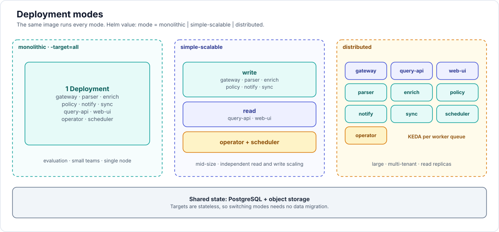

# 15 — Cloud-native tour

How the platform behaves as a Kubernetes workload, target by target, and which cloud-native building blocks it relies on.

## 1. Twelve-factor checklist

| Factor | How |
|---|---|
| Codebase | one repo, one binary, one image |
| Dependencies | Go modules, vendored SBOM; no runtime package installs |
| Config | env, flags, mounted file (koanf); declarative config through CRDs |
| Backing services | Postgres, S3, Valkey, NATS addressed by URL and Secret; swappable |
| Build, release, run | ko image → Helm chart (OCI) → Deployment; immutable tags and digests |
| Processes | stateless targets; all state in Postgres and object storage |
| Port binding | each target binds its own HTTP port; no sidecar required |
| Concurrency | scale by adding replicas per target; KEDA for workers |
| Disposability | fast start (< 2 s), graceful shutdown, idempotent jobs |
| Dev/prod parity | `-target=all` uses the same code paths as distributed mode |
| Logs | JSON to stdout, trace-correlated |
| Admin processes | `rampart migrate`, `rampart feeds`, as Jobs from the same image |

## 2. Kubernetes objects per target

| Target | Kind | Replicas (distributed) | Autoscaling | PDB | Notes |
|---|---|---|---|---|---|
| `ingest-gateway` | Deployment + Service | 2+ | HPA on CPU and RPS | minAvailable 1 | public route `/ingest`, `/hooks`, `/api/v2` shim |
| `query-api` | Deployment + Service | 2+ | HPA on CPU and RPS | minAvailable 1 | routes `/api`, `/auth`, `/scim`; uses CNPG `-ro` for reads where safe |
| `web-ui` | Deployment + Service | 2 | HPA on CPU | minAvailable 1 | static files, read-only root filesystem |
| `parser` | Deployment | 1–N | KEDA on `parse` queue depth and age | maxUnavailable 50% | CPU-heavy; memory bounded by batch size |
| `enrich` | Deployment | 1–N | KEDA on `enrich` queue | — | egress to feed mirrors only |
| `policy` | Deployment | 1–N | KEDA on `policy` queue | — | maintains read models |
| `notify` | Deployment | 1–N | KEDA on `notify` queue | — | egress to ticketing and chat |
| `sync` | Deployment | 1–N | KEDA on `dtrack-sync`, `dtrack-push` | — | egress to Dependency-Track and other upstreams |
| `operator` | Deployment | 2 (leader election) | none | minAvailable 1 | only target with a Kubernetes API ClusterRole |
| `scheduler` | Deployment | 2 (leader election) | none | — | River periodic jobs; could be folded into `policy` in small installs |
| migrations | plain Job on install (waits for the database), `pre-upgrade` hook on upgrade; every target has an init container `rampart migrate wait` | — | — | — | `rampart migrate up` |
| feed bootstrap | Job (optional) | — | — | — | first-time feed load, air-gap import |

Workers may scale to zero with KEDA when queues are empty; gateway, query-api and operator never do.

## 3. Pod specification baseline

Every pod:

- Image by digest, `distroless/static:nonroot`, multi-arch (amd64, arm64).
- `securityContext`: `runAsNonRoot`, `runAsUser: 65532`, `readOnlyRootFilesystem`, `allowPrivilegeEscalation: false`, `capabilities: drop [ALL]`, `seccompProfile: RuntimeDefault`. Passes the **restricted** Pod Security Standard; namespaces are labelled `pod-security.kubernetes.io/enforce: restricted`.
- `emptyDir` (size-limited) at `/tmp` for parser spill files.
- Requests and limits set; memory limit equals request for workers (predictable OOM behaviour); `GOMEMLIMIT` set to 90% of the limit and `GOMAXPROCS` from the CPU limit.
- `topologySpreadConstraints` across zones and nodes for replicated targets; anti-affinity soft.
- `terminationGracePeriodSeconds`: 30 for HTTP targets, 120 for workers.
- Dedicated ServiceAccount per target with `automountServiceAccountToken: false`, except the operator and targets that use workload identity.

Indicative sizing (starting points, tuned by load tests):

| Target | CPU request | Memory | Comment |
|---|---|---|---|
| gateway, query-api | 250m | 256Mi | per replica |
| parser | 1 | 1Gi | one report at a time per worker slot, 4 slots |
| enrich, policy, notify, sync | 250m | 256Mi | |
| operator, scheduler | 100m | 128Mi | |
| monolithic (`all`) | 1 | 1Gi | evaluation |

## 4. Health, lifecycle, shutdown

- `/healthz` (liveness): process alive, no dependency checks.
- `/readyz` (readiness): Postgres reachable, migrations at expected version, object storage reachable (gateway, parser), leader status not required.
- `startupProbe` covers migration wait on first start.
- On `SIGTERM`: readiness goes false, HTTP servers stop accepting and drain for up to 25 s; River workers stop fetching, finish or snooze running jobs within the grace period; unfinished jobs are picked up again because they are idempotent and keyed.
- `preStop` sleep of 5 s on HTTP targets so the endpoint is removed from load balancers before drain.

## 5. Networking

- **Gateway API** `HTTPRoute`s (preferred) or `Ingress`. Path split on one hostname: `/ingest`, `/hooks`, `/api/v2` → gateway; `/api`, `/auth`, `/scim` → query-api; `/` → web-ui. Same origin keeps the cookie model simple.
- TLS from **cert-manager**; HSTS at the edge.
- Request body limits: 32 MB on `/ingest/v1/reports`; large files go to object storage through presigned URLs and never traverse the gateway.
- **NetworkPolicy** default-deny in the namespace, then allow-lists:

| From | To | Why |
|---|---|---|
| ingress controller | gateway, query-api, web-ui | user and CI traffic |
| all targets | Postgres (5432) | data |
| gateway, parser, query-api, sync | object storage | reports and exports |
| enrich | feed mirrors or internet (443) | vulnerability intelligence |
| notify | ticketing and chat endpoints | integrations |
| sync | Dependency-Track API | upstream |
| operator | Kubernetes API; connector, Dependency-Track and IdP endpoints | reconcile and validation probes |
| KEDA | Postgres (read-only role on a queue-depth view) | scaling |
| Prometheus | all targets `/metrics` | scraping |

  In air-gapped mode the `enrich` egress rule points only at the internal mirror. The chart renders this for the monolithic install as `networkPolicy.*` (docs/16 D49).
- A service mesh is optional. The design needs no east-west HTTP between targets, so mTLS matters mainly for Postgres (TLS enforced by CNPG) and object storage.

## 6. Data services

- **PostgreSQL** through **CloudNativePG**: `Cluster` with 3 instances across zones, synchronous replica optional, `-rw` and `-ro` Services, `Pooler` (PgBouncer, transaction mode), Barman backups to object storage, point-in-time recovery, `ScheduledBackup`, monitored by its PodMonitor. An external managed Postgres (RDS, Cloud SQL, AlloyDB, Azure Flexible Server) is supported by URL; required extensions: `ltree`, `pg_trgm`, `btree_gin`.
- **Object storage**: any S3 API. Buckets: `raw` (reports), `exports`, `backups`. Raw reports are removed by the retention sweep, not by lifecycle rules (D53). Access by **workload identity** (IRSA on EKS, Workload Identity on GKE, Azure Workload Identity) so no static keys; static keys from a Secret remain possible for SeaweedFS and other self-hosted stores.
- **Valkey** (optional): rate limits, session cache, bloom filters. Absent → in-process and Postgres fallbacks.
- **NATS JetStream** (optional): outbound event fan-out.

## 7. Secrets and configuration

- Application secrets are Kubernetes Secrets referenced by name from CRDs. Recommended source: **External Secrets Operator** or the Secrets Store CSI driver backed by Vault, AWS Secrets Manager, GCP Secret Manager, Azure Key Vault.
- The operator is the only reader of Secrets, restricted to tenant namespaces, and stores referenced material encrypted in `secret_material` for the other targets ([16-implementation-decisions.md](16-implementation-decisions.md) D1 lists its exact RBAC).
- Secret rotation: connectors re-read on change (watch); database credentials through CNPG-managed Secrets with rolling restart.
- Envelope encryption key for the few server-side encrypted fields (refresh tokens) comes from a KMS or a mounted key file.
- ConfigMap holds non-secret config; a checksum annotation rolls pods on change.

## 8. Operator and CRD lifecycle

- kubebuilder v4, controller-runtime; one controller per kind; idempotent reconcile; conditions with `observedGeneration`; finalizers only where external cleanup exists.
- Least-privilege RBAC generated by controller-gen: cluster-wide read on its own CRDs and namespaces; namespaced write on status; Secret read restricted as above; `Job`/`CronJob` create only when the `ScheduledScan` module is on.
- Validation by OpenAPI schema and CEL; no admission webhook in `v1alpha1`, therefore no webhook certificate to manage and no availability coupling with the API server.
- Informer caches restricted by label selector; Secrets watched metadata-only.
- CRDs ship in the chart's `crds/` directory and as a separate `rampart-crds` chart, because Helm does not upgrade CRDs in `crds/`.
- Status writes use server-side apply with field manager `rampart-operator` and are throttled to one per object per 5 minutes except on condition changes. API uploads create no custom resources.
- Multi-cluster: the operator runs in the management cluster; managed clusters are reached through kubeconfig Secrets or workload identity, watch-only, with a per-cluster informer factory and backoff.

## 9. Autoscaling

- **HPA** (autoscaling/v2) for HTTP targets: CPU 70% plus RPS from Prometheus Adapter or Gateway metrics.
- **KEDA** `ScaledObject` for workers with the PostgreSQL scaler, for example `select count(*) from river.river_job where queue='parse' and state='available'` with target 5 per replica, plus a trigger on oldest job age so long reports do not starve. `minReplicaCount: 0` allowed, `cooldownPeriod: 300`.
- **Backpressure**: the gateway returns `429` with `Retry-After` when the tenant's queued bytes or run count exceed quota; per-tenant fairness in job fetch order prevents one tenant from monopolising parsers.
- **VPA** in recommendation mode to tune requests.

## 10. Observability

- **OpenTelemetry** SDK in every target; OTLP to a collector. A trace spans upload → parse → merge → enrich → policy → notify, linked through job metadata.
- **Prometheus** metrics on the separate ops port (`:9090`, never routed through the Gateway), with `ServiceMonitor`/`PodMonitor` objects in the chart. RED metrics per route, job metrics per queue, domain metrics (`rampart_findings_open`, `rampart_sla_breaches_total`, `rampart_ingest_run_duration_seconds`, `rampart_dtrack_lag_seconds`), controller-runtime metrics.
- **Logs**: `slog` JSON, fields `tenant`, `trace_id`, `ingest_run_id`, `request_id`; no finding payloads at info level.
- **Dashboards and alerts** shipped as ConfigMaps and `PrometheusRule`: queue age, failed ingests, feed staleness, connector degraded, Postgres replication lag, certificate expiry, operator reconcile errors.
- **SLOs**: ingestion (99% of reports under 100 MB processed within 5 minutes), query (99% of explorer queries under 1 s), availability 99.9% for gateway and query-api.

## 11. Delivery and GitOps

- Artifacts: image and Helm chart as OCI artifacts, signed with cosign (keyless), SBOM and SLSA provenance attached. A sample Kyverno or Sigstore policy-controller rule verifies them at admission.
- Install: `helm install rampart oci://…/charts/rampart --set mode=monolithic`. Values schema (`values.schema.json`) validates input. The notes printed at the end say where the first administrator's password is (the Secret `<release>-admin`, generated once and kept across upgrades); sign in with it, configure single sign-on (`auth.oidc.*`), and the account switches itself off unless `auth.bootstrapAdmin.keepEnabled` is set (doc 14 section 11). The same install brings its own PostgreSQL (CloudNativePG, role passwords generated into Secrets), SeaweedFS, the CRDs, the operator's RBAC and the migration Job.
- GitOps: Argo CD or Flux manage the chart and all Rampart CRs (applications, sources, policies, connectors, identity providers). Custom health checks for Argo CD read the `Ready` condition.
- Upgrades: migration Job first (expand), rolling update of targets, later release contracts the schema. One minor version of skew is supported, so rollback is `helm rollback` without restoring the database.
- Canary: gateway and query-api can be progressively delivered (Argo Rollouts) because they are stateless and backward compatible within a minor.
- OpenShift: runs under the restricted-v2 SCC; optional OLM bundle; Routes instead of Ingress.

## 12. Resilience and disaster recovery

| Failure | Effect | Recovery |
|---|---|---|
| Worker pod dies mid-job | job returns to queue after its timeout | automatic, idempotent |
| Gateway pod dies during upload | client retries with the same Idempotency-Key | automatic |
| Postgres primary fails | CNPG promotes a replica (seconds) | automatic; clients reconnect through the Service |
| Object storage unavailable | uploads fail fast with `503`; parsing snoozes | automatic on return |
| Zone outage | replicas in other zones serve; CNPG fails over | automatic if 3 zones |
| Cluster loss | restore CNPG from Barman to a new cluster, re-point bucket, `helm install`, re-apply CRs from Git | RPO ≤ 5 min (WAL archiving), RTO target 1 h |
| Upstream (Dependency-Track, Jira) down | circuit breaker, connector `Degraded`, queues grow | automatic on return |
| Operator down | no config changes applied; data plane continues | restart; reconcile catches up |

Raw reports are inputs that can be re-uploaded, so the `raw` bucket may be excluded from cross-region replication to save cost. CRs are in Git, so etcd is not a backup concern for Rampart.

## 13. Multi-tenancy on the cluster

- A tenant owns one or more namespaces, listed in its `Tenant` resource; they hold that tenant's CRs and Secrets. Teams inside a tenant can be separated with ordinary Kubernetes RBAC.
- Kubernetes RBAC: tenant admins get a Role in their namespace to manage Rampart CRs; they cannot see other tenants' namespaces.
- The Rampart workloads run in a system namespace (`rampart-system`) and are shared; isolation of data is enforced in Postgres (RLS), not by separate pods. A dedicated data plane per tenant is a deployment option (one release per tenant) for strict isolation.

## 14. Cost and footprint

- Smallest useful install: one `all` pod, one Postgres instance, SeaweedFS standalone: about 2 vCPU and 4 GiB.
- Workers scale to zero; parsers are the only CPU-heavy part and are bursty.
- Occurrence partitions and raw reports are the storage drivers; both are bounded by retention.
- arm64 images allow cheaper nodes.

## 15. Cloud portability

| Need | AWS | GCP | Azure | On-prem / air-gapped |
|---|---|---|---|---|
| Kubernetes | EKS | GKE | AKS | any conformant 1.29+, OpenShift 4.16+ |
| Postgres | CNPG or RDS/Aurora | CNPG or Cloud SQL/AlloyDB | CNPG or Flexible Server | CNPG |
| Object storage | S3 | GCS (S3 interop) | Blob via an S3 gateway (for example SeaweedFS) | SeaweedFS, Ceph RGW, Garage |
| Workload identity | IRSA / Pod Identity | Workload Identity | Azure Workload Identity | static keys in Secrets |
| Secrets | Secrets Manager via ESO | Secret Manager via ESO | Key Vault via ESO | Vault via ESO |
| Ingress | ALB or Gateway API | GKE Gateway | AGIC or Gateway API | NGINX, Envoy Gateway, HAProxy |

No cloud-specific API is called by application code except the S3 protocol.
