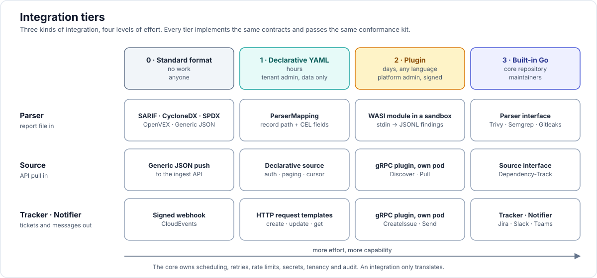

# 19 — Integration SDK

How integrations are added without changing the core, so the catalogue can grow from about 20 to hundreds.



## 1. The problem

"Integration" means three different things, and the first design only gave one of them an extension point:

| Kind | Direction | Examples | Before this document |
|---|---|---|---|
| **Parser** | report file in | Trivy JSON, a vendor's XML export | Go interface, compiled in. `ParserMapping` deferred past v1.0 |
| **Source** | API pull in | SonarQube, Snyk, GitHub Code Scanning, Dependency-Track | each one hand-written, no shared shape |
| **Tracker / Notifier** | tickets and messages out | Jira, GitHub Issues, Slack, Teams | hand-written, plus one generic webhook |

Every new tool needed a change to the core repository and a release. That caps the catalogue at whatever the core team can write.

## 2. Four tiers

Each kind can be added at four levels of effort. A tier is chosen by what the integration needs, not by who writes it.

| Tier | What you write | Who can add it | Runs in | Use when |
|---|---|---|---|---|
| **0. Standard format** | nothing | anyone | `parser` | the tool emits SARIF, CycloneDX, SPDX, OpenVEX, CSAF, or can be scripted to emit Generic JSON |
| **1. Declarative** | a YAML definition | tenant admin (data only) | `parser`, `sync`, `notify` | the format is regular: records at a path, fields to map, an HTTP API with standard paging, a ticket created by one REST call |
| **2. Plugin** | a small program in any language | platform admin (signed package) | sandbox inside `parser` (WASM) or a separate pod (gRPC) | logic the YAML cannot express: multi-pass parsing, binary formats, unusual auth, stateful APIs |
| **3. Built-in** | Go, in the core repository | maintainers | the owning target | first-class integrations that need deep coupling (Dependency-Track, Jira) |

All four tiers implement the same contracts (§3), produce the same canonical data, and pass the same conformance kit (§9). The core treats tiers 1 and 2 as untrusted input.

## 3. Contracts

One set of Go interfaces in `internal/integrations`. Built-in integrations implement them directly; the declarative engines and plugin hosts are adapters that implement them on behalf of a definition or a plugin.

```go
// Every integration describes itself.
type Descriptor struct {
    ID           string            // "sonarqube", "acme-scanner"
    Kinds        []Kind            // parser | source | tracker | notifier
    Version      string            // semver of the integration
    ConfigSchema json.RawMessage   // JSON Schema: drives CRD validation and the UI form
    Secrets      []SecretSpec      // named secrets it needs
    Egress       []string          // host patterns it may call
    Capabilities []Capability      // see below
}

// Reports in (unchanged from 05 §2).
type Parser interface {
    Detect(head []byte, hint Hint) int
    Parse(ctx context.Context, r io.Reader, pc ParseContext) iter.Seq2[RawFinding, error]
}

// API pull in.
type Source interface {
    Check(ctx context.Context, cfg Config) error                                  // credentials and permissions probe
    Discover(ctx context.Context, cfg Config) iter.Seq2[UpstreamProject, error]   // projects, repos, apps
    Pull(ctx context.Context, cfg Config, p UpstreamProject, cur Cursor) (iter.Seq2[RawFinding, error], Cursor)
}
type EventReceiver interface {   // optional: inbound webhook as a trigger
    ParseEvent(r *http.Request, cfg Config) ([]UpstreamProjectRef, error)
}
type TriageWriter interface {    // optional: push decisions upstream
    PushTriage(ctx context.Context, cfg Config, d TriageDecision) error
}

// Tickets out.
type Tracker interface {
    Check(ctx context.Context, cfg Config) error
    Create(ctx context.Context, cfg Config, d IssueDraft) (IssueRef, error)
    Update(ctx context.Context, cfg Config, ref IssueRef, d IssueDraft) error
    Get(ctx context.Context, cfg Config, refs []IssueRef) ([]IssueState, error)   // polled status sync
}
type IssueEventReceiver interface {  // optional: webhook status sync
    ParseEvent(r *http.Request, cfg Config) ([]IssueState, error)
}

// Messages out.
type Notifier interface {
    Check(ctx context.Context, cfg Config) error
    Send(ctx context.Context, cfg Config, m Message) error
}
```

Rules that hold for every implementation:

- The core owns scheduling, retries, rate limiting, circuit breaking, cursors, deduplication, secrets, tenancy and audit. An integration only translates.
- A `Source` returns `RawFinding`s. They enter the same staging, merge and close pipeline as an uploaded report, with the same scope rules ([16](16-implementation-decisions.md) D13). A source never writes findings itself.
- `IssueState` carries the external status and resolution only. Mapping a resolution to a Rampart state creates a request that follows the approval workflow (D27).
- `Check` must be side-effect free and finish in 10 seconds.
- Capabilities are declared, not discovered: `incremental`, `events`, `triage_write`, `status_poll`, `status_webhook`, `attachments`, `rich_text`. The UI and policies only offer what is declared.

Canonical data crossing the boundary is defined once as JSON Schema, published and versioned (`schemas/rawfinding.v1.json`, `issuedraft.v1.json`, `message.v1.json`, `upstreamproject.v1.json`). Tier 1 and tier 2 integrations exchange exactly these documents.

## 4. Tier 1: declarative parser (`ParserMapping`)

A mapping describes where records are and how each field is derived. Paths select; CEL computes. CEL is already the policy language, is sandboxed and cost-bounded.

```yaml
apiVersion: rampart.aspm.dev/v1alpha1
kind: IntegrationPackage
metadata: {name: pip-audit}
spec:
  kind: parser
  runtime: mapping
  version: 1.0.0
  family: pip-audit                    # scanner_family; fixes the fingerprint class
  category: sca
  detect:
    filenames: ["pip-audit*.json"]
    probes:                            # cheap checks on the first 64 KiB
      - jsonHasKeys: [dependencies, fixes]
  input:
    format: json                       # json | jsonl | csv | xml | yaml
    records: $.dependencies[*].vulns[*]   # one record per vulnerability
    parent: dep                        # name for the enclosing dependency object
  map:
    ruleId:        rec.id
    title:         'rec.id + " in " + dep.name'
    description:   rec.description
    vulnIds:       '[rec.id] + rec.aliases'
    severity:      '"unknown"'         # left to enrichment
    location:
      package:
        purl:             '"pkg:pypi/" + dep.name.lowerAscii() + "@" + dep.version'
        installedVersion: dep.version
        fixedVersion:     'size(rec.fix_versions) > 0 ? rec.fix_versions[0] : ""'
    toolRecordId:  'dep.name + "@" + dep.version + ":" + rec.id'
  severityMap: {}                      # tool value → critical|high|medium|low|info
  limits: {maxRecords: 500000, maxDepth: 64}
  tests:
    - input: testdata/pip-audit-2.7.json
      expect: testdata/pip-audit-2.7.golden.jsonl
```

Engine behaviour:

- JSON and JSONL are streamed: the engine walks to the `records` path and decodes one record at a time, so memory is bounded by record size. CSV is streamed by row. XML is converted element by element to the same tree model (attributes as `@name`, text as `#text`), with entity expansion disabled.
- `records` supports nested arrays (`[*]`) with named parents, so a vulnerability inside a dependency inside a target can reach all three levels.
- Every `map` value is a CEL expression over `rec`, the named parents, `doc` (top-level scalars only, read once) and `ctx` (upload context). Helper functions: `lowerAscii`, `trim`, `split`, `regexExtract`, `parseCvss`, `toInt`, `firstNonEmpty`, `sha256`.
- A missing field evaluates to empty, never to an error. Record-level errors are counted and reported in the run (`record_errors`), which also blocks the close step (D13).
- `family` and `category` choose the default fingerprint fields (D11). A mapping may not define its own hashing; it may only pick a class or supply `toolRecordId`.
- Changing a mapping in a way that alters fingerprints requires a version bump. The previous version stays loadable for one retention period and old keys resolve through `finding_key_alias`, so triage is not lost.

What a mapping cannot do, by design: loops beyond the record path, cross-record state, multiple input files, binary formats, network access. Those need tier 2.

A tenant admin may create a namespaced mapping (it is data, evaluated with a CEL cost budget). It is visible only to that tenant.

## 5. Tier 1: declarative source (API pull)

For REST APIs with ordinary authentication and paging. The definition describes requests; the result of each request is handed to a parser mapping.

```yaml
kind: IntegrationPackage
metadata: {name: sonarqube}
spec:
  kind: source
  runtime: declarative
  version: 1.0.0
  family: sonarqube
  configSchema:
    type: object
    required: [url]
    properties:
      url: {type: string, format: uri}
      projectFilter: {type: string}
  secrets: [{name: token}]
  egress: ["{{ config.url | host }}"]
  auth: {type: bearer, token: "{{ secrets.token }}"}        # bearer | basic | header | oauth2ClientCredentials
  check: {request: {path: /api/authentication/validate}, expect: 'body.valid == true'}
  discover:
    request: {path: /api/components/search, params: {qualifiers: TRK, q: "{{ config.projectFilter }}"}}
    paging: {type: page, pageParam: p, sizeParam: ps, size: 500, total: $.paging.total}
    records: $.components[*]
    project: {id: rec.key, name: rec.name}
  pull:
    request:
      path: /api/issues/search
      params: {componentKeys: "{{ project.id }}", types: VULNERABILITY, resolved: "false"}
    paging: {type: page, pageParam: p, sizeParam: ps, size: 500, total: $.paging.total}
    incremental: {param: createdAfter, cursorFrom: 'rec.updateDate', format: rfc3339}   # optional
    mapping:
      records: $.issues[*]
      category: sast
      map:
        ruleId:       rec.rule
        title:        rec.message
        severity:     rec.severity
        toolRecordId: rec.key
        location: {code: {file: 'rec.component.split(":")[1]', startLine: 'rec.line'}}
      severityMap: {BLOCKER: critical, CRITICAL: high, MAJOR: medium, MINOR: low, INFO: info}
  limits: {requestsPerSecond: 5, concurrency: 2, timeout: 30s}
```

- Paging types: `page`, `offset`, `cursor` (next token from a path), `linkHeader`.
- Templating in requests is restricted to `config`, `secrets`, `project`, `cursor`; no arbitrary code.
- The engine enforces `egress`: a request to a host outside the declared patterns is refused. Redirects to other hosts are not followed.
- A full pull is one ingest run per project, so reimport-close works. An incremental pull never closes; a periodic full pull does.
- The `sync` target executes these with the same queues, backoff and circuit breaker as built-in sources.

## 6. Tier 1: declarative tracker and notifier

Outbound integrations that are one or two HTTP calls.

```yaml
kind: IntegrationPackage
metadata: {name: google-chat}
spec:
  kind: notifier
  runtime: declarative
  version: 1.0.0
  secrets: [{name: webhookUrl}]
  egress: ["chat.googleapis.com"]
  send:
    request:
      method: POST
      url: "{{ secrets.webhookUrl }}"
      json:
        text: "*{{ message.title }}*\n{{ message.summary }}\n<{{ message.url }}|Open in Rampart>"
    expect: 'status == 200'
---
kind: IntegrationPackage
metadata: {name: redmine}
spec:
  kind: tracker
  runtime: declarative
  version: 1.0.0
  configSchema: {type: object, required: [url, projectId], properties: {url: {type: string}, projectId: {type: integer}, trackerId: {type: integer}}}
  secrets: [{name: apiKey}]
  egress: ["{{ config.url | host }}"]
  auth: {type: header, name: X-Redmine-API-Key, value: "{{ secrets.apiKey }}"}
  capabilities: [status_poll]
  create:
    request:
      method: POST
      path: /issues.json
      json: {issue: {project_id: "{{ config.projectId }}", tracker_id: "{{ config.trackerId }}", subject: "{{ issue.title }}", description: "{{ issue.body }}", priority_id: "{{ issue.priority | map(config.priorityMap) }}"}}
    result: {key: 'string(body.issue.id)', url: 'config.url + "/issues/" + string(body.issue.id)'}
  update:
    request: {method: PUT, path: "/issues/{{ ref.key }}.json", json: {issue: {notes: "{{ issue.comment }}"}}}
  get:
    request: {path: "/issues/{{ ref.key }}.json"}
    result: {status: body.issue.status.name, closed: 'body.issue.status.is_closed'}
```

- `message` and `issue` are the canonical `Message` and `IssueDraft` documents; the same content the built-in Jira and Slack connectors receive.
- Body templates are rendered with a small, logic-free template language with escaping per content type (JSON, form, plain). No loops over findings beyond the provided `message.items` list.
- Status sync by polling (`get`) is supported declaratively. Webhook status sync needs signature verification and is tier 2 or 3.
- The generic signed webhook and CloudEvents output remain for systems that prefer to receive and interpret events themselves.

## 7. Tier 2: plugins

Two runtimes, chosen by what the plugin needs.

### Parser plugins: WebAssembly (WASI)

A parser is a pure function from bytes to findings and handles untrusted files, so it runs in a sandbox with no file system and no network.

- **Contract**: a WASI program. The report arrives on `stdin`. The plugin writes one canonical `RawFinding` JSON document per line to `stdout`, logs to `stderr`, and exits `0` on success. The upload context is passed as the environment variable `RAMPART_CONTEXT` (JSON). A line beginning with `{"error":` reports a record error.
- **Languages**: anything that compiles to WASI: Go (`GOOS=wasip1`), TinyGo, Rust, Zig, C.
- **Host**: `wazero` (pure Go, no CGO) inside the `parser` target. Per run: memory cap (default 256 MiB), wall-clock limit, output size cap, no clocks beyond monotonic time, no random beyond a seeded source. The compiled module is cached per package version.
- **Detection** stays declarative in the package manifest (`detect.filenames`, `detect.probes`), so no plugin code runs just to decide whether a file is its own.
- The host validates every emitted line against the `RawFinding` schema. Invalid lines count as record errors.

```go
// A complete parser plugin in Go.
func main() {
    dec := json.NewDecoder(os.Stdin)
    enc := json.NewEncoder(os.Stdout)
    var doc acmeReport
    if err := dec.Decode(&doc); err != nil { fmt.Fprintln(os.Stderr, err); os.Exit(1) }
    for _, i := range doc.Issues {
        enc.Encode(sdk.RawFinding{RuleID: i.Check, Title: i.Summary, Severity: sdk.Severity(i.Level),
            Location: sdk.Location{Code: &sdk.Code{File: i.Path, StartLine: i.Line}}})
    }
}
```

### Source, tracker and notifier plugins: gRPC

These need network access and credentials, so they run as their own workload with their own identity and NetworkPolicy, not inside a core process.

- **Contract**: the `rampart.plugin.v1` service (Connect/gRPC over HTTP/2) with one RPC per interface method in §3: `Describe`, `Check`, `Discover` (server stream), `Pull` (server stream), `PushTriage`, `ParseEvent`, `CreateIssue`, `UpdateIssue`, `GetIssues`, `Send`.
- **Deployment**: a Deployment and Service in the platform namespace, installed by its own Helm chart or by the package. The core calls it; the plugin never calls the core and has no database access.
- **Credentials**: the core sends the connector's configuration and decrypted secrets with each call, over mTLS. The plugin stores nothing. A plugin only ever sees the secrets of connectors of its own type.
- **Egress**: the package manifest lists allowed hosts; the chart renders a NetworkPolicy from it.
- **Trust**: responses are size-limited, schema-validated and treated as untrusted. A plugin cannot choose the tenant, asset or scope of what it returns; the core assigns those from the connector that made the call.
- SDKs: Go first (`rampart-plugin-sdk-go`, a server skeleton plus test harness), then Python and TypeScript generated from the protobuf definitions.

### Packaging and installation

```yaml
apiVersion: rampart.aspm.dev/v1alpha1
kind: ClusterIntegrationPackage
metadata: {name: acme-scanner}
spec:
  source:
    oci: ghcr.io/acme/rampart-acme-scanner:1.2.0     # OCI artifact: manifest + wasm module or definition + fixtures
    verify:
      cosign: {issuer: https://token.actions.githubusercontent.com, subject: "https://github.com/acme/rampart-acme-scanner/.github/workflows/release.yml@refs/tags/v1.2.0"}
  tenants: ["*"]                                     # or a list
status:
  conditions: [{type: Ready, status: "True", reason: Verified}]
  kind: parser
  runtime: wasm
  version: 1.2.0
  digest: sha256:…
  conformance: passed
```

- One CRD, two scopes. `ClusterIntegrationPackage` (platform admin) may use any runtime. Namespaced `IntegrationPackage` (tenant admin) is limited to `runtime: mapping` and `runtime: declarative`, because those are data.
- A package is an OCI artifact containing `integration.yaml` (the manifest: descriptor, detection, runtime), the definition or module, and its test fixtures. Signature verification with cosign is mandatory for `wasm` and `grpc`.
- The operator pulls, verifies, runs the bundled conformance tests in the sandbox, stores the artifact in object storage and registers it. `parser`, `sync` and `notify` load definitions from the database and modules from object storage; no restart is needed.
- Using an installed integration: `ScanSource.spec.scannerFamily: acme-scanner`, or `Connector.spec.type: plugin` with `plugin: {name: redmine}` and a `config` block validated against the package's `configSchema`.
- Air-gapped: packages are mirrored to the internal registry and included in the offline bundle.

## 8. Built-in integrations use the same contracts

Tier 3 is not a separate world. Trivy, Semgrep, Jira, Slack and Dependency-Track implement the interfaces in §3 and register in `internal/integrations/registry` at start-up. Consequences:

- Dependency-Track is a `Source` with `EventReceiver` and `TriageWriter`. Its flows in [10](10-dependency-track-integration.md) are those three interfaces plus SBOM forwarding, which stays specific to it.
- Jira is a `Tracker` with `IssueEventReceiver`.
- The UI builds every connector form from `ConfigSchema`, built-in or not, so a new integration needs no frontend change.
- Where it is sensible, the core team writes new integrations as tier 1 definitions shipped in the default catalogue rather than as Go. The second wave of parsers and the API-pull connectors are planned that way, which also proves the engines.

## 9. Conformance kit

`rampart integration test <dir>` runs the same checks in a contributor's terminal, in the catalogue's CI and in the operator before install.

| Kind | Checks |
|---|---|
| Parser | each fixture produces its golden output; every record validates against the schema; fingerprints are unchanged when line numbers shift and when record order is shuffled; malformed and truncated inputs fail cleanly; memory and time stay within limits; a fuzz pass of 30 seconds finds no crash |
| Source | replays recorded HTTP exchanges ("cassettes"): paging to the end, empty result, expired credentials, `429` with `Retry-After`, a `5xx` mid-page (the pull must fail, not return a partial set), incremental cursor advances |
| Tracker | against a mock server: create returns a key and URL, update is idempotent, status mapping covers every declared status, a deleted issue is reported as gone |
| Notifier | request matches the expected shape, secrets never appear in logs or errors, message length limits respected |
| All | declared egress hosts are the only ones contacted; `Check` has no side effects; the manifest's `ConfigSchema` is valid |

A package's `status.conformance` records the result. The catalogue shows it.

## 10. Catalogue and contribution

- A separate repository, `rampart-integrations`, holds one directory per integration: `integration.yaml`, the definition or source, `testdata/`, a short `README.md`.
- CI runs the conformance kit, builds the OCI artifact, signs it and publishes a catalogue index (`index.json`).
- Support levels shown in the catalogue and the UI:

| Level | Meaning |
|---|---|
| Core | maintained and released with Rampart |
| Verified | maintained by a vendor or partner, conformance run on every release |
| Community | contributed, conformance passed at publish time |

- The UI has an Integrations catalogue page: search, support level, what it needs (secrets, egress), install for platform admins, enable for tenant admins.
- CLI: `rampart integration init --kind parser --runtime mapping`, `test`, `pack`, `push`, `install`.
- Scaffolds include a fixture, a golden file and a passing test, so a first contribution is "replace the sample".

## 11. Security model

| Risk | Control |
|---|---|
| Malicious or buggy parser | WASM sandbox: no file system, no network, memory and time caps, output validated |
| Mapping or definition used to exfiltrate data | Egress allow-list enforced by the engine and by NetworkPolicy; templates can only read `config`, `secrets` of their own connector and the canonical document |
| Plugin reading another tenant's or connector's secrets | Secrets are passed per call for that connector only; plugins have no database or Kubernetes access |
| Plugin forging tenant or asset | The core assigns tenant, asset and scope; the plugin's output cannot set them |
| Supply chain | OCI digest pinning, cosign verification, conformance run before install, packages listed in audit log with who installed them |
| Expensive expressions | CEL cost budget per record; record and byte limits per run |
| Server-side request forgery through declarative URLs | Hosts must match `egress`; private address ranges are refused unless explicitly allowed by a platform admin; no cross-host redirects |
| A tenant installing code | Tenants can only add data-only runtimes; code runtimes are platform-admin only |

## 12. Where it lives

| Piece | Target | Package |
|---|---|---|
| Interfaces, descriptors, registry | library | `internal/integrations` |
| Mapping engine (paths + CEL, streaming) | `parser` | `internal/integrations/mapping` |
| WASM host | `parser` | `internal/integrations/wasmhost` |
| Declarative source engine | `sync` | `internal/integrations/declsource` |
| Declarative tracker and notifier engine | `notify` | `internal/integrations/declaction` |
| gRPC plugin client | `sync`, `notify` | `internal/integrations/pluginclient` |
| Package reconcile, OCI pull, verification | `operator` | `internal/operator/integrationpackage.go` |
| Conformance kit and CLI | CLI | `internal/integrations/conformance`, `cmd/rampart integration` |
| Schemas | repository root | `schemas/*.json` |

## 13. Delivery

| Phase | What ships |
|---|---|
| 0 | Interfaces and registry; canonical JSON Schemas; built-in parsers written against them |
| 1 | SARIF and CycloneDX registered through the registry |
| 3 | **Mapping engine and `IntegrationPackage` (`runtime: mapping`)**; the second parser wave written as mappings wherever the format allows; `Tracker` and `Notifier` interfaces with Jira, GitHub Issues, Slack, Teams; **declarative notifier and tracker**; `Source` interface with Dependency-Track as its first implementation; conformance kit for parsers; connector forms generated from `ConfigSchema` |
| 4 | **WASM parser plugins**; OCI packaging and cosign verification; `rampart integration` CLI; the public catalogue repository with its CI; catalogue page in the UI |
| 5 | **Declarative sources** (SonarQube, Snyk, GitHub Code Scanning, GitLab written this way); **gRPC plugins** for sources, trackers and notifiers; SDKs for Python and TypeScript; vendor "Verified" programme |

## 14. What to expect

The SDK removes the release bottleneck; it does not write integrations by itself.

- A tier 1 parser mapping with fixtures takes a few hours for someone who knows the tool's output. A declarative source takes a day or two because of paging and permissions.
- With the second parser wave done as mappings, v1.0 can plausibly ship 50 to 80 integrations instead of about 20.
- Reaching several hundred depends on outside contributors and vendors, which is why the catalogue, the scaffolds and the conformance kit matter as much as the engines.
- Roughly a fifth of tools will not fit tier 1 (binary or multi-file formats, odd authentication, GraphQL with nested paging). They need a plugin or a built-in.
- Depth still differs: a declarative tracker creates and polls tickets, but two-way sync as rich as the built-in Jira connector is tier 2 or 3 work.

Not verified yet, to be confirmed by a spike before Phase 3: streaming JSONPath selection with parent access at acceptable speed; CEL cost per record at 100k records; `wazero` throughput for a Go-compiled WASI parser on large reports.
