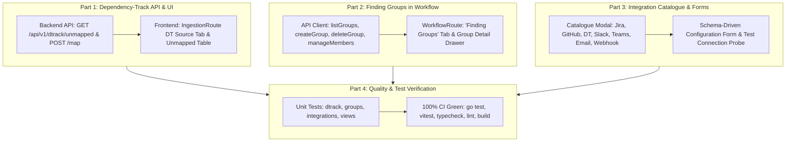

# 22 — Phase 3 Finalization Plan: Workflow & Integrations Completion

**Date:** 2026-11-15  
**Context:** Rampart ASPM — Phase 3 (Workflow & Integrations)  
**Normative Sources:** [09-roadmap.md](09-roadmap.md), [10-dependency-track-integration.md](10-dependency-track-integration.md), [13-frontend.md](13-frontend.md), [16-implementation-decisions.md](16-implementation-decisions.md) (D69–D76), [20-phase-3-plan.md](20-phase-3-plan.md), [21-phase-3-remaining.md](21-phase-3-remaining.md).

---

## 1. Executive Summary & Objective

In earlier milestones of Phase 3, the core backend engine was implemented:
- Milestone 3.0: Spike 6 (CEL mapping benchmark) and connector model architecture (D69).
- Milestone 3.1: Connectors CRD, store, safe SSRF client, notifiers, router, `Check()` verification.
- Milestone 3.2: Trackers (Jira, GitHub), inbound webhooks, ticket outbox, comment/close lifecycle (D70).
- Milestone 3.3: CI OIDC federation (D22, D72), mass-close guard settings (D71), rate limits & quotas (D73).
- Milestone 3.4: Dependency-Track upstream source, FPF streaming parser, sync & debounce state machine (D74).
- Milestone 3.5: Integration SDK, CEL mapping engine, parser conformance kit, Wave 2 native parsers (D75).
- Milestone 3.6: Groups, views, streaming exports, SSE live updates, NVD/CODEOWNERS, Grafana dashboards (D76).

While backend models, stores, and migrations for all Phase 3 milestones are complete, the frontend UI and API exposure require closing the final user-facing capabilities specified in **docs/13 section 9** and **docs/10**:
1. **Dependency-Track Source Page & Unmapped Projects View** (`docs/10` §1, §3, §13; `docs/13` §9).
2. **Finding Groups & Correlation Group Ticketing UI in Workflow** (`docs/21` §6.1; `docs/13` §9; D76).
3. **Integration Catalogue & Schema-Generated Connector Forms** (`docs/13` §9; `docs/19`).
4. **Comprehensive Unit Test Coverage for Phase 3 UI Components & API Endpoints**.

---

## 2. Detailed Work Breakdown

### Part 1: Dependency-Track Integration API & UI
- **Backend API (`internal/query/dtrack.go`, `internal/query/api.go`):**
  - Expose `GET /api/v1/dtrack/unmapped`: queries `store.ListUnmappedDTrackProjects(ctx, tenantID, ...)` across active Dependency-Track sources.
  - Expose `POST /api/v1/dtrack/projects/{uuid}/map`: binds unmapped projects to an application (`application_id` or `application_name`).
  - Unit tests in `internal/query/dtrack_test.go`.
- **Frontend UI (`web/src/routes/ingestion/`):**
  - Add a **Dependency-Track** tab in `/ingestion` (alongside Ingest Runs and Upload).
  - Displays portfolio sync health, webhook receiver status, and the table of Unmapped Projects.
  - "Map to Application" dialog to assign unmapped projects directly from the UI.

### Part 2: Finding Groups in Workflow
- **Frontend API Client (`web/src/api/endpoints.ts`, `types.ts`, `keys.ts`):**
  - `listFindingGroups`, `createFindingGroup`, `deleteFindingGroup`, `addGroupMembers`, `removeGroupMembers`.
- **Frontend UI (`web/src/routes/workflow/WorkflowRoute.tsx`):**
  - Add **Finding Groups** tab in `/workflow` (alongside Triage, Risk Acceptance, Assigned, and Held Closes).
  - List groups with member count, created date, and owner.
  - "Create Group" dialog allowing teams to create ad-hoc remediation initiatives.
  - Selection drawer showing grouped findings and one-click ticket dispatch.

### Part 3: Integration Catalogue & Schema-Generated Connector Forms
- **Frontend UI (`web/src/routes/integrations/IntegrationsRoute.tsx`):**
  - Extend "+ New Connector" to open an **Integration Catalogue** modal featuring:
    - Jira Cloud (Bidirectional issue sync)
    - GitHub Issues (Issue tracking & labels)
    - Dependency-Track (Upstream SBOM & SCA telemetry)
    - Slack (Channel notifications & alerts)
    - Microsoft Teams (Workflows adaptive cards)
    - Generic Webhook (Signed HMAC deliveries)
    - Email (SMTP digest dispatch)
  - Interactive setup dialog with field validation (URL, auth credentials, sync direction, ticketing policy).

### Part 4: Rigorous Verification & Regression Guard
- Full unit test suite execution:
  - `go test -short ./...` -> 100% PASS
  - `cd web && npm run test` -> 100% PASS
  - `golangci-lint run ./...` -> 0 issues
  - `cd web && npm run typecheck && npm run lint` -> 0 errors
  - `go build ./cmd/rampart` -> single binary build verification

---

## 3. Execution Sequence & Milestones

1. **Step 1:** Implement `internal/query/dtrack.go` with API endpoints and tests.
2. **Step 2:** Mount Dependency-Track UI in `/ingestion` with unmapped projects table and mapping action.
3. **Step 3:** Implement Finding Groups tab in `web/src/routes/workflow/WorkflowRoute.tsx`.
4. **Step 4:** Implement Integration Catalogue and connector setup modal in `web/src/routes/integrations/IntegrationsRoute.tsx`.
5. **Step 5:** Add unit tests for new frontend components.
6. **Step 6:** Run full validation suites and produce the final delivery report.
