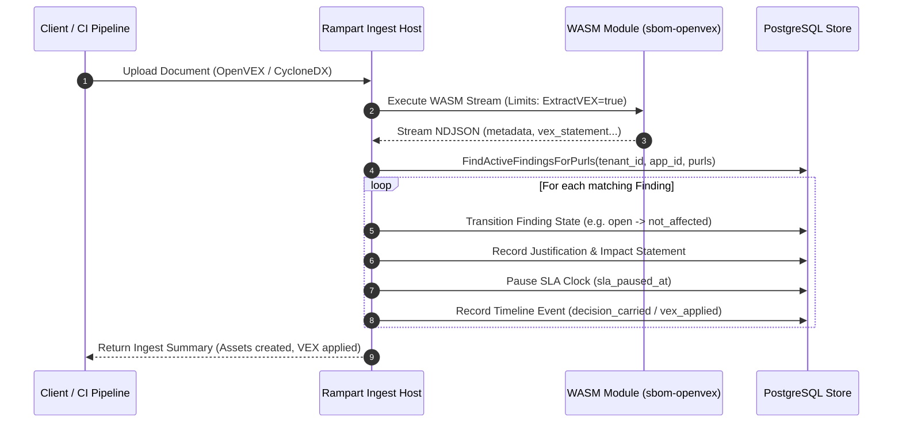

# 47. CRD-Driven SBOM and OpenVEX Parsers Architecture

Document Version: 1.0  
Date: 2026-11-22  
Status: Accepted / Production (Rampart v0.3.23 / rampart-sbom-parsers v0.2.0)  
Related Decisions: [D127](16-implementation-decisions.md#d127), [D128](16-implementation-decisions.md#d128), [D131](16-implementation-decisions.md#d131), [D141](16-implementation-decisions.md#d141), [D146](16-implementation-decisions.md#d146), [D148](16-implementation-decisions.md#d148)

---

## 1. Executive Summary

This document defines the complete architectural design and operational model for **SBOM (Software Bill of Materials) and VEX (Vulnerability Exploitability eXchange) ingestion** in Rampart.

In accordance with Rampart's core design principles (**D127** Zero Built-in Parsers, **D128** Separate Lifecycle for Assets and Findings, and **D131** An SBOM is Assets Not Findings), software inventory extraction and exploitability triage statements are strictly separated from vulnerability scanning tools:

1. **`rampart-parsers` (Report Scanners)**: Exclusively houses tools that report findings (SAST, SCA, Secrets, IaC, DAST, Compliance). OpenVEX is strictly excluded from this repository.
2. **`rampart-sbom-parsers` (SBOM & VEX Readers)**: Exclusively houses readers that ingest software components, dependency graphs, and VEX triage statements (`ClusterSBOMParser` resources).
3. **Declarative Control via CRD Options**: `ClusterSBOMParser.spec.options` provides explicit switches (`buildDependencyGraph`, `extractVulnerabilities`, `extractVEX`) so that operators, rather than hardcoded code paths, govern what data is extracted from uploaded documents.

---

## 2. Domain Separation: Findings vs. Assets vs. Exploitability

```
┌─────────────────────────────────────────────────────────────────────────────┐
│                              RAMPART INGEST                                 │
├──────────────────────────────────────┬──────────────────────────────────────┤
│          REPORT PARSERS              │             SBOM PARSERS             │
│        (rampart-parsers)             │        (rampart-sbom-parsers)        │
├──────────────────────────────────────┼──────────────────────────────────────┤
│ • 16 Vulnerability Scanners          │ • 4 SBOM & VEX Readers               │
│ • Emits: Findings & Occurrences      │ • Emits: Components, Edges, VEX      │
│ • Tools: Trivy, Grype, Semgrep,      │ • Formats: CycloneDX, SPDX, Syft,    │
│   Gitleaks, Trufflehog, Checkov,     │   OpenVEX                            │
│   Snyk, Bandit, Zap, Nuclei...       │                                      │
│ • Resource: ClusterParser            │ • Resource: ClusterSBOMParser        │
└──────────────────────────────────────┴──────────────────────────────────────┘
```

### Why OpenVEX is NOT a Vulnerability Report Parser
A common architectural pitfall is treating an OpenVEX document as a vulnerability scanner report (like SARIF or Trivy). This is fundamentally wrong:
* A vulnerability scanner **discovers** findings and asserts that a vulnerability was detected in an asset.
* A VEX document **does not discover** findings. It represents human or vendor **triage assertions** (e.g. `not_affected` with justification `code_not_reachable`, or `under_investigation`).
* If OpenVEX were ingested as a report parser, it would create phantom vulnerability occurrences instead of updating the state of existing findings.
* Therefore, OpenVEX belongs strictly in `rampart-sbom-parsers` as a `ClusterSBOMParser` that outputs `vex_statement` events to modulate finding states in the database.

---

## 3. The `ClusterSBOMParser` Custom Resource Definition

All SBOM and VEX readers reach Rampart as Kubernetes Custom Resources (`ClusterSBOMParser` cluster-wide, or `SBOMParser` namespaced).

### 3.1 CRD Schema Attributes (`clustersbomparsers.rampart.aspm.dev`)

```yaml
apiVersion: rampart.aspm.dev/v1alpha1
kind: ClusterSBOMParser
metadata:
  name: sbom-openvex
spec:
  format: openvex                     # Format identifier: cyclonedx | spdx | syft | openvex
  runtime: wasm                       # Execution runtime: wasm
  source:
    oci: ghcr.io/rampart-aspm/sbom-parsers/sbom-openvex:v1
  description: "OpenVEX 0.1-0.2 streaming WASM VEX parser"
  detect:
    filenames:
      - "*openvex*"
      - "*.vex.json"
      - "*.vex"
    contentTypes:
      - "*openvex*"
    probes:
      - jsonHasKeys:
          - "@context"
          - "statements"
  options:
    buildDependencyGraph: false       # Constructs domain.DependencyEdge
    extractVulnerabilities: false     # Extracts stated VDR vulnerabilities (D131)
    extractVEX: true                  # Extracts VEX exploitability statements (D148)
```

### 3.2 Supported Formats and Default Options Matrix

| Format | Module Name | Resource ID | Build Graph | Extract Vulnerabilities | Extract VEX | Primary Output |
| :--- | :--- | :--- | :---: | :---: | :---: | :--- |
| **CycloneDX** | `sbom-cyclonedx` | `cluster:sbom-cyclonedx` | `true` | `false` | `true` | Assets, Dependencies, Embedded VEX |
| **SPDX** | `sbom-spdx` | `cluster:sbom-spdx` | `true` | `false` | `false` | Assets, Package PURLs |
| **Syft** | `sbom-syft` | `cluster:sbom-syft` | `true` | `false` | `false` | Assets, Layer Details |
| **OpenVEX** | `sbom-openvex` | `cluster:sbom-openvex` | `false` | `false` | `true` | Exploitability Statements, PURL Triage |

---

## 4. The Streaming NDJSON Parser Contract

All WASM SBOM readers execute under a strict, memory-bounded streaming contract (`stdin` $\rightarrow$ `stdout`). The module outputs newline-delimited JSON (NDJSON) records parsed sequentially by `internal/sbom/host.go`.

### 4.1 Record Types

#### 1. `metadata` (Required first line)
```json
{"type": "metadata", "format": "openvex", "spec_version": "0.2.0"}
```

#### 2. `component` (Assets)
```json
{
  "type": "component",
  "name": "log4j-core",
  "version": "2.14.1",
  "purl": "pkg:maven/org.apache.logging.log4j/log4j-core@2.14.1",
  "bom_ref": "pkg:maven/org.apache.logging.log4j/log4j-core@2.14.1"
}
```

#### 3. `edge` (Dependency Graph)
```json
{
  "type": "edge",
  "from": "pkg:maven/com.acme/app@1.0.0",
  "to": "pkg:maven/org.apache.logging.log4j/log4j-core@2.14.1"
}
```

#### 4. `vex_statement` (Triage & Exploitability)
Emitted by readers when `spec.options.extractVEX` is `true`:
```json
{
  "type": "vex_statement",
  "vulnerability": "CVE-2021-44228",
  "aliases": ["GHSA-jfh8-c2jp-5v3q"],
  "purl": "pkg:maven/org.apache.logging.log4j/log4j-core@2.14.1",
  "purl_base": "pkg:maven/org.apache.logging.log4j/log4j-core",
  "status": "not_affected",
  "justification": "code_not_reachable",
  "impact_statement": "The vulnerable JNDI lookup class is removed during packaging.",
  "action_statement": "",
  "timestamp": "2026-11-20T12:00:00Z"
}
```

---

## 5. Host Ingestion & Automatic Finding Triage

When Rampart receives an SBOM or VEX upload (`POST /api/v1/sbom` or background ingest worker):



### 5.1 VEX State Mapping to OpenVEX Domain Vocabulary

Rampart stores finding states in exact alignment with the OpenVEX standard:

| OpenVEX Statement `status` | Rampart `domain.FindingState` | SLA Clock Action | Timeline Event Note |
| :--- | :--- | :--- | :--- |
| `not_affected` | `domain.StateNotAffected` | Paused (`sla_paused_at = now`) | VEX: Marked not affected (`justification`) |
| `affected` | `domain.StateAffected` | Active | VEX: Confirmed affected |
| `under_investigation` | `domain.StateUnderInvestigation`| Active | VEX: Investigation ongoing |
| `fixed` | `domain.StateFixed` | Stopped | VEX: Resolved / mitigated |

---

## 6. Helm Chart Distribution & Delivery Modes

Rampart's official Helm chart (`deploy/helm/rampart`) bundles the default SBOM parsers via an OCI chart dependency on `rampart-sbom-parsers: 0.2.0`.

### 6.1 `values.yaml` Configuration

```yaml
sbomParsers:
  defaultSBOMParsers:
    enabled: true
    cyclonedx:
      enabled: true
      extractVEX: true
    spdx:
      enabled: true
      extractVEX: false
    syft:
      enabled: true
      extractVEX: false
    openvex:
      enabled: true
      extractVEX: true

parsers:
  modules:
    sbom-cyclonedx: {image: "", sha256: ""}
    sbom-spdx: {image: "", sha256: ""}
    sbom-syft: {image: "", sha256: ""}
    sbom-openvex: {image: "", sha256: ""}
```

### 6.2 Module Delivery Guarantee
WASM module binaries (`parser.wasm`) are distributed either via:
1. `imageVolume` (Kubernetes 1.35+ / Containerd 2.1+ Native OCI Mounts).
2. `initContainer` (`fetch-wasm-modules` container pulling modules by digest into shared memory).

---

## 7. Verification & Zero-Builtin Guarantee

The system is continuously verified against the following invariants:
* **Zero Hardcoded Names**: Running tests without `RAMPART_PARSERS_DIR` or control plane CRDs results in zero loaded parsers (`integrations.DefaultRegistry()` is completely blind).
* **CLI Upload Compatibility**: `rampart sbom upload --parser openvex <file>` correctly detects and invokes `ClusterSBOMParser/sbom-openvex`.
* **Full CI Verification Battery**:
  - `RAMPART_WASM_DIR=$PWD/.cache/wasm go test ./internal/sbom/...`
  - `RAMPART_WASM_DIR=$PWD/.cache/wasm go test ./internal/ingest/... -run TestProcessSBOM`
  - `helm lint deploy/helm/rampart`
