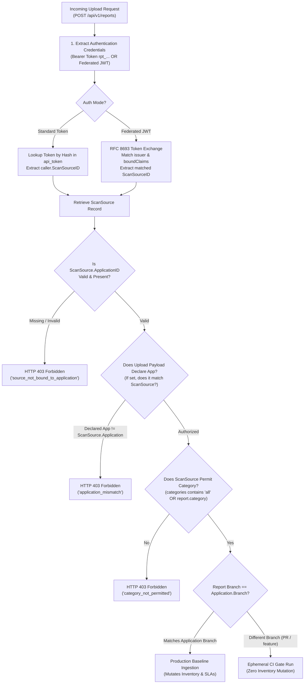

# 48. ScanSource Universal Binding & Access Control Architecture

**Status:** Approved Architecture & Implementation Plan  
**Related Documents:** [docs/04 (CRDs)](./04-crds.md), [docs/10 (Dependency-Track & Sources)](./10-dependency-track-integration.md), [docs/12 (Database Schema)](./12-database-schema.md), [docs/16 (Implementation Decisions: D10, D17, D22, D140)](./16-implementation-decisions.md)  
**Authors:** Rampart Core Security & Architecture Team  

---

## 1. Executive Summary & Problem Formulation

### 1.1 The ASPM Ingestion Vulnerability
Traditional Application Security Posture Management (ASPM) and vulnerability platforms (such as legacy DefectDojo) suffer from critical design flaws in their ingestion layer:
1. **Uncontrolled Application Sprawl:** Any CI script holding an API key can push scan results under arbitrary names (`"checkout"`, `"checkout_api"`, `"payment-svc"`). This spawns dozens of duplicate or orphaned applications with empty metadata, invalid ownership, and broken SLAs.
2. **Ambiguous Origin & Spoofing:** There is no cryptographic verification tying a report to the exact repository, pipeline, or environment that generated it. A developer running a local script or an unauthorized pipeline in a feature branch can inadvertently overwrite production baseline vulnerabilities.
3. **Vendor-Specific Schema Bloat ("فرح العمدة"):** Attempting to support multiple clouds by hardcoding vendor-specific fields (`aws.accountId`, `azure.tenantId`, `gcp.projectNumber`, `github.repositoryId`) into CRDs and database schemas leads to unmaintainable schema sprawl and fragile migration pipelines.

### 1.2 The Rampart Universal Binding Paradigm
Rampart redesigns the ingestion boundary around three foundational pillars:
1. **Strict 1-to-N Application Binding (D140):** An `Application` in Rampart represents **one branch of one repository** (`type: repo`, `branch: main`). A `ScanSource` represents the explicit access contract between an external source and that target `Application` (`spec.applicationRef`). Branch lists (`trackedRefs`) are removed from `ScanSource`; the production baseline branch is inherited strictly from the bound Application.
2. **Zero Dynamic Application Creation:** CI pipelines are strictly forbidden from creating applications. If a scan targets an application not declared via GitOps, the gateway returns `404 Not Found` (`application_not_registered`).
3. **Universal Generic Claims (`boundClaims`) & Standard Auth:**
   - **Mode A (Standard Auth - تسجيل الدخول العادي):** Dedicated, scoped API tokens (`rpt_...`) hashed with Argon2id, stored in Kubernetes Secrets (`spec.auth.tokenSecretRef`) or Rampart database, bound strictly to the `ScanSource` and target `Application`.
   - **Mode B (Universal OIDC Federation - RFC 8693):** A vendor-agnostic OIDC token exchange based on HashiCorp Vault's `bound_claims` and Kubernetes Structured Authentication (`apiserver.config.k8s.io/v1`). Any provider (AWS STS, Azure Entra ID, GCP Workload Identity, GitHub Actions, GitLab CI, HashiCorp Vault) is verified without a single line of provider-specific schema code.
4. **Flexible Security Disciplines (`categories` & `all`):** A `ScanSource` specifies allowed disciplines (`categories: [sast, secret]`, `categories: [container, sca]`, or `categories: [all]`). Ingestion of an unauthorized discipline is rejected with `403 Forbidden` (`category_mismatch`).

---

## 2. Theoretical Grounding & Industry Standards Verification

### 2.1 RFC 8693 OAuth 2.0 Token Exchange for Workload Identity Federation
* **Direct Impersonation of ScanSource Identity:** The external workload (e.g. GitHub runner, AWS CodeBuild task) presents its ambient identity token (`subject_token`) to Rampart's Security Token Service (`POST /api/v1/federation/token`).
* **Audience Enforcement (`aud`):** The external token's audience must explicitly match `rampart:<publicHost>:<tenantSlug>`. Tokens issued for other services or tenants are immediately rejected (`invalid_grant`).
* **Cryptographic Verification:** Signatures are validated against the external IdP's live JWKS using SSRF-safe caching (`SafeClient`).
* **Replay Attack Defense:** The JSON Web Token Identifier (`jti`) is recorded in the `federation_jti` table with an expiration timestamp. Any replayed token is dropped.
* **Confused Deputy Prevention:** Because the exchanged short-lived token is cryptographically and logically bound to `ScanSource.ID` and `ScanSource.ApplicationID`, an attacker cannot leverage a valid token for Service A to mutate Service B.

### 2.2 HashiCorp Vault `bound_claims` Pattern
Rather than inventing proprietary fields, Rampart adopts the industry-proven `bound_claims` model:
- `boundClaims` is an arbitrary key-value mapping (`map[string]string`).
- During token exchange, Rampart verifies that every key in `boundClaims` exists in the verified JWT payload and matches the required value exactly.
- Supports dot notation for nested claims (e.g., `"claims.repository_id"`, `"custom.team_id"`).

### 2.3 Kubernetes Structured Authentication Configuration (`apiserver.config.k8s.io/v1`)
In Kubernetes 1.30+, the API server replaced fragmented CLI flags with structured JWT authenticators defining `issuer.url`, `issuer.audiences`, and `claimValidationRules`. Rampart mirrors this declarative purity.

---

## 3. Declarative CRD Architecture

### 3.1 Updated `ScanSource` CRD Specification (`deploy/crds/scansource.yaml`)

```yaml
apiVersion: apiextensions.k8s.io/v1
kind: CustomResourceDefinition
metadata:
  name: scansources.rampart.aspm.dev
spec:
  group: rampart.aspm.dev
  names:
    kind: ScanSource
    listKind: ScanSourceList
    plural: scansources
    singular: scansource
    shortNames:
      - rpsrc
  scope: Namespaced
  versions:
    - name: v1alpha1
      served: true
      storage: true
      schema:
        openAPIV3Schema:
          type: object
          properties:
            apiVersion:
              type: string
            kind:
              type: string
            metadata:
              type: object
            spec:
              type: object
              required:
                - applicationRef
                - categories
              properties:
                # 1. Mandatory Target Application Binding (D140)
                applicationRef:
                  type: object
                  description: The target Application this ScanSource is exclusively bound to.
                  required:
                    - name
                  properties:
                    name:
                      type: string
                      minLength: 1
                      maxLength: 255

                # 2. Permitted Security Categories (D17)
                categories:
                  type: array
                  description: Security disciplines permitted (sast, sca, secret, container, dast, iac, cspm, compliance, license, supply_chain, all).
                  items:
                    type: string
                    enum:
                      - sast
                      - sca
                      - secret
                      - container
                      - dast
                      - iac
                      - cspm
                      - compliance
                      - license
                      - supply_chain
                      - all

                # 3. Source Ingestion Type
                type:
                  type: string
                  enum: [ci, apiPull, manual, webhook]
                  default: ci

                # 4. Authentication Contract
                auth:
                  type: object
                  description: Authentication method: standard API token secretRef OR universal OIDC federation.
                  properties:
                    # Mode A: Standard Authentication
                    tokenSecretRef:
                      type: object
                      required: [name, key]
                      properties:
                        name: { type: string }
                        key: { type: string }

                    # Mode B: Universal OIDC Federation (RFC 8693)
                    federation:
                      type: object
                      required: [issuer, boundClaims]
                      properties:
                        issuer:
                          type: string
                          format: uri
                          description: OIDC Issuer URL (e.g. https://token.actions.githubusercontent.com, https://sts.amazonaws.com).
                        boundClaims:
                          type: object
                          description: Key-value map of JWT claims required to authenticate the source.
                          x-kubernetes-preserve-unknown-fields: true

                # 5. Ingestion Guardrails
                ingestionPolicy:
                  type: object
                  properties:
                    minimumSeverity:
                      type: string
                      enum: [info, low, medium, high, critical]
                    closeOldFindings:
                      type: boolean
                    closeScope:
                      type: string
                    doNotReactivate:
                      type: boolean
                    fieldMerge:
                      type: string
                    maxClosePercent:
                      type: number
                    minHeldClose:
                      type: integer
                    maxReportBytes:
                      type: integer
                    acceptedFormats:
                      type: array
                      items:
                        type: string
            status:
              type: object
              properties:
                scanSourceId:
                  type: string
                applicationId:
                  type: string
                observedGeneration:
                  type: integer
                conditions:
                  type: array
                  items:
                    type: object
                    required: [type, status]
                    properties:
                      type: { type: string }
                      status: { type: string }
                      reason: { type: string }
                      message: { type: string }
                      lastTransitionTime: { type: string }
```

---

## 4. Database Schema Migration Plan

### 4.1 Migration `00056_scansource_universal_binding.sql`

```sql
-- +goose Up
-- ============================================================================
-- 00056_scansource_universal_binding.sql
-- Implements explicit Application Binding, Security Categories, and Universal
-- Workload Identity Federation (D140, D17, D22).
-- ============================================================================

-- 1. ScanSource Table Enhancement
ALTER TABLE scan_source
    ADD COLUMN IF NOT EXISTS application_id UUID REFERENCES application(id) ON DELETE RESTRICT,
    ADD COLUMN IF NOT EXISTS categories TEXT[] NOT NULL DEFAULT '{"all"}',
    ADD COLUMN IF NOT EXISTS auth_type TEXT NOT NULL DEFAULT 'token',
    ADD COLUMN IF NOT EXISTS token_hash TEXT,
    ADD COLUMN IF NOT EXISTS bound_claims JSONB NOT NULL DEFAULT '{}';

-- Index for high-throughput lookup during ingestion resolution
CREATE INDEX IF NOT EXISTS idx_scan_source_app_tenant ON scan_source (tenant_id, application_id);
CREATE INDEX IF NOT EXISTS idx_scan_source_auth ON scan_source (tenant_id, auth_type);

-- 2. Enhance source_trust table for Universal Claims Matching
ALTER TABLE source_trust
    ADD COLUMN IF NOT EXISTS bound_claims JSONB NOT NULL DEFAULT '{}';

CREATE INDEX IF NOT EXISTS idx_source_trust_bound_claims ON source_trust USING gin (bound_claims);

-- 3. Backfill existing rows if any exist
UPDATE scan_source
SET application_id = default_application_id
WHERE application_id IS NULL AND default_application_id IS NOT NULL;

-- +goose Down
DROP INDEX IF EXISTS idx_source_trust_bound_claims;
ALTER TABLE source_trust DROP COLUMN IF EXISTS bound_claims;

DROP INDEX IF EXISTS idx_scan_source_auth;
DROP INDEX IF EXISTS idx_scan_source_app_tenant;
ALTER TABLE scan_source
    DROP COLUMN IF EXISTS bound_claims,
    DROP COLUMN IF EXISTS token_hash,
    DROP COLUMN IF EXISTS auth_type,
    DROP COLUMN IF EXISTS categories,
    DROP COLUMN IF EXISTS application_id;
```

---

## 5. Domain Models & Operator Implementation

### 5.1 Domain Model Updates (`internal/domain/scansource.go`)

```go
package domain

import (
	"fmt"
	"github.com/google/uuid"
)

type AuthSpec struct {
	TokenSecretRef *SecretRef        `json:"tokenSecretRef,omitempty"`
	Federation     *FederationSpec   `json:"federation,omitempty"`
}

type SecretRef struct {
	Name string `json:"name"`
	Key  string `json:"key"`
}

type FederationSpec struct {
	Issuer      string            `json:"issuer"`
	BoundClaims map[string]string `json:"boundClaims"`
}

type ApplicationRef struct {
	Name string `json:"name"`
}

type ScanSource struct {
	ID              uuid.UUID        `json:"id"`
	TenantID        uuid.UUID        `json:"tenant_id"`
	Name            string           `json:"name"`
	ApplicationRef  ApplicationRef   `json:"applicationRef"`
	ApplicationID   uuid.UUID        `json:"application_id"`
	Categories      []string         `json:"categories"`
	Type            string           `json:"type"`
	Auth            AuthSpec         `json:"auth"`
	IngestionPolicy *IngestionPolicy `json:"ingestionPolicy,omitempty"`
}

func (s *ScanSource) PermitsCategory(cat FindingCategory) bool {
	for _, c := range s.Categories {
		if c == "all" || c == string(cat) {
			return true
		}
	}
	return false
}
```

### 5.2 Operator Reconciler Updates (`internal/operator/reconciler.go`)
1. **Validate `applicationRef`:** Reconciler checks if the referenced `Application` CR or DB record exists in the tenant namespace. If missing, status condition is set to `Ready=False, Reason=ApplicationNotFound`.
2. **Retrieve Bound Branch:** Reconciler extracts `Application.spec.branch`.
3. **Persist ScanSource:** Persists `application_id`, `categories`, and `auth` credentials.
4. **Secret Synchronization:** If `tokenSecretRef` is provided, fetches the token from Kubernetes Secret and writes Argon2id hash to `scan_source.token_hash` and `api_token`.

---

## 6. Ingestion Security Gate & Gateway Logic



### 6.1 Generic Claims Matching in `internal/ingest/federation.go`

```go
// MatchClaims evaluates verified JWT claims against the generic boundClaims dictionary.
func MatchClaims(verifiedClaims map[string]any, boundClaims map[string]string) bool {
	if len(boundClaims) == 0 {
		return false
	}
	for expectedKey, expectedVal := range boundClaims {
		actualVal, exists := getNestedClaim(verifiedClaims, expectedKey)
		if !exists {
			return false
		}
		if fmt.Sprintf("%v", actualVal) != expectedVal {
			return false
		}
	}
	return true
}

func getNestedClaim(claims map[string]any, path string) (any, bool) {
	parts := strings.Split(path, ".")
	var current any = claims
	for _, part := range parts {
		m, ok := current.(map[string]any)
		if !ok {
			return nil, false
		}
		val, exists := m[part]
		if !exists {
			return nil, false
		}
		current = val
	}
	return current, true
}
```

---

## 7. Configuration Scenarios (Production Examples)

### Scenario 1: Pure Standard Authentication (تسجيل الدخول العادي)
```yaml
apiVersion: rampart.aspm.dev/v1alpha1
kind: ScanSource
metadata:
  name: payments-standard-token
spec:
  applicationRef:
    name: payments-service
  categories: [all]
  type: ci
  auth:
    tokenSecretRef:
      name: payments-ingest-token
      key: token
```

### Scenario 2: Multi-Category GitHub Actions Pipeline (SAST + Secret + SCA)
```yaml
apiVersion: rampart.aspm.dev/v1alpha1
kind: ScanSource
metadata:
  name: checkout-github-multiscan
spec:
  applicationRef:
    name: checkout-payment-service
  categories:
    - sast
    - secret
    - sca
  type: ci
  auth:
    federation:
      issuer: "https://token.actions.githubusercontent.com"
      boundClaims:
        repository_id: "123456789"
        repository_owner_id: "98765432"
```

### Scenario 3: AWS CodeBuild / EKS via AWS STS (Keyless)
```yaml
apiVersion: rampart.aspm.dev/v1alpha1
kind: ScanSource
metadata:
  name: checkout-aws-pipeline
spec:
  applicationRef:
    name: checkout-payment-service
  categories:
    - container
    - sca
  type: ci
  auth:
    federation:
      issuer: "https://sts.amazonaws.com"
      boundClaims:
        account_id: "123456789012"
        role_arn: "arn:aws:iam::123456789012:role/checkout-builder-role"
```

### Scenario 4: Azure DevOps / Microsoft Entra ID
```yaml
apiVersion: rampart.aspm.dev/v1alpha1
kind: ScanSource
metadata:
  name: checkout-azure-pipeline
spec:
  applicationRef:
    name: checkout-payment-service
  categories:
    - sast
  type: ci
  auth:
    federation:
      issuer: "https://login.microsoftonline.com/72f988bf-86f1-41af-91ab-2d7cd011db47/v2.0"
      boundClaims:
        appid: "00000000-0000-0000-0000-000000000000"
```

---

## 8. Comprehensive Test Suite & Verification Matrix

To ensure compliance with the **Rampart Zero-Mock Principle** and `AGENTS.md` verification cycles, the implementation is accompanied by an exhaustive, multi-layered test battery across 5 test suites.

---

### 8.1 Test Suite 1: Domain & CRD Validation Tests (`internal/domain/scansource_test.go`)

| Test Name | Tested Component | Input / Scenario | Expected Outcome |
| :--- | :--- | :--- | :--- |
| `TestScanSource_ApplicationRefValidation` | `ApplicationRef.Validate()` | Empty name `""`, spaces `" "` or names exceeding 255 chars | Returns clear descriptive validation error |
| `TestScanSource_CategoriesValidation` | `ScanSource.Validate()` | Empty `categories: []` or invalid string `["unknown_discipline"]` | Returns validation error refusing invalid categories |
| `TestScanSource_PermitsCategory` | `ScanSource.PermitsCategory()` | 1. `["all"]` tested against all 10 `FindingCategory` values<br/>2. `["sast", "secret"]` tested against `sast`, `secret`, `dast` | 1. Returns `true` for all.<br/>2. Returns `true` for `sast`/`secret`, `false` for `dast` |
| `TestScanSource_AuthSpecExclusivity` | `AuthSpec.Validate()` | 1. Both `tokenSecretRef` and `federation` present<br/>2. Neither `tokenSecretRef` nor `federation` present | 1. Validation error: mutually exclusive modes<br/>2. Validation error: at least one auth mode required |
| `TestScanSource_BoundClaimsValidation` | `FederationSpec.Validate()` | Empty `boundClaims: {}`, empty key `"": "val"`, or empty value `"key": ""` | Validation error refusing malformed claim patterns |

---

### 8.2 Test Suite 2: Database Migration & Store Tests (`internal/store/scansource_postgres_test.go`)

| Test Name | Tested Component | Input / Scenario | Expected Outcome |
| :--- | :--- | :--- | :--- |
| `TestMigration_00056_UniversalBinding` | Goose Migration Runner | Run `00056_scansource_universal_binding.sql` Up and Down | Up applies cleanly; columns exist; Down rolls back cleanly without leaving orphan objects |
| `TestStore_ForeignKeyConstraint_OnDeleteRestrict` | PostgreSQL Schema | Attempt to `DELETE FROM application WHERE id = app_id` when an active `scan_source` references it | PostgreSQL rejects deletion with Foreign Key Violation (SQLSTATE `23503`) |
| `TestStore_SaveAndLookupScanSource_Universal` | `PostgresStore` | Insert and retrieve `ScanSource` with `application_id`, `categories: ["sast", "sca"]`, `bound_claims JSONB` | All fields round-trip exactly, GIN index on `bound_claims` confirms query efficiency |
| `TestStore_ListTrustRulesByIssuer_GenericClaims` | `ListTrustRulesByIssuer` | Insert trust rules with arbitrary nested `bound_claims` for AWS, Azure, and GitHub | Query by issuer returns records with full `bound_claims` dictionary intact |

---

### 8.3 Test Suite 3: RFC 8693 Token Exchange & Claims Matcher Tests (`internal/ingest/federation_test.go`)

| Test Name | Provider / Scenario | Input Token & Claims | Expected HTTP Response |
| :--- | :--- | :--- | :--- |
| `TestFederation_AWS_STS_Success` | AWS STS (CodeBuild / EKS) | JWT from `https://sts.amazonaws.com` with `account_id: "123456789012"`, `role_arn: "arn:aws:iam::123456789012:role/checkout-role"` matching rule | `200 OK`<br/>Returns scoped Bearer token bound to `ScanSource.ID` |
| `TestFederation_Azure_Success` | Azure Entra ID / DevOps | JWT from `https://login.microsoftonline.com/.../v2.0` with `appid: "uuid-client-id"` matching rule | `200 OK`<br/>Returns scoped Bearer token |
| `TestFederation_GitHub_Success` | GitHub Actions | JWT from `https://token.actions.githubusercontent.com` with `repository_id: "123"`, `repository_owner_id: "456"` | `200 OK`<br/>Returns scoped Bearer token |
| `TestFederation_ClaimMismatch_Rejected` | Attack Scenario (Cross-tenant) | Attacker JWT has `account_id: "999999999999"`, while rule expects `"123456789012"` | `400 Bad Request`<br/>`{"error":"invalid_grant","error_description":"token validation failed"}` |
| `TestFederation_MissingClaim_Rejected` | Incomplete Token | JWT lacks required `role_arn` claim specified in `boundClaims` | `400 Bad Request` (`invalid_grant`) |
| `TestFederation_ReplayAttack_Prevented` | Token Replay Attack | Present identical JWT with same `(issuer, jti)` twice within validity window | 1st call: `200 OK`<br/>2nd call: `400 Bad Request` ("token already exchanged") |
| `TestFederation_AudienceMismatch_Rejected` | Audience Spoofing | JWT requested for `aud: "rampart:wrong-host:other-tenant"` | `400 Bad Request` (`invalid_grant`) |
| `TestFederation_ExpiredToken_Rejected` | Expired Token | JWT with `exp` timestamp in the past | `400 Bad Request` (`invalid_grant`) |

---

### 8.4 Test Suite 4: Ingestion Security Gate Tests (`internal/ingest/gateway_test.go`)

| Test Name | Security Dimension | Scenario & Test Conditions | Expected Outcome |
| :--- | :--- | :--- | :--- |
| `TestGateway_ApplicationMismatch_Returns403` | Cross-Application Hijack | Token bound to `ScanSource` for `checkout-service` uploads report declaring `application: "auth-service"` | Immediate `403 Forbidden` (`application_mismatch`). Zero processing of report. |
| `TestGateway_CategoryEnforcement_Permitted` | Discipline Isolation | `ScanSource` has `categories: ["sast", "secret"]`. Uploads Semgrep (SAST) and Gitleaks (Secret) reports | `201 Created`. Reports processed into staging. |
| `TestGateway_CategoryEnforcement_Rejected` | Discipline Isolation | `ScanSource` has `categories: ["sast"]`. Uploads Trivy Container or OWASP ZAP (DAST) report | `403 Forbidden` (`category_not_permitted: expected [sast], received dast`). |
| `TestGateway_CategoryAll_PermitsAll` | Universal Ingestion | `ScanSource` has `categories: ["all"]`. Uploads SAST, SCA, Container, DAST, IaC, and Secret reports | All return `201 Created`. |
| `TestGateway_ZeroDynamicApplicationCreation` | No-Sprawl Enforcement | Upload arrives with token whose `ScanSource` references an application deleted in DB | `404 Not Found` (`application_not_registered`). Assert zero rows added to `application` table. |
| `TestGateway_BranchBaselineUpdate` | Production Inventory | Upload with `branch: main` matching `Application.spec.branch` | `201 Created`, `ephemeral: false`. Baseline findings inventory and SLAs are updated. |
| `TestGateway_BranchEphemeralEvaluation` | CI Gate Isolation | Upload with `branch: "feature/pr-42"` targeting application with `branch: main` | `201 Created`, `ephemeral: true`. Findings evaluated for gate; zero mutation to production inventory. |

---

### 8.5 Test Suite 5: Operator Reconciler & Secret Sync Tests (`internal/operator/reconciler_test.go`)

| Test Name | Operational Aspect | Input / Conditions | Expected Outcome |
| :--- | :--- | :--- | :--- |
| `TestReconciler_ScanSource_ApplicationExists` | Lifecycle Synchronization | `ScanSource` CR referencing pre-existing `Application` CR in namespace | Reconciles successfully; sets Status `Ready=True, Reason=Reconciled`. |
| `TestReconciler_ScanSource_ApplicationMissing` | Fail-Fast Validation | `ScanSource` CR referencing non-existent Application name | Sets Status `Ready=False, Reason=ApplicationNotFound`. Blocks until Application appears. |
| `TestReconciler_SecretSync_StandardAuth` | K8s Secret Materialization | `ScanSource` with `spec.auth.tokenSecretRef` pointing to Secret containing API token | Reconciler fetches secret, computes Argon2id hash, syncs to `api_token` table linked to `scan_source_id`. |
| `TestReconciler_Finalize_Revocation` | Safe Deletion | Deleting a `ScanSource` CR triggers `FinalizeScanSource` | Marks `scan_source.disabled_at = NOW()`, revokes all associated `api_token` records immediately. |

---

## 9. Implementation Steps & Verification Battery

### Step 1: CRD Synchronization
1. Edit `deploy/crds/scansource.yaml`.
2. Mirror to `deploy/helm/rampart/crds/scansource.yaml`.
3. Run `python3 hack/crds-bundle.py` to update `deploy/rampart-crds.yaml`.
4. Validate with `python3 hack/crds-bundle.py --check`.

### Step 2: Database Migration
1. Create `internal/store/migrations/00056_scansource_universal_binding.sql`.
2. Run database migration tests (Up & Down).

### Step 3: Domain & Store Logic
1. Update `internal/domain/scansource.go` and `internal/domain/trust_rule.go`.
2. Update `internal/store/postgres.go` and `internal/store/federation.go`.
3. Run Suite 1 and Suite 2 tests.

### Step 4: Ingestion Gateway Enforcement
1. Update `internal/ingest/gateway.go` to enforce `PermitsCategory` and `application_mismatch`.
2. Update `internal/ingest/resolution.go` to disable dynamic application creation (`createMissing = false`).
3. Update `internal/ingest/federation.go` to implement `MatchClaims` over `boundClaims`.
4. Run Suite 3 and Suite 4 tests.

### Step 5: Operator Reconciler
1. Update `internal/operator/types.go` and `internal/operator/reconciler.go`.
2. Run Suite 5 tests.

### Step 6: Full Quality Verification Battery (`AGENTS.md`)
1. Frontend: `bun run typecheck && bun run lint && bun run build && bun run test`.
2. Backend: `go test -race ./internal/domain/... ./internal/store/... ./internal/ingest/... ./internal/operator/...` with `RAMPART_WASM_DIR=$PWD/.cache/wasm`.
3. Helm: `helm lint deploy/helm/rampart`.
